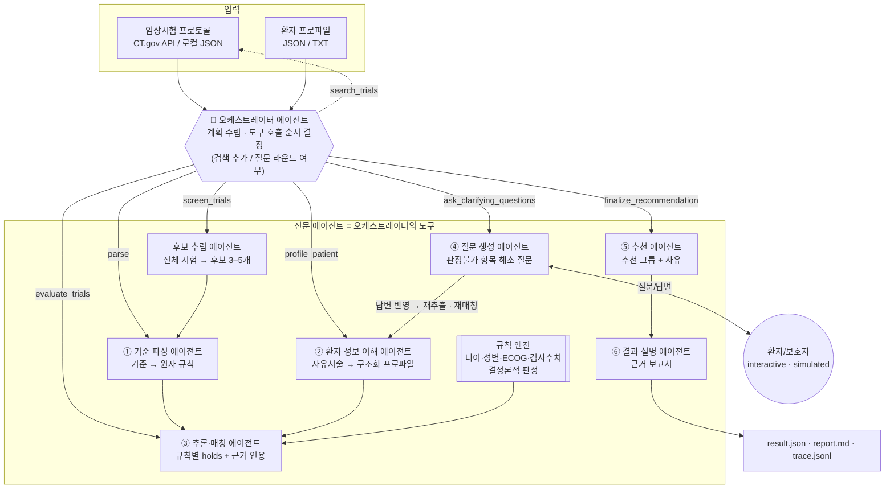
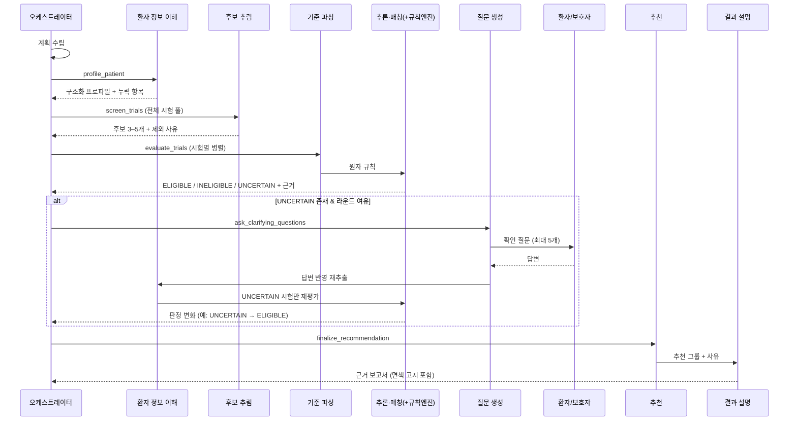

# ctrec: 인터랙티브 임상시험 추천 멀티 에이전트 시스템

**Healthcare Agentic AI Challenge 2026** 제출용 코드입니다. 주제는 *Interactive Clinical Trial Recommendation*입니다.

이 시스템은 임상시험 프로토콜의 선정/제외 기준과 상세 설명을 환자 정보와 대조해 참여 가능성을 **근거와 함께 판정**합니다. 정보가 부족하면 **확인 질문을 생성**해 답변을 반영한 뒤 다시 평가하고, 마지막으로 공개 기준에 맞는 임상시험을 **추천 그룹으로 묶어 근거와 함께 제시**합니다. 시험 사이의 임상적 우열은 정하지 않습니다.

설계 기준 문서는 [`docs/ARCHITECTURE.md`](docs/ARCHITECTURE.md)(Final Merged Architecture)입니다.

역할이 나뉜 6개의 전문 에이전트와 이를 지휘하는 오케스트레이터 에이전트가 함께 동작합니다. 오케스트레이터는 스스로 계획을 세우고 도구를 호출하므로, 단일 질의응답형 챗봇이 아닙니다.

> ⚠️ **의료적 면책 고지**
> 이 시스템의 출력은 연구·교육 목적의 **참고 자료**이며 의학적 자문, 진단, 치료 권고가 아닙니다. 임상시험 참여 여부는 반드시 담당 의료진 및 해당 임상시험 연구진과 상담해 결정해야 합니다. 모든 보고서(`report.md`)와 결과 파일(`result.json`)에는 이 고지가 자동으로 포함됩니다.

### 저장소

| 구분 | 주소 |
|---|---|
| 팀 저장소 | https://github.com/seoyeon488/workseoyeon |
| 개인 저장소 | https://github.com/rlaehdrua/clinical-recommendation-multi-agent-ai |

---

## 1. 전체 파이프라인

### 1.1 과제의 6단계와 구현 대응

| 단계 | 과제 요구사항 | 담당 에이전트 / 모듈 | 산출물 |
|---|---|---|---|
| ① 기준 입력 | 선정·제외 기준과 상세 설명 입력 | `tools/ctgov.py` (CT.gov API v2, 로컬 JSON) | `TrialRecord` |
| ② 환자 정보 입력 | 인구학·병력·검사·투약 프로파일 | `pipeline.load_patients` (JSON/TXT, TREC topics 형식) | `PatientCase` |
| (추가) 후보 추림 | 전체 시험 풀에서 이 환자에게 해당될 만한 시험 선택 | 후보 추림 에이전트 (`agents/screener.py`) | `ScreeningResult` (선택·제외 시험과 사유) |
| ③ 정보 추출 및 매칭 | 기준 파싱 → 환자 정보 추출 → 조건 매칭·추론 → 근거 제시 | 기준 파싱 → 환자 정보 이해 → **규칙 엔진 + 추론·매칭** | `ParsedTrial`, `PatientProfile`, `TrialMatch` |
| ④ 부족 정보 탐지 | 충족이 불확실하거나 누락된 항목 식별 | 추론·매칭 에이전트 (`holds="unknown"`, `missing_info`) | `UNCERTAIN` 판정과 누락 항목 |
| ⑤ 질문 생성 및 재평가 | 확인 질문 → 추가 정보 반영 → 최종 판정 | 질문 생성 에이전트 → 답변 제공자 → 환자 정보 재추출 → 재매칭 | `QAPair`, 판정 변화 이력 |
| ⑥ 임상시험 추천 | 적절한 시험 추천 (추천 그룹 + 설명 가능한 표시 순서) | 추천 에이전트 → 결과 설명 에이전트 | `Recommendation`, `report.md` |

### 1.2 에이전트 구성도 (역할과 오케스트레이션)



### 1.3 오케스트레이션 흐름 (agent 모드)



### 1.4 설계 원칙

- **근거 기반 판정**: 모든 규칙 판정에는 환자 원문 인용(`evidence`)과 추론 과정(`reasoning`)이 붙습니다. 근거가 없으면 `unknown`으로 판정하며, 정보가 없다는 이유만으로 "해당 없음"이라고 가정하지 않습니다.
  - 이 원칙은 프롬프트뿐 아니라 **코드로도 강제**합니다. 매칭 에이전트는 판정마다 근거 유형(`explicit` 명시 / `inferred` 추론 / `absent` 정보 없음)을 함께 냅니다.
  - **확정 판정은 기록에 명시된 근거(`explicit`)가 있을 때만 인정**합니다. `inferred`나 `absent`인데 확정 판정을 내리면 코드가 `unknown`으로 되돌립니다. 모델이 스스로 매긴 확신도는 기준으로 쓰지 않습니다. 실제로 모델이 추론에도 `high`를 매겨 통과하는 사례가 있었기 때문입니다. 되돌린 항목은 확인 질문 대상이 됩니다.
  - 그래서 모델을 바꿔도 같은 기준이 유지됩니다. 실제로 Sonnet은 "62세이므로 폐경 후일 것"처럼 추정해 질문 단계를 건너뛰는 경향을 보였고, 이 규칙으로 바로잡았습니다.
- **LLM과 코드의 역할 분리**
  - 나이·성별·ECOG·수치형 검사값은 **결정론적 규칙 엔진**이 먼저 판정해 산술 오류를 막습니다.
  - 시험 단위 최종 적격성은 **코드가 정한 결정 규칙**으로 계산합니다. 선정 기준 불충족이나 제외 기준 해당이 하나라도 있으면 `INELIGIBLE`, 그렇지 않고 판정 불가 항목이 있으면 `UNCERTAIN`, 모두 통과하면 `ELIGIBLE`입니다.
  - 추천 에이전트가 이 판정과 어긋나는 출력을 내면 코드가 교정합니다.
- **후보는 전체 시험에서 에이전트가 고름**: 후보 추림 에이전트가 시험 풀 전체(현재 26개)의 제목·대상 질환·대상군·요약을 한 번에 보고, 이 환자에게 해당될 만한 시험을 최대 5개 고릅니다(`--max-candidates`). 기준별 자세한 판정은 고른 시험에만 하므로 비용이 시험 수에 비례해 늘지 않습니다.
  - 제외 사유는 ① 대상 질환 자체가 다름 ② 나이·성별 범위를 명백히 벗어남, 두 가지뿐입니다. 같은 질환이면 원인·병기·동반 질환 같은 세부 차이로는 제외하지 않고 다음 단계의 기준별 판정에 맡깁니다.
  - 모델이 판단을 빠뜨린 시험은 후보로 남기고(안전한 기본값), 목록에 없는 시험 ID는 버립니다. 선택·제외된 시험과 사유는 `result.json`의 `screening`과 `report.md`의 "후보 시험 추림" 섹션에 남습니다.
  - 이전 방식(질환별로 사람이 미리 정한 2–3개, `data/topic_map.json`)은 `--candidates given`으로 쓸 수 있습니다.
- **추천은 그룹으로, 순서는 설명 가능한 기준으로 (아키텍처 §49–50)**: 시험 간 임상적 우열을 주장하지 않습니다.
  - 사용자에게는 내부 판정(`eligibility`) 대신 외부 상태(`match_status`)를 보여 줍니다. 등록이 확정된 것처럼 읽히지 않도록 "공개 프로토콜 기준 사전 비교이며 실제 참여 여부는 연구기관 스크리닝과 연구자 판단으로 정해진다"는 안내를 함께 붙입니다.

    | 내부 판정 | 외부 상태 (`match_status`) | 화면 표시 |
    |---|---|---|
    | ELIGIBLE | `CRITERIA_MATCH` | 공개 기준 충족 |
    | UNCERTAIN (남은 항목이 UNVERIFIED이고 답변상 충족) | `POTENTIAL_MATCH` | 기록 확인 시 충족 가능 |
    | UNCERTAIN (남은 항목이 의사 확인 항목) | `NEEDS_REVIEW` | 의료진 검토 필요 |
    | UNCERTAIN (질문으로 확인할 항목이 남음) | `INSUFFICIENT_INFORMATION` | 추가 정보 필요 |
    | INELIGIBLE | `CRITERIA_MISMATCH` | 공개 기준 불충족 |
    | NOT_EVALUATED | `NOT_EVALUATED` | 평가 실패(부적격 아님) |

  - 추천 에이전트(LLM)는 순위를 매기지 않고 시험별 근거만 씁니다. 표시 순서는 코드가 정합니다: 추천 그룹(위 표 순서) → 모집 상태(모집 중 → 모집 예정) → 남은 미확인 항목 수 → 후보 추림 순서. `rank`는 이 표시 순서(1, 2, 3…)이고, `selection_reason`에 이 기준을 적습니다.
  - `recommended`는 가장 앞 그룹의 시험 전부입니다(1순위 하나를 고르지 않음).
- **가상 데모 시험은 데모 모드에서만 추천 (아키텍처 §67)**: `"synthetic": true`인 시험(예: `DEMO-LUNG-001`)은 적격성 판정(평가용)은 하지만 추천에서는 빼고, 제외 목록에 "가상 데모 시험(실제 시험 아님)"이라고 남깁니다. `--demo` 또는 `CTREC_DEMO_MODE=1`일 때만 추천에 나옵니다.
- **값싼 확정 제외 (아키텍처 §27)**: 후보 추림(LLM) 전에 코드가 명백히 맞지 않는 시험을 먼저 뺍니다(`hard_filter.py`). 모집 종료, CT.gov 구조화 나이 범위와 환자 나이 구간이 겹치지 않음, 한 성별 전용 시험과 환자 성별 불일치만 씁니다. 나이·성별을 모르거나 단위를 해석할 수 없으면 빼지 않습니다. 뺀 시험과 사유는 `screening.hard_filtered`와 보고서에 남습니다.
- **환자 답변 ≠ 확인된 진료 기록 (UNVERIFIED, 아키텍처 §19)**: 검사 수치·바이오마커·진단·병기처럼 진료 기록이 필요한 기준을 환자 답변만으로 판정하면 판정을 확정하지 않고 `UNVERIFIED`(판정 불가)로 남깁니다. 답변이 가리킨 값은 `self_reported_holds`에 보존하고, 같은 질문을 반복하지 않고 문서(검사 결과지·보고서) 확인을 요청합니다(`missing_facts`의 `document_requested`). 추천의 `verification_needed`와 보고서의 "문서 확인 필요 사항 (UNVERIFIED)" 섹션에 표시됩니다.
- **추천 가능 조건과 '추천 없음' 사유**: 시험은 **적격성(ELIGIBLE/UNCERTAIN)**과 **현재 모집 상태(모집 중·모집 예정)**를 모두 만족해야 추천됩니다.
  - 완료·조기 종료·철회 등 모집이 끝난 시험은 적격이어도 추천하지 않습니다. 대신 제외 목록에 "모집 종료된 시험으로 현재 참여 불가"라는 사유와 적격성 결과를 함께 남깁니다.
  - 추천할 시험이 하나도 없으면 코드가 상황별 이유를 `no_recommendation_reason`에 명시합니다. 이 이유는 콘솔 출력, `result.json`, `report.md` 맨 위에 모두 표시됩니다. 예: *"현재 진행 중인 적절한 임상시험이 없습니다. 환자 조건에 맞는 시험(NCT00195949)이 있었으나 후보 시험 2개가 모두 모집이 종료되었습니다: …"*
  - 이 경우 추천 에이전트(LLM)는 호출하지 않습니다.
  - 확인 질문도 모집 중인 시험의 미확인 항목에 대해서만 합니다.
  - agent 모드에서 `--search`가 허용되면, 오케스트레이터는 후보가 모두 모집 종료일 때 모집 중인 시험을 추가로 검색합니다.
- **코호트별 기준과 조건부 기준**
  - **코호트별 기준**: 기준이 참여자 군(예: IM군 / 대조군, Cohort A / B)마다 다르면, 기준 파싱 에이전트가 각 규칙에 코호트를 표시합니다. 매칭은 "공통 기준 + 해당 코호트 기준"으로 코호트마다 따로 판정하고, 가장 유리한 코호트 결과를 채택해 `matched_cohort`와 `cohort_results`에 기록합니다. 다른 코호트 전용 기준(예: "대조군은 IM 의심 시 제외")이 판정을 막지 않습니다.
  - **조건부 기준**: "Men who can father a child: must use contraception"처럼 특정 집단에만 적용되는 기준에서 환자가 그 집단이 아니면 `applicable=false`로 표시하고 **해당 없음 = 통과**로 처리합니다. "해당 없음"과 "조건 불성립"을 구분하기 위한 장치입니다.
- **원문에 구체 기준이 없는 항목은 '의사 확인 필요'로 분류**: "Use of certain medications", "clinically significant abnormalities", "연구자 판단" 같은 기준은 공개된 원문에 약물 목록이나 기준값이 없어 시스템이 판정할 수 없습니다.
  - **기준 파싱**: 이런 기준에 `underspecified` 표시를 붙입니다. "환자 정보가 완벽해도 원문만으로 판정 불가한 경우"에만 붙이고, "Crohn's disease"처럼 구체적인 질환·소견은 제외합니다. 이 표시는 적격 판정을 막지 않으므로, 남발하면 잘못 적격으로 판정할 위험이 커집니다.
  - **매칭**: 적격 판정을 막지 않고 "의사 확인 필요"로 분류합니다. 예: `ELIGIBLE: 통과 5 / 불충족 0 / 판정불가 0 (+의사 확인 필요 1)`
  - **확인 질문**: 판정용 질문과 별도로 **의사 참고용 질문**(`purpose: physician_reference`)을 한 번 만들어 관련 사실을 수집합니다. 예: "현재 복용 중인 약(처방약, 일반의약품, 한약, 건강기능식품 포함)을 모두 알려주세요."
  - **추천·보고서**: 추천된 시험마다 해당 기준, 환자 응답, 기록상 복용 약물을 묶어 `physician_review`에 적습니다. `report.md`에는 코드가 **"의사 확인 필요 사항 (참고)"** 섹션을 고정으로 붙여, 참여 여부를 최종 결정할 때 담당 의사가 전체 프로토콜(금지 약물 목록 등)과 대조할 수 있게 합니다.
- **통일된 판정 의미**: 각 규칙은 "조건이 환자에게 성립하는가(`holds`)"로 판정합니다. 선정 기준은 `yes`여야, 제외 기준은 `no`여야 통과입니다.
- **구조화 출력**: 모든 에이전트 간 데이터는 Pydantic 스키마(`schemas.py`)와 Claude의 JSON schema 구조화 출력으로 주고받습니다.
- **LLM 출력의 기계적 검증**: 스키마가 맞는지에 더해, 내용이 입력과 어긋나지 않는지 코드로 확인합니다.
  - **파서 수치·부등호 검사**: 규칙 엔진이 쓸 비교값(`value`)이 기준 원문(또는 CT.gov 구조화 나이 필드)에 그대로 있는지, 부등호 방향이 원문 표현("이상/at least/≥" 등)과 같은지 검사합니다. 어긋나면 그 규칙의 구조화 필드를 비워 규칙 엔진 대신 LLM이 원문으로 판정하게 하고, 사유를 `parsing_notes`와 `trace.jsonl`(`integrity_issues`)에 남깁니다. 단위 환산값(예: "2 Weeks" → `0.038` years)도 원문에 없는 값이므로 걸러집니다.
  - **없는 ID 차단과 누락분만 재요청**: 매칭 에이전트가 요청하지 않은 `rule_id`를 지어내면 버립니다. 일부 규칙의 판정을 빠뜨리면 빠진 규칙만 다시 요청합니다(기본 1회, `CTREC_MATCHER_RETRIES`). 재요청한 규칙은 `TrialMatch.retried_rule_ids`에 기록되고, 그래도 빠진 규칙은 `unknown`("평가 누락")으로 남습니다.
- **추적 가능성**: 에이전트 호출, 계획, 도구 사용, 질문과 답변, 판정 변화가 `trace.jsonl`에 기록됩니다. 발표 시연에 그대로 활용할 수 있습니다.
- **개인정보 보호**: 질문 생성 에이전트는 이름, 연락처 같은 식별 정보를 묻지 않도록 제한되어 있습니다. 예시 환자는 모두 가상 데이터입니다.

---

## 2. 설치

Python 3.10 이상이 필요합니다.

```bash
python3 -m venv ~/.venvs/ctrec && source ~/.venvs/ctrec/bin/activate
pip install -e ".[dev,web]"      # 또는 pip install -r requirements.txt && pip install -e .
cp .env.example .env             # ANTHROPIC_API_KEY 입력
```

> **가상환경은 iCloud Drive 밖에 만드세요.** 프로젝트 폴더가 iCloud 안에 있으면 macOS가 가상환경 속 `.pth` 파일에 숨김 속성을 붙이고, Python 3.13이 이를 무시해 `ModuleNotFoundError: No module named 'ctrec'`가 발생합니다. 위 예시처럼 `~/.venvs/ctrec`에 만들면 이 문제가 없고, 패키지 파일 수천 개가 iCloud로 동기화되는 것도 막을 수 있습니다.

- 기본 모델은 `claude-sonnet-5`이며 `.env`의 `CTREC_MODEL`로 바꿀 수 있습니다(예: `claude-opus-5`).
- `ant auth login`으로 로그인한 프로필이 있으면 API 키 없이도 동작합니다.
- 재현성을 위해 실험에 사용한 환경은 `pip freeze > requirements.lock.txt`로 고정해 함께 제출하세요.

API 호출 없이 동작하는 단위 테스트로 설치를 확인할 수 있습니다.

```bash
pytest -q
```

---

## 3. 실행

### 3.1 빠른 시작 (가상 데모 데이터)

```bash
# 오케스트레이터(agent) 모드 + 가상 환자 시뮬레이터로 확인 질문 자동 응답
# --demo: 가상 데모 시험(DEMO-LUNG-001)도 추천에 표시 (없으면 판정만 하고 추천에서 제외)
python -m ctrec run \
  --patient data/patients/synthetic/SYN-DEMO-A.json \
  --trials data/trials/DEMO-LUNG-001.json \
  --answers simulated --demo
```

### 3.2 웹 UI (실시간 시연)

실제 파이프라인을 실행하면서 에이전트 협업 과정을 브라우저에서 실시간으로 보여줍니다. 발표 시연용입니다.

```bash
python -m ctrec.web              # http://127.0.0.1:8000 (--port로 변경)
```

> **Phase 8: 웹의 실제 AI 분석은 기본 꺼짐입니다**(`CTREC_WEB_PAID_ENABLED=0`). API 키가 있어도 화면만 열리고 분석은 시작되지 않습니다. 켜는 조건은 `docs/web_deployment.md` 7절, 팀원용 실행 안내는 `docs/team_local_setup.md`, 현재 상태·한계·후속 작업은 `docs/team_handoff.md`를 보세요. CLI(`python -m ctrec run`)는 이 스위치 밖이므로 `.env`에 키가 있으면 실제 호출합니다.

| 단계 | 내용 |
|---|---|
| 소개·안내 | 서비스가 하는 일과 하지 않는 일(참여 자격 확정 아님), 사용 순서를 안내합니다 |
| ① 환자 정보 입력 | 직접 입력(기본) 또는 예시 사례(가상 데이터) 선택. 도움이 되는 정보 안내, 개인 식별 정보 입력 금지 안내, 글자 수 표시(20,000자), 합성 예시 넣기. "입력 내용 확인"에서 내용을 확인한 뒤 분석을 시작합니다. 후보 시험은 기본 **전체 시험에서 자동 추림**이고 "고급 설정"에서 직접 고를 수 있습니다. 분석 중에는 입력을 바꿀 수 없습니다 |
| ② 분석 진행 | 분석 준비 → 환자 정보 분석 → 임상시험 조건 검토 → 추가 질문 → 답변 반영 및 재분석 → 추천 결과 정리 → 완료. 각 단계는 **서버 이벤트로만** 바뀌며 진행률 숫자는 표시하지 않습니다. 오래 걸리면 안내, 연결이 끊기면 자동으로 다시 연결해 이어 받습니다. 에이전트 구성도·진행 기록은 접힌 "자세한 진행 기록(개발자용)"에 있습니다 |
| 추가 질문 | 기존 LLM 질문 생성기가 만든 질문을 순서대로 표시합니다(예/아니요·숫자·날짜·자유 입력). 질문마다 "모름 · 확인 불가"를 고를 수 있고, 보내기 전에 답변을 확인·수정합니다. 보내기 실패 시 입력을 유지한 채 다시 보낼 수 있습니다 |
| ③ 추천 결과 | 서버 공식 상태(공개 기준 충족·기록 확인 시 충족 가능·의료진 검토 필요·추가 정보 필요·공개 기준 불충족·평가 실패)와 설명, 시험별 **충족 / 불충족 / 정보 부족 / 추가 확인 필요** 조건, 조건별 근거 인용·근거 출처(환자 기록/답변/확인 불가)·판정 방식(규칙 엔진/AI 판정), ClinicalTrials.gov 원문 링크. AI가 쓴 문장은 "검증된 사실 아님"으로 표시합니다. "새 분석 시작"으로 처음으로 돌아갑니다 |

자세한 사용 안내: `docs/web_user_guide.md`

> **팀원 단계별 화면(4ea12d6)**: 단계 표시줄·단계 전용 화면·다시 보기로 개편한 화면은 Phase 9 통합에서 보류했습니다(CSP·CSRF·실행 소유권·환자 원문 전송 문제, `docs/team_handoff.md` 4절). 객관식 질문·한국어 번역·추천 카드 줄글 삭제는 현재 화면에 옮겼습니다. 원래 설명과 화면은 `git show 4ea12d6:README.md`, `git show 4ea12d6:src/ctrec/web/static/index.html`.

- 서버는 이 컴퓨터(127.0.0.1)에서만 접속할 수 있습니다.
- **실행별 접근 권한**: 실행을 만든 브라우저만 그 실행의 진행 상황·질문·결과를 보고 답변·취소할 수 있습니다. 실행마다 새 소유권 토큰을 HttpOnly·SameSite=Strict 쿠키(경로: 그 실행의 API)로만 주고, 서버는 토큰의 해시만 보관합니다. 실행 ID만 알거나 다른 브라우저에서는 접근할 수 없습니다(없는 실행과 같은 404). 상태를 바꾸는 요청은 `X-CTREC-Request` 헤더와 Origin을 확인합니다(CSRF 방어). `CTREC_PASSWORD`(공용 비밀번호)와 함께 쓸 수 있으며, 같은 비밀번호를 쓰는 사람끼리도 실행은 분리됩니다. 이 방식은 사용자 계정 인증을 대신하지 않습니다(`docs/web_security.md`).
- **HTTPS**: 이 컴퓨터(루프백) 밖에서 오는 평문 HTTP는 거절합니다(개발용 localhost는 그대로 동작). 운영은 HTTPS 프록시 뒤에서 `CTREC_REQUIRE_HTTPS=1`, `CTREC_COOKIE_SECURE=1`과 uvicorn `--proxy-headers --forwarded-allow-ips`(신뢰하는 프록시)로 실행합니다(`render.yaml`). 프록시 헤더는 신뢰한 프록시에서 온 것만 반영됩니다.
- **개발자 진단(Decision Loop, 기본 off)**: 주소에 `?diagnostic=1`을 붙여 실행하면 다음 행동 계획(질문 후보·문서 요청·검토·종료 사유)을 접힌 "개발자 진단" 영역에 따로 보여 줍니다. 판정·질문·추천에는 쓰이지 않고 LLM을 더 부르지 않습니다(`docs/decision_loop.md`).
- **저장**: 웹 실행은 기본적으로 디스크에 아무것도 저장하지 않습니다. 시연·디버깅에 필요하면 `CTREC_WEB_SAVE_OUTPUTS=1`로 켜며, 그때는 `outputs/web/<실행 ID>/`에 저장하고 `CTREC_WEB_OUTPUT_TTL_S`(기본 24시간)가 지나면 자동 삭제합니다. 이 정책 이전에 만들어진 폴더는 자동으로 지우지 않습니다.
- **취소·제한**: 화면의 "분석 취소"로 멈출 수 있습니다(진행 중인 API 호출 1건은 끝까지 진행된 뒤 멈춤). 실행 전체 시간 제한 `CTREC_WEB_RUN_TIMEOUT_S`(기본 1시간), 답변 대기 `CTREC_WEB_ANSWER_TIMEOUT_S`(기본 30분, 넘으면 '모름'으로 진행). 같은 브라우저는 동시에 1개(`CTREC_WEB_MAX_ACTIVE_PER_CLIENT`), 시간당 20개(`CTREC_WEB_MAX_STARTS_PER_HOUR`)까지 시작할 수 있습니다.
- **탭을 닫았다 다시 열면**: 같은 브라우저의 새 탭에 "진행 중인 분석 이어 보기" 버튼이 나옵니다(`GET /api/runs/active`, 진행 중 실행만, 누를 때만 이어 봄).
- **배포**: 기본 `render.yaml`은 기록 모드(record, 비용 강제 차단 없음)·`CTREC_FALLBACKS=0`·워커 1개입니다. 비용 상한(enforce) 구성, 대체 모델을 끈 이유, 배포 사전 점검(`scripts/check_web_deployment.py`)은 `docs/web_deployment.md`, 비용 원장 운영(UNKNOWN 정산·백업·복구)은 `docs/web_budget_operations.md`를 보세요.
- 서버 메모리에는 실행 상태를 최대 20개(`CTREC_WEB_MAX_RUNS`)까지만 두고, 끝난 실행은 2시간(`CTREC_WEB_RUN_TTL_S`, 초), 취소·오류·시간 초과로 끝난 실행은 2분(`CTREC_WEB_ENDED_TTL_S`) 뒤 지웁니다. 작업이 실제로 끝나지 않은 실행이 한도만큼 있으면 새 실행은 429로 거절됩니다.
- 실행할 때마다 Claude API 비용이 발생합니다. Sonnet 기준 환자 1명당 약 $0.2–0.7입니다.

### 3.3 사업단 제공 환자 + 실제 ClinicalTrials.gov 시험

사업단 제공 환자 10명(S001–S010)마다 CT.gov에서 관련 시험 2–3개를 골라 `data/trials/`에 저장해 두었습니다(전체 26개). 기본 실행은 이 26개 전체를 후보 풀로 보고 후보 추림 에이전트가 고릅니다. 이전처럼 질환별로 정해 둔 후보(`data/topic_map.json`)만 평가하려면 `--candidates given --topic-map data/topic_map.json`을 붙입니다.

```bash
# 사람이 직접 답하는 인터랙티브 모드 (S004: 방광암)
python -m ctrec run --patient data/patients/provided/synthetic-patients.json --patient-id S004 \
  --trials-dir data/trials --answers interactive

# 오케스트레이터가 필요 시 CT.gov에서 후보 시험을 추가 검색
python -m ctrec run --patient data/patients/provided/synthetic-patients.json --patient-id S008 \
  --search --answers interactive

# 시험 프로토콜을 더 내려받기 (data/trials/에 캐시되어 재현성 확보)
python scripts/fetch_trials.py --condition "idiopathic pulmonary fibrosis" --max 5
python scripts/fetch_trials.py --nct NCT0XXXXXXX NCT0YYYYYYY
```

### 3.4 합성 평가셋 일괄 실행과 평가

합성 환자 파일에는 환자별 `candidate_trials`(해당 질환의 시험)가 들어 있습니다. (A)·(B)는 확인 질문의 효과만 비교하려고 `--candidates given`으로 이 후보만 평가합니다. (C)는 후보 추림까지 포함한 전체 흐름을 평가합니다.

```bash
# (A) 확인 질문 없이: 공개 서술만으로 판정 -> label_text_only와 비교
python -m ctrec batch --patients-dir data/patients/synthetic --trials-dir data/trials --candidates given \
  --answers none --mode fixed --out outputs/no_qa --workers 4 --quiet
python eval/evaluate.py --labels data/labels/synthetic_labels.csv --outputs outputs/no_qa --label-column label_text_only

# (B) 확인 질문 + 가상 환자 응답: 숨은 정보를 얻은 뒤 판정 -> label과 비교
python -m ctrec batch --patients-dir data/patients/synthetic --trials-dir data/trials --candidates given \
  --answers simulated --mode agent --out outputs/with_qa --workers 4 --quiet
python eval/evaluate.py --labels data/labels/synthetic_labels.csv --outputs outputs/with_qa --label-column label

# (C) 후보 추림 포함: 전체 26개 시험에서 후보를 골라 평가 -> 전체 시험으로 확장한 라벨과 비교
python scripts/expand_labels.py   # data/labels/synthetic_labels_all.csv (다른 분야 시험은 자동으로 INELIGIBLE)
python -m ctrec batch --patients-dir data/patients/synthetic --trials-dir data/trials \
  --answers simulated --mode fixed --out outputs/screen --workers 4 --quiet
python eval/evaluate.py --labels data/labels/synthetic_labels_all.csv --outputs outputs/screen
```

(C)에서 `evaluate.py`는 후보 추림 지표도 출력합니다: 정답 적격 시험을 후보로 남긴 비율(가장 중요. 추림에서 놓친 시험은 이후 단계에서 되찾을 수 없음), 같은 분야 시험을 남긴 비율, 다른 분야 시험을 고른 수, 놓친 적격 시험 목록. 추림에서 제외된 시험은 INELIGIBLE 예측으로, 상한을 넘어 평가하지 않은 시험은 UNCERTAIN 예측으로 셉니다. 자동 라벨(`auto=1`)은 "다른 질환 분야 시험은 부적격"이라는 가정이므로 연구진 검토가 필요합니다.

(A)에서 판정 보류(UNCERTAIN)였던 쌍이 (B)에서 정답(ELIGIBLE)으로 바뀌는 비율이, 확인 질문 단계의 효과를 보여주는 핵심 지표입니다. `evaluate.py`는 이를 다음 지표로 나눠 출력합니다(`--json 경로`로 저장 가능, 정의는 `src/ctrec/metrics.py`).

| 지표 | 의미 | 방향 |
|---|---|---|
| Rescue | 서술만으로는 보류(`label_text_only=UNCERTAIN`)였고 실제로는 적격인 쌍 중 ELIGIBLE로 회복한 비율 | 높을수록 좋음 |
| Cleanup | 서술만으로는 보류였고 실제로는 부적격인 쌍 중 INELIGIBLE로 걸러낸 비율 | 높을수록 좋음 |
| False Removal | 정답 적격인데 부적격으로 제거한 비율 | 낮을수록 좋음 |
| Premature Match | 정답이 적격이 아닌데 적격으로 판정한 비율 | 낮을수록 좋음 |

> 현재 라벨에는 "서술만으로 보류 → 실제 부적격" 쌍이 없어 Cleanup은 `N/A (0/0)`로 나옵니다. 평가셋을 늘릴 때 이 유형을 추가해야 합니다.

**질문 예산별 성능 곡선**: 환자당 허용 질문 수를 바꿔 가며 같은 평가셋을 반복 실행하고, 예산마다 정확도·Rescue·안전 지표·질문 수·LLM 호출 수를 표로 모읍니다. "질문을 많이 해서 좋아졌다"와 "적은 질문으로 대부분의 개선을 얻었다"를 구분하기 위한 실험입니다. 재현성을 위해 fixed 모드 + 가상 환자 응답으로 고정합니다.

```bash
python scripts/budget_sweep.py --budgets 0,1,2,3,5 --workers 4
# -> outputs/budget_sweep/b<예산>/ (환자별 결과), frontier.csv, frontier.json
python scripts/budget_sweep.py --budgets 0,1,2,3,5 --reuse   # 다시 실행하지 않고 기존 결과만 집계
```

추천 지표(최종 추천 적중률, Precision@k)에서는 **정답 ELIGIBLE이면서 모집 중인 시험**만 정답 추천으로 봅니다. 적격 시험이 모두 모집 종료된 환자(예: 유문협착증 S007)는 "추천 없음"을 내야 정답이며, 이는 `'추천 없음' 정확도`로 따로 보고합니다.

> 판정 정확도(적격/부적격)는 모집 상태와 관계없이 계산합니다. 다만 모집 종료 시험에는 확인 질문을 하지 않으므로, S007-03처럼 모집 종료 시험에서만 판정 보류인 쌍은 (B)에서도 판정 보류로 남습니다.

### 3.4.1 정보 가리기 평가셋 (Controlled Masking)

기존 합성 평가셋에서 확인 질문 단계를 시험하는 쌍은 14개뿐이고, "서술만으로는 보류 → 실제로는 부적격"(Cleanup) 사례는 없었습니다. 그래서 정보가 모두 있는 합성 환자에서 **판정을 가르는 사실만 자동으로 숨겨** 평가 사례를 만듭니다.

```bash
# 평가셋 생성 (LLM 출력은 data/cache/benchmark/에 캐시되어 다시 실행해도 API를 호출하지 않음)
python scripts/build_masked_benchmark.py --workers 4

# 평가: 확인 질문 + 사실 단위 가상 환자
python -m ctrec batch --patients-dir data/patients/masked --trials-dir data/trials --candidates given \
  --answers simulated --mode fixed --out outputs/masked --workers 4 --quiet
python eval/evaluate.py --labels data/labels/masked_labels.csv --outputs outputs/masked
```

**생성 과정**
1. **사실 분해**: 환자 전체 기록(공개 서술 + `hidden_details`)을 번호 붙은 원자 사실(F1, F2, …)로 나눕니다. 같은 내용을 두 번 적지 않게 하고, 사실 문장에 원문에 없는 숫자가 있으면 다시 요청합니다. 나이·성별·주 진단명만 '핵심 사실'로 표시하며, 핵심 사실은 숨기지 않습니다.
2. **결정 기준 주석**: (환자, 시험) 쌍마다 판정을 가르는 기준과 그 근거 사실 ID를 표시합니다. 정답 라벨과 모순되는 주석은 버리고, 목록에 없는 사실 ID는 버립니다.
3. **변형 생성** (모집 중인 시험만. 모집 종료 시험에는 확인 질문을 하지 않으므로 제외)

   | 유형 | 만드는 법 | 서술만 본 정답 → 전체 정답 |
   |---|---|---|
   | `full` | 모든 사실 공개 (정보가 다 있을 때의 기준선) | 원래 라벨 그대로 |
   | `rescue` | 적격 쌍에서 충족 기준 1개의 근거 사실을 숨김 | UNCERTAIN → ELIGIBLE |
   | `rescue2` | 적격 쌍에서 충족 기준 2개의 근거를 함께 숨김 (질문이 여러 개 필요) | UNCERTAIN → ELIGIBLE |
   | `cleanup` | 부적격 쌍에서 위반 기준의 근거 사실을 모두 숨김 | UNCERTAIN → INELIGIBLE |

4. **누출 검사**: 사실 하나를 숨겨도 다른 사실로 추론할 수 있으면 평가가 무의미합니다. 예를 들어 "근육침윤 없음"을 숨겨도 "검체의 배뇨근은 침범되지 않음"이 남아 있으면 답이 드러납니다. 그래서 별도 LLM이 **남은 사실만 보고** 숨긴 기준을 추론할 수 있는지 확인합니다. 추론 가능하면 단서 사실(`clue_fact_ids`)도 함께 숨기고 다시 검사하며(최대 3회), 그래도 새거나 핵심 사실이 단서면 그 변형을 버립니다.

**정답 격리**: 숨긴 사실과 정답(`oracle_facts`, `hidden_facts`, `masked_fact_ids` 등)은 환자 파일에 있지만 `pipeline._HIDDEN_KEYS`로 파이프라인 입력에서 빠집니다. "정답을 보지 말라"고 프롬프트로 지시하는 것이 아니라 입력에서 아예 제거합니다. 생성된 101명 전체에서 숨긴 사실 문장이 입력에 섞이지 않았음을 확인했습니다.

**사실 단위 가상 환자 (`FactRevealAnswerer`)**: `--answers simulated`로 실행하면, 사실 목록이 있는 환자는 이 시뮬레이터가 답합니다. LLM은 "어떤 사실 ID가 이 질문에 답하는가"만 고르고(질문당 최대 2개, 목록에 없는 ID는 버림), 답변 문장은 코드가 **사실 원문 그대로** 만듭니다. 그래서 묻지 않은 정보를 흘리거나 값을 지어낼 수 없습니다. 공개한 사실 ID는 `result.json`의 `revealed_facts`에 기록됩니다. 기존 환자는 이전처럼 `SimulatedPatientAnswerer`가 답합니다.

**추가 지표** (`masked_fact_ids` 열이 있는 라벨에서 자동 계산)

| 지표 | 의미 |
|---|---|
| 사례 유형별 정확도 | full / rescue / rescue2 / cleanup 각각의 정확도 |
| 숨긴 사실 회수율 | 결정 근거로 숨긴 사실 중 질문으로 되찾은 비율 (단서 사실은 제외) |
| 숨긴 사실 전부 회수한 비율 | 결정 근거 사실을 모두 되찾은 사례 비율 |
| 쓸모 있는 질문 비율 | 적격성 질문 중 숨긴 사실을 하나 이상 공개시킨 질문 비율 |
| 사실 1개 회수당 질문 수 | 질문 효율 |

질문 예산 곡선도 이 평가셋으로 만들 수 있습니다: `python scripts/budget_sweep.py --patients-dir data/patients/masked --labels data/labels/masked_labels.csv --out outputs/budget_sweep_masked`

> 주석과 누출 검사는 LLM이 한 것이므로, 발표 수치로 쓰기 전에 연구진이 표본을 검토해야 합니다. 생성 중 건너뛰거나 버린 사례와 그 사유는 `data/patients/masked/build_report.json`의 `warnings`에 있습니다.

### 3.5 주요 옵션

| 옵션 | 설명 | 기본값 |
|---|---|---|
| `--mode agent` | 오케스트레이터 에이전트가 계획을 세우고 도구 호출 순서를 결정 | ✅ |
| `--mode fixed` | 6단계를 고정 순서로 실행 (평가 재현성과 비교 실험용) | |
| `--answers interactive` | 터미널에서 사람이 직접 답변 (시연용) | |
| `--answers simulated` | 가상 환자의 `hidden_details`를 아는 LLM이 답변 (개발·평가용) | |
| `--answers none` | 답변 없이 질문만 기록 | ✅ |
| `--max-rounds N` | 확인 질문 최대 라운드 | 2 |
| `--candidates screen` | 불러온 시험 전체를 풀로 보고 후보 추림 에이전트가 고름 | ✅ |
| `--candidates given` | 환자 파일의 `candidate_trials` 또는 `--topic-map`에 정한 후보만 평가 (이전 방식, 라벨이 있는 쌍만 평가할 때) | |
| `--max-candidates N` | 후보 추림 후 자세히 평가할 최대 시험 수. 시험 풀이 이보다 작으면 추림 없이 전부 평가. **5는 실험 전 임시값**입니다. D3 결정에 따라 `scripts/screen_budget.py`(recall@k)로 정합니다 | 5 (임시) |
| `CTREC_MAX_QUESTIONS` (환경변수) | 라운드당 최대 질문 수 (`batch`·`adaptive` 정책의 한도). **5는 실험 전 임시값**입니다 | 5 (임시) |
| `CTREC_QUESTION_POLICY` (환경변수) | 한 라운드에 묶을 질문 수 정책 (D4). `single` 항상 1개 / `batch` 한도까지 / `adaptive` 서로 독립적이고 판정을 바꿀 질문만 함께. 기본 `adaptive`는 권장안이며 `scripts/question_policy_sweep.py` 결과로 확정합니다 | adaptive (임시) |
| `compile_trials.py --unfreeze` | 잠긴 기준표(`data/parsed/FROZEN.json`)의 시험도 다시 컴파일해 덮어씀. 팀 검토 후에만 쓰고, 끝나면 `scripts/freeze_parsed.py`로 다시 잠급니다 | off |
| `CTREC_LAZY_COMPILE=1` (환경변수) | 고정 저장소(`data/parsed/`)에 없는 시험을 그 자리에서 파싱합니다(검증 없음). 기본은 `COMPILATION_PENDING`(NOT_EVALUATED)으로 기록 (D8). `--search`·`--nct`로 새 시험을 시연할 때 씁니다 | 0 |
| `CTREC_WRITE_REPORT=0` (환경변수) | 보고서(설명 에이전트) 생략. 평가 실험 비용 절감용 | 1 |
| `--input-source` | 모든 환자의 최초 입력 출처를 지정 (`clinical_record` / `self_report` / `unknown`). 환자 파일의 `input_source`보다 우선합니다. 4.1 "최초 입력의 출처" 참고 | 파일 값, 없으면 unknown |
| `--demo` / `CTREC_DEMO_MODE=1` | 가상 데모 시험(`"synthetic": true`)도 추천에 표시. 끄면 판정만 하고 추천에서 제외 (§67) | off |
| `CTREC_HARD_FILTER_STATUS=0` (환경변수) | 후보 추림 전 확정 제외에서 모집 종료 시험을 빼지 않음. 모집 종료 시험의 적격성까지 평가해야 하는 벤치마크용 | 1 |
| `--question-budget N` | 환자 1명당 전체 라운드 합산 최대 질문 수 (질문 예산 실험용). 라운드당 한도(`CTREC_MAX_QUESTIONS`, 기본 5)와 남은 예산 중 작은 값만큼 묻습니다 | 제한 없음 |
| `--search` | CT.gov 추가 검색 허용 (agent 모드) | off |
| `--trials`, `--trials-dir`, `--nct` | 후보 시험 지정 | |
| `--patient-id` | 여러 환자가 든 파일에서 한 명만 실행 (`run`) | |
| `--workers N` | 환자 N명을 동시에 처리합니다. 로그에 환자 ID가 붙고 토큰 사용량은 환자별로 집계됩니다. `interactive` 답변 모드에서는 1로 고정됩니다. 시험별 병렬 처리(`CTREC_MAX_WORKERS`, 기본 4)와 곱해져 동시 API 호출 수가 정해지니, 429(rate limit) 오류가 잦으면 줄이세요 | 1 |
| `--topic-map` | 환자 ID → 후보 시험 ID 목록 JSON. 환자 파일에 `candidate_trials`가 있으면 그것이 우선합니다 | |

### 3.6 잠긴 기준표 검수·패치 (`scripts/review_store.py`)

잠긴 기준표(`data/parsed/`, `FROZEN.json`)는 직접 고치지 않습니다. 규칙 단위 패치를 제안하고, 사람이 승인한 패치만 원본을 복사한 **후보 저장소**에 적용해 diff와 검사를 거칩니다. LLM·API를 쓰지 않습니다.

```bash
python scripts/review_store.py propose --out data/patches/<이름>.json          # 제안 생성 (모두 proposed, 승인 아님)
python scripts/review_store.py status  --patches data/patches/<이름>.json --approvals data/patches/approvals.json
python scripts/review_store.py decide  --patches ... --approvals ... --patch-id <ID> --decision approved --reviewer <이름>
python scripts/review_store.py apply   --patches ... --approvals ... --candidate outputs/candidate_store/<이름>
python scripts/review_store.py check   --store outputs/candidate_store/<이름>   # 후보 파일 해시·로드·필드·무결성 검사
```

- 패치 종류: 지워진 규칙 엔진 필드 복구(`restore_engine_fields`, 원문 범위·짝 규칙·CT.gov 구조화 값이 모두 맞을 때만 제안), 단위만 남은 규칙의 단위 정리(`clear_orphan_unit`, 다른 필드를 만들지 않음), 원문이 의심스러운 기준의 의사 확인 표시(`flag_review`, 값은 고치지 않고 자동 판정에서 뺌).
- 적용은 원본이 `FROZEN.json`과 같을 때만, 승인된 패치만, 기존 값이 맞을 때만 합니다. 하나라도 거부되면 아무것도 쓰지 않습니다. 후보 파일의 해시는 `CANDIDATE.json`에 기록되어, 적용 뒤 손으로 고친 후보는 `check`와 이어서 적용할 때 거부됩니다.
- **승인 기록은 인증이 아니라 감사 기록입니다.** `--reviewer`에 적은 이름은 확인하지 않습니다. 승인은 패치 내용의 해시에 묶여 있어 승인 뒤 패치를 고치면 `stale`(무효)이 되고, 마지막 결정이 유효합니다. 누가 승인했는지는 승인 파일의 git 이력과 코드 리뷰(PR)로 확인합니다.
- 후보를 공식 기준표로 바꾸는 일(`data/parsed/` 교체 후 `scripts/freeze_parsed.py --note`로 다시 잠금)은 팀 승인 후 사람이 합니다. 다시 잠그기 전에 `apply`가 출력한 규칙 단위 diff와 `check`, 전체 오프라인 테스트를 확인하세요(잠금은 그 시점의 파일을 그대로 잠급니다).

---

## 4. 입력과 출력 형식

### 4.1 입력

**임상시험 (JSON)**: `scripts/fetch_trials.py`로 받은 CT.gov 레코드 또는 직접 작성한 파일을 씁니다. 최소 필드는 `trial_id`와 `eligibility_criteria`입니다.

```json
{"trial_id": "NCT0XXXXXXX", "title": "...", "brief_summary": "...", "detailed_description": "...",
 "eligibility_criteria": "Inclusion Criteria:\n* ...\nExclusion Criteria:\n* ...",
 "sex": "ALL", "minimum_age": "18 Years", "overall_status": "RECRUITING"}
```

**환자 (JSON 또는 TXT)**: 아래 형식을 모두 지원하며, 한 파일에 여러 환자가 있어도 됩니다.

- 사업단 제공 형식(TREC topic): `{"topics": [{"num": "S001", "title": "환자 서술"}, ...]}`
- 단일 환자: `{"patient_id": "...", "text": "자유 서술 프로파일"}`
- 그 밖의 JSON은 모든 필드를 텍스트로 바꿔 처리합니다.

다음 필드는 평가·시뮬레이션용 메타데이터라서 파이프라인(환자 정보 이해 에이전트)에는 **전달되지 않습니다**: `hidden_details`(시뮬레이터 전용), `design_note`, `candidate_trials`, `base_topic`, `synthetic`, `labels`, `input_source`.

**최초 입력의 출처 (`input_source`, 아키텍처 §18–19)**: 환자 원문이 진료 기록인지 환자 본인의 진술인지는 문자열만으로 알 수 없어서, 입력을 넘기는 쪽이 밝힙니다. 이 값은 **선언이지 검증 결과가 아닙니다**(문서 검증 상태 `DOCUMENT_VERIFIED`와 다름).

| 값 | 뜻 | 진료 기록이 필요한 기준(진단·바이오마커·검사 수치 등)을 원문 근거로 판정할 때 |
|---|---|---|
| `clinical_record` | 의료진이 작성한 기록이나 신뢰할 수 있는 임상 자료라는 근거가 있음 | 판정 확정 (`evidence_source=record`) |
| `self_report` | 환자·보호자 본인의 진술 | UNVERIFIED (답변상 값 보존, 문서 확인 요청) |
| `unknown` (기본값) | 출처를 밝히지 않음 | UNVERIFIED (기록으로 인정하지 않음) |

- 지정 방법: JSON 환자마다 `"input_source": "clinical_record"` 필드, 또는 실행 시 `--input-source`(모든 환자에 적용, 파일 값보다 우선). `.txt` 입력과 웹 화면에 직접 입력한 텍스트는 `unknown`입니다.
- 확인 질문 답변은 최초 입력의 출처와 관계없이 `self_report`입니다. 근거가 원문·답변 어디에서도 확인되지 않으면 `unknown`입니다.
- 근거가 있을 때만 `clinical_record`로 지정합니다(팀 결정, 2026-10-12). 현재 저장소의 환자 데이터(사업단 가상 증례, 합성 환자, 정보 가리기 평가셋)는 모두 가상 데이터라 출처를 지정하지 않으며 `unknown`으로 실행됩니다. 이 때문에 이전 실행보다 UNVERIFIED가 늘고 ELIGIBLE이 줄 수 있습니다.
- 결과 파일 `result.json`의 `input_source`에 실행에 쓴 값이 남습니다.

**정답 라벨 (`data/labels/synthetic_labels.csv`)**: `patient_id,trial_id,label,label_text_only,rationale`
- `label`: 전체 기록(`hidden_details`) 기준 정답. ELIGIBLE 또는 INELIGIBLE입니다.
- `label_text_only`: 공개 서술(`title`)만으로 본 정답. ELIGIBLE, INELIGIBLE, UNCERTAIN 중 하나입니다. 동의 의사나 방문 가능 여부 같은 절차 기준은 충족된 것으로 봅니다.
- `rationale`: 결정적인 기준에 대한 근거입니다.

### 4.2 출력 (`outputs/<patient_id>/`)

| 파일 | 내용 |
|---|---|
| `result.json` | 구조화 프로파일, 시험별 규칙 판정(근거·방법·신뢰도), 문답 기록, 판정 변화 이력, 추천 순위, 데이터 출처, 면책 고지 |
| `report.md` | 결과 설명 에이전트가 쓴 보고서: 환자 요약, 추천 표, 시험별 근거, 제외 사유, 문답, 남은 확인 사항. 코드가 고정으로 붙이는 섹션은 "추천 없음" 사유(해당 시)와 "의사 확인 필요 사항 (참고)"입니다. |
| `trace.jsonl` | 에이전트별 실행 로그 (오케스트레이터의 계획과 도구 호출, 질문과 답변, 오류) |

---

## 5. 평가 대응

| 평가 항목 | 비중 | 대응 |
|---|---|---|
| 매칭 정확성 | 30% | `eval/evaluate.py`로 계산하며, 모든 수치는 **"합성 벤치마크 성능"**으로 표기합니다(아래 참고). 지표는 전체 정확도, 판정 확정 비율(coverage), 확정 판정 정확도, Rescue/Cleanup, False Removal/Premature Match, 혼동 행렬, 추천 Top-1 적중률, Precision@k입니다. 질문 예산별 곡선은 `scripts/budget_sweep.py`로 만듭니다(3.4 참고). `--mode fixed`와 `--mode agent`, `--answers none`과 `--answers simulated`를 비교하면 질문 라운드의 효과를 수치로 보여줄 수 있습니다. |
| 랩 내 정성 평가 | 30% | `report.md`의 규칙 단위 근거와 `trace.jsonl`의 에이전트 협업 과정을 근거로 평가받습니다. |
| 발표 | 40% | 1.2와 1.3의 구성도를 활용하고, `trace.jsonl`로 실제 오케스트레이션 흐름을 시연합니다. |

**정답 라벨과 성능 표기 (팀 결정, 2026-10-12)**: 임상의가 검토한 정답표(Gold Set)는 만들 수 없어, 합성 데이터를 만들 때 LLM이 정한 정답 라벨만 씁니다. 그래서 모든 평가 결과는 **"합성 벤치마크 성능"**으로 표기하고, 실제 임상 성능으로 주장하지 않습니다(아키텍처 §64). `eval/evaluate.py` 출력 첫 줄과 `--json` 결과의 `benchmark` 필드에 이 표기가 붙습니다.

**기준선 비교 (팀 결정, 2026-10-12)**: 구조를 바꾸는 단계마다 기준선(현재 파이프라인)보다 정확도가 **1%p 넘게 떨어지면 다음 단계로 넘어가지 않습니다.** 기준선 지표를 `--json baseline.json`으로 저장해 두고, 이후 평가에 `--baseline baseline.json`을 붙이면 비교 결과를 출력하고 불합격이면 종료 코드 1을 냅니다.

### 5.1 합성 평가셋 구성

사업단 제공 환자는 10명뿐이고, 한두 문장짜리 서술이라 정답 라벨도 없습니다. 그래서 같은 10개 질환 분야로 합성 평가셋을 만들었습니다.

| 항목 | 규모 |
|---|---|
| 질환 분야 | 10개 (S001–S010과 같은 분야: 급성 췌장염, 그레이브스병, 소아 신증후군, 방광암, 조짐 편두통, 털곰팡이증, 유문협착증, 특발성 폐섬유증, 전염성 단핵구증, 망막박리) |
| 실제 CT.gov 시험 | 25개 (분야별 2–3개) |
| 합성 환자 | 30명 (분야별 3명) + 데모 2명 |
| (환자, 시험) 라벨 | 77쌍. 전체 기록 기준 ELIGIBLE 35 / INELIGIBLE 42, 공개 서술 기준 UNCERTAIN 14 |

**분야별 환자 설계**
- 01번: 정보가 충분하고, 한 시험에는 적격이며 다른 시험에는 부적격입니다. 추천 순위를 평가하기 위한 사례입니다.
- 02번: 검사 수치, 병용 약물, 동반 질환 등 자연스럽게 서술된 기준 위반이 있습니다.
- 03번: 판정을 가르는 정보 1–3개를 공개 서술에서 빼고 `hidden_details`에만 넣었습니다. 확인 질문 단계를 평가하기 위한 사례입니다.

라벨은 각 시험의 선정/제외 기준을 한 줄씩 대조해 작성했고, 근거는 `rationale` 열에 남겼습니다. 임상의 검토는 거치지 않았으므로 결과는 "합성 벤치마크 성능"으로만 보고합니다. 특히 다음 판단은 해석에 따라 달라질 수 있습니다.
- NCT06833073의 중앙 병리 검토, NCT06530004의 기관·기간 제한은 행정 절차로 보고 라벨에 반영하지 않았습니다.
- NCT07616128의 "특정 약물 사용" 제외 기준은 원문에 약물 목록이 없습니다. 정답 라벨은 이 기준을 판정에 쓰지 않았고, 시스템도 "의사 확인 필요"로 분류합니다.
- 유문협착증 시험 2개(NCT00195949, NCT02415049)는 이미 완료된 시험입니다. 라벨은 모집 상태와 관계없이 기준 충족 여부만으로 정했습니다.

추가 합성 데이터는 다음 명령으로 만들 수 있습니다(Claude API 사용).

```bash
python scripts/generate_synthetic_patients.py --trial data/trials/NCT0XXXXXXX.json --n 6
```

---

## 6. 데이터 출처 및 라이선스

| 데이터 | 경로 | 출처 | 라이선스 / 이용 조건 |
|---|---|---|---|
| 임상시험 프로토콜 | `data/trials/NCT*.json` | [ClinicalTrials.gov](https://clinicaltrials.gov) API v2, U.S. National Library of Medicine | 공개 데이터. [ClinicalTrials.gov Terms and Conditions](https://clinicaltrials.gov/about-site/terms-conditions)를 따릅니다. 각 레코드의 `source.url`, `source.retrieved_at`에 원문 URL과 수집 시각을 기록합니다. |
| 가상 데모 시험 | `data/trials/DEMO-LUNG-001.json` | 본 프로젝트에서 직접 작성 (`"synthetic": true`) | 프로젝트 라이선스를 따릅니다. **실제 시험이 아닙니다.** |
| 합성 환자 · 정답 라벨 | `data/patients/synthetic/`, `data/labels/` | 본 프로젝트에서 작성 (Claude 사용, `"synthetic": true`). 시험 기준은 위 CT.gov 레코드를 참조 | 프로젝트 라이선스를 따릅니다. 실존 인물 정보가 없는 가상 데이터입니다. |
| 사업단 제공 환자 예시 (10건) | `data/patients/provided/synthetic-patients.json` | Healthcare Agentic AI Challenge 2026 사업단 (가상 증례, TREC topic 형식) | 사업단 제공 조건을 따릅니다. *(제공 조건 확인 후 기재)* |
| 환자–후보 시험 매핑 | `data/topic_map.json` | 본 프로젝트에서 작성 (S001–S010 → 관련 CT.gov 시험) | 프로젝트 라이선스를 따릅니다. |

**유의사항 준수**
1. 공개 활용이 허용된 데이터(ClinicalTrials.gov)와 사업단 제공 데이터만 사용합니다.
2. 개인식별정보와 비공개 의료정보를 사용하지 않습니다. 환자 데이터는 가상 데이터나 사업단 예시만 쓰며, 질문 생성 에이전트는 식별 정보를 묻지 않도록 제한되어 있습니다.
3. 모든 데이터의 출처와 라이선스를 위 표와 각 레코드의 `source` 필드에 명시합니다.

> 참고: 환자 텍스트는 Claude API(Anthropic)로 전송되어 처리됩니다. 실제 환자 데이터를 사용하는 경우 기관 규정과 데이터 이용 조건을 먼저 확인하세요.

---

## 7. 프로젝트 구조

```
.
├── README.md
├── docs/ARCHITECTURE.md        # 설계 기준 문서 (Final Merged Architecture)
├── pyproject.toml / requirements.txt / .env.example
├── src/ctrec/
│   ├── cli.py                  # 명령행 진입점 (run / batch)
│   ├── config.py               # 모델, 에이전트별 effort, 라운드 수 등
│   ├── llm.py                  # Claude API 공통 래퍼 (구조화 출력, 캐싱, refusal 처리)
│   ├── schemas.py              # 에이전트 간 데이터 스키마 (Pydantic)
│   ├── pipeline.py             # Session: 6단계 상태와 실행, fixed 모드
│   ├── orchestrator.py         # 오케스트레이터 에이전트 (agent 모드, tool use 루프)
│   ├── trace.py                # trace.jsonl 기록 (+ 웹 UI 실시간 구독)
│   ├── metrics.py              # 평가 지표 (정확도, Rescue/Cleanup, False Removal 등)
│   ├── trial_store.py          # 사전 컴파일 기준 고정 저장소 (D8)
│   ├── evidence.py             # 기준별 근거 수준 정책 (D2)
│   ├── acquisition.py          # 부족한 정보의 확보 순서 (D7)
│   ├── status.py               # 외부 표현(match_status)과 추천 그룹 순서 (§49–50)
│   ├── hard_filter.py          # 후보 추림 전 값싼 확정 제외 (§27)
│   ├── web/                    # 웹 UI: app.py(FastAPI + SSE), static/index.html
│   ├── agents/
│   │   ├── screener.py         # 후보 추림 에이전트
│   │   ├── criteria_parser.py  # 기준 파싱 에이전트
│   │   ├── parser_validator.py # 파싱 검증 에이전트 (D1·D6, 사전 컴파일 때만 실행)
│   │   ├── patient_profiler.py # 환자 정보 이해 에이전트
│   │   ├── matcher.py          # 추론·매칭 에이전트 (+ 적격성 결정 규칙)
│   │   ├── question_generator.py # 질문 생성 에이전트
│   │   ├── answerers.py        # 답변 제공자 (interactive / simulated / none)
│   │   ├── recommender.py      # 추천 에이전트
│   │   └── explainer.py        # 결과 설명 에이전트
│   └── tools/
│       ├── ctgov.py            # ClinicalTrials.gov API v2 클라이언트
│       └── rule_engine.py      # 결정론적 규칙 엔진
├── scripts/
│   ├── fetch_trials.py         # CT.gov 프로토콜 수집
│   ├── generate_synthetic_patients.py  # 가상 환자와 정답 라벨 생성
│   ├── budget_sweep.py         # 질문 예산별 성능 곡선
│   ├── build_masked_benchmark.py  # 정보 가리기 평가셋 생성
│   ├── expand_labels.py        # 라벨을 전체 시험 풀로 확장 (후보 추림 평가용)
│   ├── parse_consistency.py    # 기준 파싱 일관성 측정
│   ├── compile_trials.py       # 시험 기준 사전 컴파일 (파싱 + 검증 -> data/parsed/)
│   ├── freeze_parsed.py        # 고정 저장소 잠금 (data/parsed/FROZEN.json)
│   ├── screen_budget.py        # 후보 수 실험 (D3, 추림 recall@k)
│   └── question_policy_sweep.py # 라운드당 질문 정책 비교 (D4)
├── eval/evaluate.py            # 매칭 정확성 평가
├── tests/                      # API 없이 도는 단위 테스트 (test_offline, test_recommender, test_reliability, test_masked_benchmark, test_screening, test_safety, test_stage05, test_decisions, test_stage0, test_evidence_source)
└── data/
    ├── trials/                 # 시험 프로토콜 (CT.gov 캐시 + 가상 데모)
    ├── parsed/                 # 사전 컴파일한 기준 고정 저장소 (git 포함, 환자 평가 때 이것만 사용, FROZEN.json으로 잠금)
    ├── topic_map.json          # 사업단 환자 S001–S010 → 후보 시험
    ├── patients/synthetic/     # 합성 환자 30명 (cases_*.json) + 데모 2명
    ├── patients/provided/      # 사업단 제공 예시 10명
    ├── patients/masked/        # 정보 가리기 평가셋 101명 (masked_cases.json) + 생성 보고서 (build_report.json)
    └── labels/                 # 평가용 정답 라벨 (synthetic_labels.csv, synthetic_labels_all.csv, masked_labels.csv)
```

---

## 8. 모델 및 비용 관련 참고

- **모델**: 모든 에이전트는 기본값 `claude-sonnet-5`를 씁니다($2 / $10 per 1M 입력·출력 토큰). 데모 환자 1명 기준 약 $0.2로, 같은 환자를 `claude-opus-5`로 돌렸을 때(약 $0.57)보다 저렴했습니다. 에이전트마다 추론 강도(`effort`)를 다르게 둡니다. 판정 정확도가 중요한 기준 파싱, 매칭, 추천, 오케스트레이터는 `high`이고, 추출과 문장 생성 위주 단계는 `medium`입니다. 값은 `config.py`의 `EFFORT`에서 조정합니다.
- **캐싱**
  - 에이전트별 시스템 프롬프트에 프롬프트 캐싱을 적용합니다.
  - 시험 기준은 `scripts/compile_trials.py`로 미리 파싱·검증해 `data/parsed/`(git 포함)에 고정합니다. 2026-10-12에 26개 시험 전부를 공식 기준표로 잠갔습니다(`FROZEN.json`, 파일이 바뀌면 테스트 실패). 환자를 평가할 때는 파싱하지 않습니다. 시험 기준 원문이 바뀌면 그 시험은 `COMPILATION_PENDING`이 되므로 다시 컴파일합니다. `data/cache/parsed/`는 컴파일·즉석 파싱용 내부 캐시입니다.
- **안전 분류기 대응**: 의료 텍스트가 드물게 모델의 안전 분류기에 의해 거절될 수 있습니다. 이 경우를 대비해 Claude API의 서버측 refusal fallback(`fallbacks: "default"`)을 기본으로 켜 두었습니다. Bedrock이나 Vertex 등 다른 플랫폼에서는 `.env`에 `CTREC_FALLBACKS=0`을 설정하세요.
- **비용 규모**: 환자 1명 × 시험 N개 기준으로 대략 다음 횟수만큼 Claude를 호출합니다.
  - 후보 추림: 1회 (약 $0.03. 시험 풀 설명은 시스템 프롬프트에 넣어 환자가 바뀌어도 캐시로 재사용). 자세한 판정은 고른 시험 N개(최대 5개)에만 합니다
  - 기준 파싱: 0회 (사전 컴파일한 고정 저장소 사용. 컴파일은 시험당 파싱 3회 + 검증 1회를 한 번만)
  - 매칭: N회
  - 질문 라운드: 라운드마다 3회 이상
  - 추천과 설명: 2회
  - agent 모드: 여기에 오케스트레이터 호출이 추가됩니다.

---

## 9. 한계와 향후 과제

- 규칙 엔진은 단위가 같은 수치 비교만 판정합니다. 단위 환산과 "정상 상한의 1.5배(ULN)" 같은 상대 기준은 LLM이 판정합니다.
- 확인 질문의 답변은 원문에 덧붙인 뒤 환자 정보를 다시 추출하는 방식으로 반영합니다. 답변이 기존 정보와 충돌하면 최신 답변을 우선합니다.
- 추천 표시 순서는 추천 그룹, 모집 상태, 남은 미확인 항목 수, 후보 추림 순서로만 정합니다. 시험 간 임상적 우열, 지리적 접근성, 환자 선호는 반영하지 않습니다.
- `INSUFFICIENT_INFORMATION`과 `POTENTIAL_MATCH`의 구분은 남은 항목의 종류로만 정합니다. 판정을 바꿀 수 있는 정보인지(판정 영향)는 아직 계산하지 않습니다(아키텍처 Stage 2).
- 가상 데이터로 측정한 정확도는 실제 임상 환경의 성능을 보장하지 않습니다.

---

## 10. 변경 이력

수정할 때마다 무엇을 왜 바꿨는지 여기에 기록합니다. 최신 항목이 위에 옵니다.

### 2026-10-15 — 팀원 커밋 4ea12d6 통합 (Phase 9, 병합 커밋 전)

배경: origin/main의 팀원 커밋(객관식 질문, 한국어화, 단계별 화면, 다시 보기)을 보안·비용 구조가 들어간 작업 브랜치와 합쳤습니다. 기능별 판단과 근거는 `docs/team_handoff.md` 4절에 있습니다.

| # | 변경 | 판단 |
|---|---|---|
| 1 | 객관식 질문(스키마·생성 규칙·자동 답변) | 유지. 현재 화면(`app.js`)에 객관식 입력을 새로 만들고, 서버가 선택지 밖 답을 거절(400, 질문은 대기 유지) |
| 2 | 에이전트·규칙 엔진·확정 제외 문구 한국어화 | 유지. 규칙 엔진 검사 수치 설명은 단위 환산 값으로 합침 (판정 불변) |
| 3 | 시험 번역 파일 `data/i18n/trials_ko.json`, `/api/ko` | 유지. 원문 일치 시에만 번역, 원문 함께 표시 |
| 4 | 추천 카드 줄글 삭제 | 유지 (현재 화면의 "AI 요약" 줄글 제거) |
| 5 | trace 단계 데이터(프로필·추림·기준별 판정) | 서버 trace에는 유지, 웹 SSE에서는 제외 (환자 원문 인용·오류 원문) |
| 6 | 단계별 화면 전체·토스 디자인 | 보류: 외부 CDN·인라인 스크립트·인라인 style(CSP), CSRF 헤더 없음, 환자 원문 SSE 의존 |
| 7 | 저장된 실행 다시 보기 | 비활성화: 소유권·CSRF 없음, 환자 원문 전송, 저장(기본 꺼짐) 의존 |

- 테스트: `tests/test_team_integration.py`(통합), Edge `test_choice_questions_and_korean_titles`. 실제 유료 호출 0회.

### 2026-10-14 — 추천 카드의 줄글 설명 삭제

배경: 추천 결과 카드마다 시험 근거를 줄글(`rationale`)로 한 번 쓰고, 그 아래 "맞는 점 / 확인할 점" 카드로 같은 내용을 다시 보여 줘 중복됐습니다. 줄글을 빼고 카드만 남겼습니다.

| # | 변경 | 파일 |
|---|---|---|
| 1 | **추천 카드**: 시험 제목 아래 `rationale` 줄글 표시와 해당 CSS(`.rec .rat`) 삭제. 맞는 점·확인할 점·다음 단계·확인 필요 안내는 그대로 | `web/static/index.html` |

- 그대로 둔 것: `rationale` 필드 자체(스키마와 CLI 출력에서는 계속 쓰임).

### 2026-10-14 — 확인 질문을 객관식으로

배경: 주관식 답변은 "아니요", "없어요", "임신 아님"처럼 형식이 제각각이라 다시 해석해야 했습니다. 답을 통일된 형식으로 받기 위해 질문마다 선택지를 주고 고르게 바꿨습니다.

| # | 변경 | 파일 |
|---|---|---|
| 1 | **질문 형식 확장**: `answer_type`에 `single_choice`(하나 고르기)·`multi_choice`(모두 고르기) 추가, 선택지 `options`와 수치 단위 `unit` 필드 추가. 예전 기록(필드 없음)도 그대로 읽힘 | `schemas.py` |
| 2 | **질문 생성 규칙**: 가능하면 객관식으로 묻고, 선택지는 서로 겹치지 않고 빠짐없이 2~6개, 기준 경계값(4주, 28일 등)과 선택지 경계를 맞추도록 함. "모름"은 화면이 붙이므로 넣지 않음. 주관식은 약 목록처럼 선택지로 만들 수 없을 때만. 생성 후 코드가 정리: "모름"류 선택지 제거·중복 제거, 선택지 2개 미만이면 주관식으로 되돌림 | `agents/question_generator.py`(`_normalize`) |
| 3 | **답변 화면**: 예/아니요는 가로 버튼, 선택지는 세로 목록(하나 고르기는 원형, 모두 고르기는 체크 상자), 모든 질문에 "모름" 버튼. "기타"를 고르면 입력칸이 열려 "기타: 천식"처럼 보냄. 수치는 단위를 붙여 보냄("210 ng/dL"). 답한 개수 표시, 고르지 않은 질문은 "모름". 답한 뒤에는 선택지와 고른 답을 함께 보여 줌. 마지막 입력칸에서 Enter를 누르면 바로 보내지 않고 "답변 보내기"로 이동 | `web/static/index.html` |
| 4 | **자동 답변 에이전트(평가·CLI)**: 질문에 선택지를 함께 보여 주고, 가상 환자는 선택지 문구 그대로 답하도록 함 | `agents/answerers.py` |

- 테스트: 오프라인 테스트 120개 통과(선택지 정리, 자동 답변 에이전트에 보여 주는 형식, 예전 질문 읽기 테스트 5개 추가). 화면은 가짜 질문 이벤트(예/아니요·하나 고르기·모두 고르기+기타·수치·주관식)로 클릭해 보낸 값이 `{"Q1":"아니요","Q2":"3개월 이상 전","Q3":"고혈압, 기타: 천식","Q4":"210","Q5":"모름"}`처럼 통일되는 것을 확인했고, 단위를 붙이도록 고친 뒤 수치 답이 "210 ng/dL"로 가는 것을 따로 확인함. 375px 폭에서 가로 넘침 없음.
- 확인하지 못한 것: 실제 LLM이 선택지를 잘 만드는지(API 비용). 질문 생성 프롬프트가 바뀌어 질문 단계의 LLM 캐시도 새로 쌓임.

### 2026-10-13 — 화면에 보이는 영어를 한국어로

배경: 화면에 영어(시험 제목·기준 원문·에이전트 추론·UI 용어)와 한국어가 섞여 있었습니다. 한국어로 옮길 수 있는 것은 옮기고, 원문 대조가 필요한 것은 그대로 뒀습니다.

| # | 변경 | 파일 | 비고 |
|---|---|---|---|
| 1 | **시험 번역 파일**: 26개 시험의 제목·질환명·기준 471개를 한국어로 번역해 저장. 화면은 기준 원문이 번역 당시와 같을 때만 번역을 보여 주고, 기준을 펼치면 영어 원문도 표시. 기준표 잠금 전 예전 기록에만 있는 문장 17개는 `legacy`로 따로 번역 | `data/i18n/trials_ko.json`(신규), `web/app.py`(`GET /api/ko`) | **표시 전용**. 판정·파싱에는 쓰지 않으며 `data/parsed/`와 `FROZEN.json`은 바꾸지 않음 |
| 2 | **에이전트 출력 언어**: 추론·매칭 에이전트의 `reasoning`·`missing_info`, 환자 정보 이해 에이전트의 사실 설명·주 진단·병기·누락 정보를 한국어로 쓰도록 프롬프트에 한 줄씩 추가. 근거 인용(`evidence`, `source_quote`)과 검사 표준명(`labs.name`)은 원문·영문 그대로 | `agents/matcher.py`, `agents/patient_profiler.py` | 프롬프트가 바뀌어 LLM 캐시가 새로 쌓임. 기준선 측정 전이라 비교 기준에는 영향 없음 |
| 3 | **코드가 만드는 문구**: 규칙 엔진 추론 `-> True/False` → `→ 조건 성립/불성립`, 성별 `male/female` → 남성/여성 (규칙 엔진, 확정 제외 사유) | `tools/rule_engine.py`, `hard_filter.py` | |
| 4 | **UI 용어**: 규칙 번호 I3/E4 → 선정 3/제외 4, ECOG → 전신 상태(ECOG), UNVERIFIED → 기록 미확인·진료 기록 확인 필요, LLM 추론 → AI 추론, CT.gov → 등록 정보, 검사명 한국어(혈색소, 총 빌리루빈 등), 도구 호출 인자 JSON → "시험 NCT…" 형식. 예전 기록의 `-> True`, `sex: male` 같은 표기도 화면에서 한국어로 바꿔 보여 줌 | `web/static/index.html` | |

- 그대로 둔 것: 환자 원문(데이터 원본이고, 형광 표시·근거 인용이 원문 문자열과 맞아야 함), 근거 인용, 시험 ID·환자 ID·모델 이름, 이미 저장된 실행의 에이전트 추론 문장(예전 프롬프트로 만든 영어 문장. 새로 실행하면 한국어로 나옴).
- 테스트: 오프라인 테스트 115개 통과. 저장된 실행 재생으로 기준 입력·매칭·부족 정보·질문·추천 화면을 확인했고, 저장된 기록의 기준 142개가 모두 번역과 연결됨.

### 2026-10-13 — 웹 UI를 토스 디자인 언어로 다듬기

배경: 단계별 화면의 정보는 충분했지만 색·테두리·작은 글씨가 많아 읽기 피곤했습니다. 토스 홈페이지·앱의 디자인 언어를 참고해 시각 위계를 정리했습니다. 토스 로고·이름 등 브랜드 요소는 쓰지 않았습니다.

| # | 변경 | 파일 |
|---|---|---|
| 1 | **시각 스타일**: 회색 바탕 + 흰 카드(모서리 24–28px), 테두리 대신 면 색 구분, 파란색(#3182F6) 단일 강조색, 큰 굵은 헤드라인(28px), 본문 15px, 탭은 선택 단계 아래 검은 막대, 에이전트 말풍선은 회색·답변은 파란색, 다크 모드 색 따로 지정 | `web/static/index.html` (CSS 전면 교체) |
| 2 | **상태를 말하는 헤드라인**: 단계 제목을 고정 문구 대신 현재 결과를 한 문장으로 표시(예: "사실 19개를 찾았어요, 빠진 정보는 6개예요", "추천할 임상시험이 1개 있어요"). 단계마다 이모지 아이콘 | `web/static/index.html` (`headline()` 추가) |
| 3 | **문구**: 설명·빈 화면·안내 문구를 해요체로 바꿈. 실행 버튼은 "임상시험 찾기" | `web/static/index.html` |

- 데이터 흐름(이벤트 처리·서버)은 바꾸지 않았습니다. 테스트: 오프라인 테스트 통과, 저장된 실행 재생으로 데스크톱(1440px)·모바일(375px) 모든 단계 화면을 확인했고 375px에서 가로 넘침이 없습니다.

### 2026-10-13 — 웹 UI 단계별 화면으로 개편, 저장된 실행 다시 보기

배경: 기존 웹 UI는 입력·구성도·로그·판정 카드를 한 화면에 나열한 형태라 과제의 각 단계에서 무엇이 일어나는지 드러나지 않았습니다. 단계마다 전용 화면을 두어 시연에서 단계의 내용이 보이도록 바꿨습니다.

| # | 변경 | 파일 | 이유 |
|---|---|---|---|
| 1 | **단계별 화면**: 상단 단계 표시줄 + 단계 전용 화면 7개(시험 카드 그리드, 원문 근거 형광 표시 + 구조화 프로파일, 추림 깔때기, 기준별 판정 목록, 부족 정보 세 칸, 질문 대화 + 판정 변화, 추천 그룹). 진행 중인 단계로 자동 이동. 에이전트 구성도(SVG)는 에이전트 현황 목록으로 대체 | `web/static/index.html` | 단계별 결과가 로그 한 줄로만 보였음 |
| 2 | **trace에 단계 데이터 추가**: 환자 정보 이해 완료에 `profile`, 후보 추림 완료에 `screening`, 기준 파싱 완료에 선정·제외 규칙 수, 매칭 완료에 판정·외부 상태·기준별 판정(`assessments`, 해소 경로 `gap`)과 라운드 | `pipeline.py`(`trace_match` 추가) | 화면이 단계 결과를 실시간으로 그리려면 필요. `trace.jsonl`도 그만큼 자세해짐 |
| 3 | **저장된 실행 다시 보기**: `GET /api/replays`, `POST /api/replays/{id}?speed=` — `outputs/web/`의 기록을 API 호출 없이 재생. 경로는 목록에 있는 이름만 허용 | `web/app.py` | 시연·화면 확인을 비용 없이 하기 위해 |
| 4 | 결과 이벤트에 시험별 기준 판정(`match_views`)을 함께 보냄 | `web/app.py` | 최종 화면이 서버가 계산한 해소 경로를 그대로 쓰도록 |

- 테스트: 오프라인 테스트 115개 통과. 브라우저에서 저장된 실행 2건(질문 2개 / 질문 0개)을 재생해 각 단계 화면을 확인했고, 375px 폭에서 가로 스크롤이 없는 것을 확인했습니다.
- 확인하지 못한 것: 실제 LLM 실행(API 비용)은 하지 않았습니다. 자동 추림 깔때기와 답변 입력 화면은 저장 기록에 해당 데이터가 없어 가짜 이벤트로 확인했습니다.

### 2026-10-12 — 잠긴 기준표 검수·패치 체계 (Phase 0-4)

- `src/ctrec/store_patch.py`, `scripts/review_store.py` 추가 (3.6 참고). 원본 `data/parsed/`와 `FROZEN.json`은 변경하지 않음.
- 검수 대상 제안 `data/patches/frozen-review-2026-10-12.json` (10개, 모두 proposed, **승인 없음**): 나이 하한 복구 2개(NCT06878144 I1 `age >= 18`, NCT07679893 I1 `age >= 40`), 단위만 남은 규칙의 단위 정리 7개(NCT07516951 I5·I8·I10·I11·E5·E12, NCT07679893 E26), NCT06125405 E4(`혈소판 < 100 x10^12/L`) 의사 확인 표시 1개(값은 고치지 않음).
- E4 표시를 승인하면 E4는 규칙 엔진·LLM이 자동 판정하지 않고 의사 확인 항목이 되어 시험이 '공개 기준 충족'이 될 수 없습니다. NCT06125405는 E14(underspecified) 때문에 이미 '의료진 검토 필요' 상태입니다.
- 테스트: `tests/test_store_patch.py` 22개 (원본 불변, 승인 없는 패치 거부, 후보에만 적용, 거부 조건, 중복 방지, diff, 후보 파일 해시 검사, E4 표시의 Matcher·Session 경로 효과)

### 2026-10-12 — 근거 출처 판별 수정 (Phase 0-1): 확인되지 않은 출처를 진료 기록으로 보지 않음

| # | 변경 | 파일 | 이유 |
|---|---|---|---|
| 1 | 근거를 기록·답변 어디에서도 확인할 수 없으면 `record` 대신 `unknown` (진료 기록이 필요한 기준이면 UNVERIFIED, 답변 값으로 꾸미지 않음) | `matcher.py`, `schemas.py` | 출처 불명 근거가 기록으로 처리되어 UNVERIFIED를 우회할 수 있었음 |
| 2 | 규칙 엔진의 나이·성별·ECOG와 LLM의 `ecog: 1` 같은 필드 참조도 값이 원문·답변 어디에 적혀 있는지 확인 | `matcher.py` | 답변으로만 얻은 ECOG가 무조건 기록으로 처리되었음 |
| 3 | 최초 입력의 출처 `input_source` 추가(기본 `unknown`), 환자 파일 필드와 `--input-source`로 지정 (4.1 참고) | `pipeline.py`, `evidence.py`, `cli.py`, `web/app.py` | 최초 입력을 문자열이라는 이유로 진료 기록으로 간주하고 있었음 |

- 팀 결정: 기본값은 `unknown`, 환자 데이터 파일은 일괄 수정하지 않음, 근거가 있을 때만 `clinical_record` 지정, `clinical_record` 선언과 문서 검증(`DOCUMENT_VERIFIED`)은 구분.
- 테스트: 오프라인 133개 통과 (`tests/test_evidence_source.py` 18개 추가. `test_decisions.py`의 공용 도우미는 입력을 진료 기록으로 선언하도록 설정만 바꿈, 검증 내용은 그대로)
- 평가 영향: 출처를 지정하지 않은 벤치마크 실행에서는 진료 기록이 필요한 기준이 UNVERIFIED가 되어 ELIGIBLE이 크게 줄 수 있습니다(LLM을 흉내 낸 오프라인 비교에서 26개 시험 중 19개가 '공개 기준 충족' → '추가 정보 필요'). `scripts/budget_sweep.py`, `scripts/question_policy_sweep.py`는 `--input-source`를 넘기지 않으므로 항상 `unknown`으로 실행됩니다. 기준선(1%p)은 같은 출처 설정으로 측정한 값끼리 비교해야 합니다.

### 2026-10-12 — 팀 결정 반영: 합성 벤치마크 표기, 애매한 기준 검토 후 기준표 잠금, 기준선 1%p 조건

| # | 결정 | 변경 | 파일 |
|---|---|---|---|
| 1 | **Gold Set**: 임상의 검토가 불가능하므로 합성 정답만 쓰고 결과를 "합성 벤치마크 성능"으로 표기 | `evaluate.py` 출력과 JSON에 표기 추가, README 평가 절 수정 | `metrics.py`, `eval/evaluate.py` |
| 2 | **애매함 검토**: 검증 LLM이 '애매하다'고만 표시한 17개 중 원문에 판단 기준이 없는 **7개만** underspecified(의사 확인 항목)로 적용 | NCT06468397 E4(마취 위험 요인 목록 없음), NCT06908096 I10·I11(PI가 '임상적으로 유의하지 않음' 판단), E9(체형은 진찰자 판단), E15('임상적으로 유의한' 기준 없음), NCT07516951 I4(연구자 판단 기대 수명), E13(부형제 목록 없음). 나머지 10개는 질문·검사 결과로 판정 가능해 `reviewed_not_vague`로 기록 (예: "Elevated T3"는 결과지 참고 범위로 판정, 백신 중증 반응 이력은 환자에게 확인) | `data/parsed/`(8개 파일), `schemas.py` |
| 3 | **기준표 잠금**: 위 검토 반영 후 26개 시험 기준을 공식 기준표로 잠금. 이후 평가·비교는 모두 이 버전 기준 | `FROZEN.json`에 파일 해시 기록, `compile_trials.py`는 잠긴 시험을 건너뜀(`--unfreeze`로만 갱신), 파일이 바뀌면 테스트 실패, OS별 줄바꿈 변환 방지(`.gitattributes`) | `trial_store.py`, `scripts/compile_trials.py`, `scripts/freeze_parsed.py`(신규), `.gitattributes`(신규) |
| 4 | **기준선 통과 조건**: 정확도 1%p 이내 하락 허용 | `evaluate.py --baseline`으로 비교, 불합격이면 종료 코드 1 | `metrics.py`, `eval/evaluate.py` |

- 테스트: 오프라인 테스트 115개 통과 (잠금 유지·덮어쓰기 거부, 애매함 검토 반영, 기준선 비교 테스트 추가)
- 아직 남은 일: 기준선 수치 측정(실제 LLM 실행, API 크레딧 필요). 측정 전까지는 1%p 조건을 적용할 기준값이 없습니다.

### 2026-10-12 — UNVERIFIED 적용, Stage 0 즉시 수정 5개, 아키텍처 문서에서 위치 삭제

배경: 팀 결정에 따라 (1) 진료 기록이 필요한 기준을 답변만으로 판정하면 UNVERIFIED로 남기고 문서 확인을 요청하도록 바꾸고, (2) 아키텍처 §67의 즉시 수정 5개를 적용하고, (3) 아키텍처 본문에서도 위치 항목을 뺐습니다.

| # | 변경 | 파일 | 이유 |
|---|---|---|---|
| 1 | **UNVERIFIED**: 진료 기록이 필요한 기준(`clinical_record`)의 근거가 환자 답변뿐이면 판정 불가(`passes=None`)로 되돌리고 답변 값은 `self_reported_holds`에 보존. 다시 묻지 않고 문서 확인 요청(`missing_facts` 상태 `document_requested`, `REQUEST_DOCUMENT`) | `matcher.py`, `schemas.py`, `acquisition.py`, `question_generator.py`, `recommender.py`, `explainer.py`, `evidence.py` | 아키텍처 §19. 이전(10-11)에는 판정은 통과시키고 '기록 확인 필요' 표시만 붙였음 |
| 2 | **데모 시험 추천 차단**: `"synthetic": true` 시험은 판정만 하고 추천에서 제외, `--demo`/`CTREC_DEMO_MODE=1`일 때만 추천 | `recommender.py`, `config.py`, `cli.py` | §67. `DEMO-LUNG-001`이 실제 추천에 나올 수 있었음 |
| 3 | **외부 표현 변경**: 내부 판정은 그대로 두고, 화면·보고서·추천에는 `match_status`(공개 기준 충족 / 기록 확인 시 충족 가능 / 의료진 검토 필요 / 추가 정보 필요 / 공개 기준 불충족 / 평가 실패)와 "공개 기준 사전 비교" 안내를 표시 | `status.py`(신규), `schemas.py`, `explainer.py`, `cli.py`, `web/` | §49. "적격(ELIGIBLE)"이 등록 확정처럼 읽힘 |
| 4 | **우열 순위 제거**: 추천 LLM은 시험별 근거만 쓰고 순위를 매기지 않음. 표시 순서는 코드가 그룹 → 모집 상태 → 미해결 항목 수 → 후보 순서로 정함. `recommended`는 가장 앞 그룹 전체, `pre_score`·공동 1순위 로직 삭제 | `recommender.py`, `orchestrator.py`, `web/static/index.html` | §50. 이전에는 LLM이 적합도로 1순위를 골랐음 |
| 5 | **값싼 확정 제외**: 후보 추림 전에 모집 종료, 나이 범위 불일치, 성별 불일치 시험을 코드로 제외(확실할 때만). 지표에서 나이·성별 제외는 INELIGIBLE, 모집 종료 제외는 예측 없음으로 셈 | `hard_filter.py`(신규), `screener.py`, `metrics.py`, `pipeline.py` | §26–27. 명백히 안 맞는 시험에 LLM 비용을 쓰지 않도록 |
| 6 | **웹 실행 기록 한도**: 메모리의 `RUNS`를 최대 20개, 끝난 실행은 2시간 뒤 삭제. 한도에 차면 새 실행 429 | `web/app.py` | §67. 실행 상태가 메모리에 무한히 쌓였음 |
| 7 | **아키텍처 문서 저장소에 추가 + 위치 삭제**: §8·§25·§31·§50·§56·Stage 5의 location 항목 삭제 | `docs/ARCHITECTURE.md`(신규) | 팀 결정 (위치 기능 불필요) |

- 테스트: 오프라인 테스트 111개 통과 (D2 테스트를 새 동작으로 바꾸고, 추천 순서·데모 차단·외부 상태·확정 제외·웹 정리 테스트 추가)
- 평가 수치에 주는 영향(실제 LLM 재측정 전): 답변으로 해소하던 기록 필요 기준이 UNVERIFIED로 남아 ELIGIBLE과 Rescue가 줄어들 수 있습니다. 후보 추림 실행에서는 모집 종료 시험(3개)이 예측 없음이 되고, 데모 시험은 추천 적중률 계산에서 추천되지 않습니다. 이전 수치와 비교하려면 `CTREC_HARD_FILTER_STATUS=0`, `CTREC_DEMO_MODE=1`로 실행합니다.

### 2026-10-11 — 위치(D5) 기능 삭제

배경: 시험 기관 위치는 이 시스템에 필요 없다고 판단해, 같은 날 추가한 위치 기능을 모두 걷어냈습니다.

- 삭제: `location.py`, `--country`·`--country-only` 옵션, `CTREC_COUNTRY` 설정, 추천의 기관 위치 표시와 순위 고려, 보고서의 '참여 기관 위치' 섹션, `result.json`의 `location`, 관련 테스트 1개
- 유지: CT.gov에서 시험을 가져올 때 저장하던 `locations` 필드는 원래 있던 데이터라 그대로 둡니다(어디에도 쓰지 않음)
- 확인: 오프라인 테스트 101개 통과

### 2026-10-11 — 팀 결정 D1–D8 반영 (회의 자료의 제안안 적용)

배경: 팀 결정 대기 문서의 8개 항목을 회의 자료에서 제안한 안대로 적용했습니다(D5 위치는 이후 삭제, 위 항목 참고). 정책만 정하는 항목(D3·D4)은 실험 도구를 만들었고, 수치는 실험 후 확정합니다.

| 결정 | 적용한 안 | 구현 | 파일 |
|---|---|---|---|
| D8 사전 파싱 범위 | C: 대회 범위 전체 사전 컴파일, 범위 밖은 `COMPILATION_PENDING` | 26개 시험을 컴파일해 `data/parsed/`(git 포함)에 고정. 환자 평가 때 다시 파싱하지 않음. 저장소에 없거나 기준 원문이 바뀐 시험은 `NOT_EVALUATED`(`COMPILATION_PENDING`) | `trial_store.py`, `scripts/compile_trials.py`, `data/parsed/` |
| D1 파서 검증 | D: 결정적 검사 → 위험 탐지 → 위험 항목만 LLM 검증 → 심각한 불일치는 의사 확인 | 결정적 검사(수치·부등호, 필드 형식, 선정/제외 절 방향, 코호트, 누락 문장) 후 위험 항목(underspecified, 절차 선정 기준, 검사·ECOG 규칙 엔진, 다른 실행과 속성이 다른 규칙, category=other)만 LLM이 원문과 대조. 뜻이 바뀐 규칙은 자동 판정하지 않고 의사 확인(UNSUPPORTED) | `agents/parser_validator.py`, `agents/matcher.py` |
| D6 underspecified | C: 상태 기반 | underspecified 규칙은 모두 검증. 원문이 구체적이면 규칙 단위로 재분류(`reparsed_concrete`), 정말 애매하면 `vague_confirmed`. 반대로 켜는 것(false → true)은 기록만(`vague_suspected`) | `agents/parser_validator.py` |
| D2 근거 수준 | D: 유형별 고정 규칙 + 애매한 유형만 검증 제안 + 충돌 시 엄격한 쪽 | 판정 근거가 처음 기록인지 확인 질문 답변(자기 보고)인지 구분. 진료 기록이 필요한 기준(바이오마커·검사·병기 등)을 답변만으로 판정하면 '기록 확인 필요'로 표시(판정은 막지 않음) | `evidence.py`, `agents/matcher.py`, `agents/recommender.py`, `agents/explainer.py` |
| D7 정보 확보 순서 | 주요 4개 유형(바이오마커, 검사 수치, 복용 약, 치료 이력)만 명시 정책 | 판정 불가 항목마다 확보 단계(결과지 요청 → 자기 보고)·시도 기록·미해결 시 결과를 관리. 모든 단계를 시도한 항목은 다시 묻지 않고 보고서에 영향 표시 | `acquisition.py`, `pipeline.py`, `agents/question_generator.py` |
| D3 후보 예산 | 개념만 유지, 수치는 실험 | `scripts/screen_budget.py`: 추림 순위로 k=3/5/8/전체의 적격·같은 분야 recall 계산. 두 recall이 95% 이상인 가장 작은 k를 제안 | `scripts/screen_budget.py` |
| D4 라운드당 질문 수 | C 후보, 1개 vs 묶음 비교 후 확정 | `CTREC_QUESTION_POLICY`(single/batch/adaptive) 추가, 기본 adaptive. `scripts/question_policy_sweep.py`로 같은 예산(3개)에서 세 정책 비교 | `config.py`, `agents/question_generator.py`, `scripts/question_policy_sweep.py` |

**사전 컴파일 결과** (시험 26개, 어제 측정한 3회 파싱 중 다른 실행과 가장 많이 겹치는 실행을 기준으로 선택, 검증 비용 약 $0.7)

| 항목 | 결과 |
|---|---|
| 규칙 | 471개 (검증 단계에서 누락 기준 1개 추가: NCT06908096 피임 요건) |
| 위험 항목 → LLM 검증 | 129개 (27%) |
| 코드가 바꾼 것 | 11건: category 재분류 9건, 나이 규칙 엔진 필드 제거 2건(원문은 18–100세·40–80세 범위인데 하한만 구조화됨) |
| underspecified | 32개 모두 원문이 애매함을 확인(재분류 0건). 검증이 애매하다고 본 비-underspecified 17건은 적용하지 않고 기록만 |
| 의사 확인(UNSUPPORTED) | 0건 |
| 근거 수준 | 진료 기록 필요 206개 / 자기 보고 가능 265개. 유형 규칙과 검증 제안이 다른 22건은 엄격한 쪽 |

- 판단 기록: 처음 컴파일에서는 검증 LLM이 '애매하다'고 본 규칙 17건의 underspecified를 켰습니다. 그런데 underspecified 기준은 ELIGIBLE을 막고 확인 질문 대상에서도 빠집니다. 그래서 "백신 중증 반응 이력"처럼 환자에게 물으면 판정 가능한 기준까지 시험을 적격 불가로 만들었습니다. 절차 선정 기준 2건은 면제 대상에서 빠져 ELIGIBLE을 막았습니다. D6 문서도 "파서가 underspecified라고 한 것을 검증"하는 방향이므로 false → true는 자동 적용하지 않도록 바꿨습니다. 같은 LLM 판정에 바뀐 규칙만 다시 적용했습니다(재호출 없음).
- 동작 변화: 환자 평가 때 시험 기준을 파싱하지 않습니다(고정 저장소만 사용). 기존 테스트 2개는 가짜 시험을 쓰므로 `LAZY_COMPILE`을 켜도록 고쳤습니다.
- 확인: 오프라인 테스트 102개 통과(새로 20개, `tests/test_decisions.py`). 저장소의 모든 시험이 최신 컴파일로 불러와지는지도 테스트합니다.
- **실행하지 못한 것**: D3·D4 실험은 API 크레딧 소진으로 실행하지 못했습니다(재컴파일 시도 중 `credit balance is too low`). `--max-candidates 5`, `CTREC_MAX_QUESTIONS 5`, `CTREC_QUESTION_POLICY=adaptive`는 아직 임시값입니다. 크레딧을 충전한 뒤 아래를 실행해 확정합니다.
  - `python scripts/screen_budget.py --ks 3,5,8,26` (환자 32명 × 프로필·추림 2회, 약 $2 예상)
  - `python scripts/question_policy_sweep.py --policies single,batch,adaptive --budget 3 --per-type 5` (표본 20명 × 3정책, 보고서 생략, 약 $15–25 예상)
- 검증 LLM 원본 응답은 이번 저장소 기록에는 없습니다. 다음 컴파일부터 `validation.llm_output`에 저장됩니다.

### 2026-10-10 — 안전 패치 브랜치 병합, 파싱 일관성 측정, 전체 시험 사전 파싱

배경: 팀 아키텍처 문서(Final Merged Architecture) §66은 0/0.5단계 안전 패치가 "현재 저장소에 이미 적용됨"을 전제로 하지만, 이 패치는 `worktree-stage0-safety-patch` 브랜치에만 있고 main에는 병합되지 않은 상태였습니다. 그래서 main에서는 원문이 애매한(underspecified) 기준을 확인하지 않아도 ELIGIBLE이 나올 수 있었습니다. 팀 결정 대기 문서의 D1(파서 검증 수준)·D8(사전 파싱 범위)을 정할 근거도 함께 만들었습니다.

**1. 안전 패치 브랜치 병합** (`worktree-stage0-safety-patch` → main)
- 들어온 것: underspecified 미확인 기준이 ELIGIBLE을 막음, '해당 없음'도 명시적 근거 필요, LLM 인용 근거를 환자 원문과 대조, 파싱·매칭 실패를 `NOT_EVALUATED`로 기록(조용히 빠지지 않음), 코호트 혼합 방지, 판정 기준일 고정(`CTREC_REFERENCE_DATE`), 영아 나이 단위, lab 날짜·단위 처리, 회귀 테스트 49개
- 충돌 해결: 매칭은 "인용 원문 대조 + 누락 규칙만 재요청"을 함께 적용, 파이프라인은 "후보 추림 + 기준일 고정 + 평가 실패 기록"을 함께 적용, 평가 지표는 `NOT_EVALUATED`를 미확정으로 집계
- 확인: 오프라인 테스트 82개 통과. 후보 추림 → 파싱 실패 시험 `NOT_EVALUATED` → 누락 규칙 재요청 → 지어낸 인용 차단 → underspecified 미확인이 ELIGIBLE을 막음까지 한 번에 도는 통합 시나리오 확인

**2. 기준 파싱 일관성 측정** (`scripts/parse_consistency.py`, 시험 26개 × 같은 프롬프트로 3회, 약 $3.6)

| 항목 | 결과 |
|---|---|
| 규칙 수가 실행마다 다른 시험 | 26개 중 17개 (예: NCT07516951 33 / 25 / 22개) |
| underspecified 수가 다른 시험 | 26개 중 11개, 3개 이상 차이 4개 (예: NCT07516951 10 / 2 / 2개) |
| 코호트 구조가 다른 시험 | **0개** (이전 캐시에서 보인 코호트 차이는 프롬프트 버전 차이 때문이었음) |
| 규칙 분할 일치율 (원문 문장 기준) | 평균 0.50. 같은 기준을 하나로 묶거나 여러 개로 나누는 방식이 실행마다 다름 (예: "심장·간·위장·신장 질환" 1개 vs 5개) |
| 같은 규칙에서 속성이 바뀐 비율 (공통 규칙 316개) | underspecified 2.5%, 규칙 엔진 필드(field/operator/value) 9.2%, category 17.1%, 선정/제외 구분 0% |

- 해석: 파싱 결과의 **구조(규칙 분할)가 실행마다 크게 달라지고**, 같은 규칙이라도 약 10%는 규칙 엔진 대상 여부가 바뀝니다. 환자마다 다시 파싱하면 같은 시험이 매번 다른 기준 목록으로 평가된다는 뜻입니다. → 사전 파싱 후 고정(D8), 결정적 검사 + 위험 항목만 추가 검증(D1 Option D), underspecified를 한 번의 파싱 결과로 믿지 않는 상태 기반 처리(D6 Option C)의 근거.
- 실행별 원본과 요약은 `outputs/parse_consistency/`(git 제외)에 있습니다.

**3. 전체 시험 사전 파싱**: 위 측정의 마지막 실행 결과가 파싱 캐시로 남아 26개 시험 모두 사전 파싱된 상태입니다. 다만 `data/cache/`는 git에 올라가지 않으므로 팀원 환경에는 공유되지 않습니다(공유 방식은 D8 결정 사항).

### 2026-10-10 — 후보 시험을 전체 시험에서 에이전트가 고르도록 변경 (후보 추림)

배경: 환자별 후보 시험 2–3개는 데이터를 만들 때 질환별로 사람이 골라 둔 목록(`data/topic_map.json`)이었고, 고르는 기준이 없었습니다. 전체 시험을 모두 자세히 평가하면 비용이 약 5–6배(환자당 $2–3)로 늘기 때문에, **전체를 한 번에 훑어 추린 뒤 추린 시험만 자세히 평가**하는 방식(B안)을 택했습니다.

| # | 변경 | 파일 | 효과 |
|---|---|---|---|
| 1 | **후보 추림 에이전트**: 시험 26개의 제목·대상 질환·대상군·요약을 한 번에 보고 최대 5개 선택. 제외 사유는 "대상 질환이 다름"과 "나이·성별 범위를 명백히 벗어남" 두 가지뿐. 판단을 빠뜨린 시험은 후보로 남기고 없는 ID는 버림 | `agents/screener.py`(신규), `config.py`(`SCREEN_MAX_CANDIDATES`, effort) | 사람이 후보를 정하지 않아도 됨. 선택·제외 사유가 `result.json`(`screening`)과 `report.md`("후보 시험 추림")에 남음 |
| 2 | **파이프라인 연동**: Session이 시험 풀과 후보를 구분하고 후보만 파싱·매칭. 오케스트레이터에 `screen_trials` 도구 추가(추림 없이 풀 전체를 평가하지 않도록 코드가 보장). 검색으로 찾은 시험은 바로 후보에 추가 | `pipeline.py`, `orchestrator.py`, `agents/explainer.py` | fixed·agent 모드 모두 동작 |
| 3 | **CLI·웹 옵션**: `--candidates screen`(기본) / `given`(이전 방식), `--max-candidates`. 웹 UI에 "전체 시험에서 자동 추림 / 직접 선택" 선택 추가(기본 자동) | `cli.py`, `web/app.py`, `web/static/index.html` | 이전 방식과 비교 실험 가능 |
| 4 | **평가**: 라벨을 전체 시험으로 확장(다른 분야 시험은 자동 INELIGIBLE, `auto=1`)하고 추림 지표 추가(정답 적격 시험을 남긴 비율, 다른 분야 선택 수 등) | `scripts/expand_labels.py`(신규), `data/labels/synthetic_labels_all.csv`(신규, 832쌍), `metrics.py`, `eval/evaluate.py`, `scripts/budget_sweep.py`(`--candidates`) | 추림 단계에서 맞는 시험을 놓치지 않았는지 측정 |

**프롬프트 조정 과정** (사업단 환자 10명, 추림 에이전트만 실행)

| 버전 | 같은 분야 시험 유지 | 다른 분야 시험 선택 | 문제 |
|---|---|---|---|
| 1차 ("애매하면 남김") | – | 환자당 다수 | 췌장염 환자에게 "편두통 진단 여부 미확인"이라며 폐암·편두통 시험까지 남김 |
| 2차 (기록에 없는 질환은 제외) | 21/25 | 3 | 같은 질환인데 세부 대상군(암 동반 여부 등)으로 제외. 실행마다 결과가 달라짐 |
| 3차 (제외 사유 2가지로 한정, effort high) | **24/25, 23/25** (2회) | **0** | 남은 1건(S002의 9–17세 소아 전용 시험)은 29세 환자라 올바른 제외. 1회차에서 영아 시험 1건 누락 |

**실측 비용** (fixed 모드, 답변 없음, 같은 환자를 두 방식으로 실행)

| 환자 | 이전 방식 (사람이 정한 후보) | 후보 추림 (전체 26개 → 3개 선택) | 평가한 시험·판정·최종 추천 |
|---|---|---|---|
| S001 (급성 췌장염) | $0.59 (17회 호출) | $0.47 (15회) | 같음 |
| S009 (전염성 단핵구증) | $0.35 (10회) | $0.43 (11회) | 같음 |

- 추림 호출 자체는 환자당 약 $0.03(입력 대부분이 캐시 읽기)이고, 나머지 차이는 질문·출력 길이에 따른 실행별 편차입니다. 결론적으로 **비용은 이전과 거의 같고**(전체 26개를 모두 자세히 평가했다면 약 $2–3), 두 환자 모두 사람이 정했던 후보를 그대로 찾아 같은 결과를 냈습니다.
- 테스트: `tests/test_screening.py`에 3개 추가(전체 33개 통과).
- 알려진 한계: ① 합성 환자 32명 전체로는 아직 추림 평가를 돌리지 않았습니다(위 (C) 명령). ② 자동 라벨은 "다른 분야 시험은 부적격" 가정이라 검토가 필요합니다. ③ 1차 실험에서, 추림이 엉뚱한 시험을 남기면 매칭 에이전트가 "폐암 진단"처럼 명백히 다른 질환 기준도 `unknown`(근거 없음)으로 두어 UNCERTAIN이 되는 것을 발견했습니다. "명시적 근거가 있을 때만 확정" 규칙의 부작용으로, 추림이 막아 주지만 매칭 단계에서도 따로 개선할 과제입니다.

### 2026-10-09 — 평가 데이터 키우기 (정보 가리기 평가셋 + 사실 단위 가상 환자)

배경: 1차 작업 후에도 확인 질문 단계를 시험하는 쌍이 14개뿐이고 Cleanup 사례는 0개라, 새 지표의 숫자를 믿기 어려웠습니다. 또 기존 가상 환자는 숨긴 기록 전체를 보고 자유롭게 답해, 질문하지 않은 정보까지 흘릴 수 있었습니다. 자세한 방법은 3.4.1 참고.

| # | 변경 | 파일 | 효과 |
|---|---|---|---|
| 1 | **정보 가리기 평가셋 생성 스크립트**: 사실 분해 → 결정 기준 주석 → 변형 생성 → 누출 검사 | `scripts/build_masked_benchmark.py`(신규) | 판정을 가르는 사실만 골라 숨긴 평가 사례를 자동 생성 |
| 2 | **생성된 평가셋** | `data/patients/masked/masked_cases.json`, `data/labels/masked_labels.csv`, `build_report.json`(신규) | 환자 101명, 라벨 140쌍. 아래 표 참고 |
| 3 | **사실 단위 가상 환자**: 질문이 직접 묻는 사실만 원문 그대로 공개, 공개 기록을 결과에 저장 | `agents/answerers.py`(`FactRevealAnswerer`, `RoutingAnswerer`), `cli.py`, `pipeline.py`(`revealed_facts`) | 시뮬레이터가 정보를 흘리거나 지어낼 수 없음. 어떤 질문이 숨긴 정보를 되찾았는지 추적 가능 |
| 4 | **정답 격리**: 평가셋의 정답 필드를 파이프라인 입력에서 제거 | `pipeline.py`(`_HIDDEN_KEYS`) | 101명 전체에서 숨긴 사실이 입력에 섞이지 않음을 확인 |
| 5 | **회수 지표**: 사례 유형별 정확도, 숨긴 사실 회수율, 쓸모 있는 질문 비율 등 | `metrics.py`, `eval/evaluate.py`, `scripts/budget_sweep.py` | 질문 단계를 "판정이 맞았나"뿐 아니라 "필요한 정보를 골라 물었나"로도 평가 |

**평가셋 규모 (이전 → 이후)**

| | 이전 (`synthetic_labels.csv`) | 이후 (`masked_labels.csv`) |
|---|---|---|
| 질문 단계 시험 쌍 (서술만으로 보류) | 14 | **72** (rescue 42 + rescue2 12 + cleanup 18) |
| Cleanup 사례 | 0 | **18** |
| 정보가 다 있는 기준선 | – | 68 (`full`) |
| 근거가 된 원본 환자 / 질환 분야 | – | 27명 / 10개 분야 전부 |

- 숨긴 결정 근거 사실은 사례당 1–5개(대부분 1–2개)이고, 누출을 막으려 함께 숨긴 단서 사실이 있는 사례는 29개입니다.
- 만들지 못한 사례: 부적격 쌍 14개는 위반 근거가 핵심 사실(나이·진단)이거나 숨길 사실이 너무 많아 건너뛰었고, 변형 33개는 누출 검사에서 버렸습니다. 사유는 모두 `build_report.json`에 있습니다.
- 소규모 시험 실행에서 발견해 고친 점: ① 사실 분해가 "두 번째 입원 7주 후" 같은 문장을 핵심 사실로 묶어 숨길 수 없게 만듦 → 핵심 사실을 나이·성별·진단명으로 제한 ② 원본 기록이 같은 내용을 여러 번 적어 단서가 많아짐 → 중복 제거, 단서 사실을 따로 기록하고 숨김 상한을 8개로.
- 테스트: `tests/test_masked_benchmark.py`에 5개 추가(전체 30개 통과).
- 아직 하지 않은 것: **이 평가셋으로 시스템을 실제로 돌리지 않았습니다**(환자 101명 × 확인 질문 라운드라 API 비용이 큼). 주석·누출 검사는 LLM 결과이므로 연구진 표본 검토가 필요합니다. `data/cache/`는 git에 올라가지 않으므로, 다른 사람이 생성 스크립트를 다시 실행하면 API를 다시 호출합니다(평가셋 파일 자체는 저장소에 포함).

### 2026-10-09 — 지난 대상팀 분석 반영 1차 (평가 지표·질문 예산·LLM 출력 검증)

배경: 지난 대상팀 분석 문서에서 "설계에 비해 실험·검증이 부족해지는 것"이 가장 큰 위험으로 지적되었습니다. 그래서 기존 코드에 바로 붙일 수 있는 4가지를 먼저 반영했습니다. 파이프라인 구조와 판정 규칙은 바꾸지 않았습니다.

| # | 변경 | 파일 | 효과 |
|---|---|---|---|
| 1 | **Rescue / Cleanup / False Removal / Premature Match 지표** 추가. 지표 계산을 `metrics.py`로 분리하고 `evaluate.py`에 `--json` 출력 추가 | `src/ctrec/metrics.py`(신규), `eval/evaluate.py` | 질문 단계가 "적격 후보를 살렸는지"와 "잘못 제거·성급한 적격 판정이 없었는지"를 따로 보고 |
| 2 | **질문 예산** `--question-budget` 옵션과 **예산별 성능 곡선** 스크립트 | `pipeline.py`, `cli.py`, `scripts/budget_sweep.py`(신규) | 질문 0, 1, 2, …개일 때의 정확도·Rescue·호출 수를 한 표(`frontier.csv`)로 비교 |
| 3 | **매칭 누락 규칙만 재요청** + 요청하지 않은 `rule_id` 버리기 | `agents/matcher.py`, `schemas.py`(`retried_rule_ids`), `config.py`(`MATCHER_MISSING_RETRIES`) | LLM이 일부 규칙을 빠뜨려도 시험 전체를 다시 평가하지 않고 빠진 규칙만 다시 물음. 그동안 "평가 누락"이 정보 부족 `unknown`과 섞여 UNCERTAIN을 만들던 문제가 줄어듦 |
| 4 | **파서 수치·부등호 검사**: 비교값이 원문에 없거나 부등호 방향이 반대면 규칙 엔진 대상에서 빼고 LLM 판정으로 전환 | `agents/criteria_parser.py`(`check_integrity`), `schemas.py`, `pipeline.py`(trace 기록) | 파서가 숫자를 바꿔도 규칙 엔진이 틀린 값으로 확정 판정하지 않음. 기존 파싱 캐시 39개(구조화 수치 규칙 약 120개)에 돌려 보니 단위 환산된 나이 2건(NCT02415049, "2 Weeks"→0.038 years)만 걸렸고 오탐은 없었음 |

- 테스트: `tests/test_reliability.py`에 9개를 추가했습니다(전체 25개 통과). 실행: `PYTHONPATH=src python -m pytest -q`
- 아직 실제 API로 평가셋을 다시 돌리지 않았습니다. 지표와 예산 스크립트는 가짜 결과 파일로만 동작을 확인했습니다. 실제 수치는 `budget_sweep.py` 실행 후 이 표에 추가합니다.
- 알려진 한계: 현재 라벨에 Cleanup 대상 쌍(서술만으로 보류 → 실제 부적격)이 0개라 Cleanup은 N/A입니다. 질문 단계를 시험하는 쌍도 14개뿐이라 예산 곡선의 통계적 힘이 약합니다. 다음 단계에서 평가셋 확대(판정에 쓰인 사실을 자동으로 숨기는 방식)와 가상 환자가 물어본 사실만 공개하도록 바꾸는 작업을 진행할 예정입니다.
