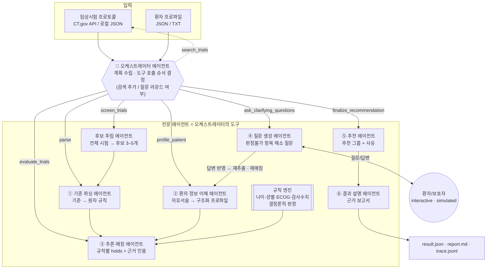
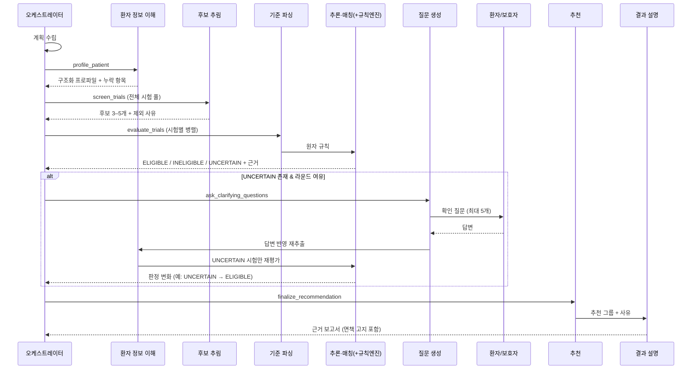

<p align="center"></p>

# Trialog: 대화로 찾는 임상시험 추천 멀티 에이전트 시스템

**Trialog**는 *Trial*(임상시험)과 *Dialog*(대화)를 합친 이름입니다. 기준을 대조해 판정하고, 모자란 정보는 환자에게 되물어 채운다는 시스템의 동작을 이름에 담았습니다. 로고는 말풍선(대화) 안의 체크 표시(기준 충족 판정)입니다. 코드 패키지 이름은 그대로 `ctrec`입니다.

**Healthcare Agentic AI Challenge 2026** 제출용 코드입니다. 주제는 *Interactive Clinical Trial Recommendation*입니다.

이 시스템은 임상시험 프로토콜의 선정/제외 기준과 상세 설명을 환자 정보와 대조해 참여 가능성을 **근거와 함께 판정**합니다. 정보가 부족하면 **확인 질문을 생성**해 답변을 반영한 뒤 다시 평가하고, 마지막으로 공개 기준에 맞는 임상시험을 **추천 그룹으로 묶어 근거와 함께 제시**합니다. 시험 사이의 임상적 우열은 정하지 않습니다.

설계 기준 문서는 [`docs/ARCHITECTURE.md`](docs/ARCHITECTURE.md)(Final Merged Architecture)입니다.

역할이 나뉜 6개의 전문 에이전트와 이를 지휘하는 오케스트레이터 에이전트가 함께 동작합니다. 오케스트레이터는 스스로 계획을 세우고 도구를 호출하므로, 단일 질의응답형 챗봇이 아닙니다.

> ⚠️ **의료적 면책 고지**
> 이 시스템의 출력은 연구·교육 목적의 **참고 자료**이며 의학적 자문, 진단, 치료 권고가 아닙니다. 임상시험 참여 여부는 반드시 담당 의료진 및 해당 임상시험 연구진과 상담해 결정해야 합니다. 모든 보고서(`report.md`)와 결과 파일(`result.json`)에는 이 고지가 자동으로 포함됩니다.

### 저장소

| 구분 | 주소 |
|---|---|
| 팀 저장소 | https://github.com/seoyeon488/workseoyeon |
| 개인 저장소 | https://github.com/rlaehdrua/clinical-recommendation-multi-agent-ai |

---

## 1. 전체 파이프라인

### 1.1 과제의 6단계와 구현 대응

| 단계 | 과제 요구사항 | 담당 에이전트 / 모듈 | 산출물 |
|---|---|---|---|
| ① 기준 입력 | 선정·제외 기준과 상세 설명 입력 | `tools/ctgov.py` (CT.gov API v2, 로컬 JSON) | `TrialRecord` |
| ② 환자 정보 입력 | 인구학·병력·검사·투약 프로파일 | `pipeline.load_patients` (JSON/TXT, TREC topics 형식) | `PatientCase` |
| (추가) 후보 추림 | 전체 시험 풀에서 이 환자에게 해당될 만한 시험 선택 | 후보 추림 에이전트 (`agents/screener.py`) | `ScreeningResult` (선택·제외 시험과 사유) |
| ③ 정보 추출 및 매칭 | 기준 파싱 → 환자 정보 추출 → 조건 매칭·추론 → 근거 제시 | 기준 파싱 → 환자 정보 이해 → **규칙 엔진 + 추론·매칭** | `ParsedTrial`, `PatientProfile`, `TrialMatch` |
| ④ 부족 정보 탐지 | 충족이 불확실하거나 누락된 항목 식별 | 추론·매칭 에이전트 (`holds="unknown"`, `missing_info`) | `UNCERTAIN` 판정과 누락 항목 |
| ⑤ 질문 생성 및 재평가 | 확인 질문 → 추가 정보 반영 → 최종 판정 | 질문 생성 에이전트 → 답변 제공자 → 환자 정보 재추출 → 재매칭 | `QAPair`, 판정 변화 이력 |
| ⑥ 임상시험 추천 | 적절한 시험 추천 (추천 그룹 + 설명 가능한 표시 순서) | 추천 에이전트 → 결과 설명 에이전트 | `Recommendation`, `report.md` |

### 1.2 에이전트 구성도 (역할과 오케스트레이션)



### 1.3 오케스트레이션 흐름 (agent 모드)



### 1.4 설계 원칙

- **근거 기반 판정**: 모든 규칙 판정에는 환자 원문 인용(`evidence`)과 추론 과정(`reasoning`)이 붙습니다. 근거가 없으면 `unknown`으로 판정하며, 정보가 없다는 이유만으로 "해당 없음"이라고 가정하지 않습니다.
  - 이 원칙은 프롬프트뿐 아니라 **코드로도 강제**합니다. 매칭 에이전트는 판정마다 근거 유형(`explicit` 명시 / `inferred` 추론 / `absent` 정보 없음)을 함께 냅니다.
  - **확정 판정은 기록에 명시된 근거(`explicit`)가 있을 때만 인정**합니다. `inferred`나 `absent`인데 확정 판정을 내리면 코드가 `unknown`으로 되돌립니다. 모델이 스스로 매긴 확신도는 기준으로 쓰지 않습니다. 실제로 모델이 추론에도 `high`를 매겨 통과하는 사례가 있었기 때문입니다. 되돌린 항목은 확인 질문 대상이 됩니다.
  - 그래서 모델을 바꿔도 같은 기준이 유지됩니다. 실제로 Sonnet은 "62세이므로 폐경 후일 것"처럼 추정해 질문 단계를 건너뛰는 경향을 보였고, 이 규칙으로 바로잡았습니다.
- **LLM과 코드의 역할 분리**
  - 나이·성별·ECOG·수치형 검사값은 **결정론적 규칙 엔진**이 먼저 판정해 산술 오류를 막습니다.
  - 시험 단위 최종 적격성은 **코드가 정한 결정 규칙**으로 계산합니다. 선정 기준 불충족이나 제외 기준 해당이 하나라도 있으면 `INELIGIBLE`, 그렇지 않고 판정 불가 항목이 있으면 `UNCERTAIN`, 모두 통과하면 `ELIGIBLE`입니다.
  - 추천 에이전트가 이 판정과 어긋나는 출력을 내면 코드가 교정합니다.
- **후보는 전체 시험에서 에이전트가 고름**: 후보 추림 에이전트가 시험 풀 전체(실제 CT.gov 시험 25개)의 제목·대상 질환·대상군·요약을 한 번에 보고, 이 환자에게 해당될 만한 시험을 최대 5개 고릅니다(`--max-candidates`). 기준별 자세한 판정은 고른 시험에만 하므로 비용이 시험 수에 비례해 늘지 않습니다.
  - 제외 사유는 ① 대상 질환 자체가 다름 ② 나이·성별 범위를 명백히 벗어남, 두 가지뿐입니다. 같은 질환이면 원인·병기·동반 질환 같은 세부 차이로는 제외하지 않고 다음 단계의 기준별 판정에 맡깁니다.
  - 모델이 판단을 빠뜨린 시험은 후보로 남기고(안전한 기본값), 목록에 없는 시험 ID는 버립니다. 선택·제외된 시험과 사유는 `result.json`의 `screening`과 `report.md`의 "후보 시험 추림" 섹션에 남습니다.
  - 이전 방식(질환별로 사람이 미리 정한 2–3개, `data/topic_map.json`)은 `--candidates given`으로 쓸 수 있습니다.
- **추천은 그룹으로, 순서는 설명 가능한 기준으로 (아키텍처 §49–50)**: 시험 간 임상적 우열을 주장하지 않습니다.
  - 사용자에게는 내부 판정(`eligibility`) 대신 외부 상태(`match_status`)를 보여 줍니다. 등록이 확정된 것처럼 읽히지 않도록 "공개 프로토콜 기준 사전 비교이며 실제 참여 여부는 연구기관 스크리닝과 연구자 판단으로 정해진다"는 안내를 함께 붙입니다.

    | 내부 판정 | 외부 상태 (`match_status`) | 화면 표시 |
    |---|---|---|
    | ELIGIBLE | `CRITERIA_MATCH` | 공개 기준 충족 |
    | UNCERTAIN (남은 항목이 UNVERIFIED이고 답변상 충족) | `POTENTIAL_MATCH` | 기록 확인 시 충족 가능 |
    | UNCERTAIN (남은 항목이 의사 확인 항목) | `NEEDS_REVIEW` | 의료진 검토 필요 |
    | UNCERTAIN (질문으로 확인할 항목이 남음) | `INSUFFICIENT_INFORMATION` | 추가 정보 필요 |
    | INELIGIBLE | `CRITERIA_MISMATCH` | 공개 기준 불충족 |
    | NOT_EVALUATED | `NOT_EVALUATED` | 평가 실패(부적격 아님) |

  - 추천 에이전트(LLM)는 순위를 매기지 않고 시험별 근거만 씁니다. 표시 순서는 코드가 정합니다: 추천 그룹(위 표 순서) → 모집 상태(모집 중 → 모집 예정) → 남은 미확인 항목 수 → 후보 추림 순서. `rank`는 이 표시 순서(1, 2, 3…)이고, `selection_reason`에 이 기준을 적습니다.
  - `recommended`는 가장 앞 그룹의 시험 전부입니다(1순위 하나를 고르지 않음).
- **가상 데모 시험은 데모 모드에서만 추천 (아키텍처 §67)**: `"synthetic": true`인 시험(예: `DEMO-LUNG-001`)은 적격성 판정(평가용)은 하지만 추천에서는 빼고, 제외 목록에 "가상 데모 시험(실제 시험 아님)"이라고 남깁니다. `--demo` 또는 `CTREC_DEMO_MODE=1`일 때만 추천에 나옵니다. 후보 추림 풀에도 데모 모드에서만 들어가며, 웹 화면은 데모 모드가 아니면 이 시험과 이 시험만 후보로 둔 환자(`SYN-DEMO-A/B`)를 목록에서 숨깁니다.
- **값싼 확정 제외 (아키텍처 §27)**: 후보 추림(LLM) 전에 코드가 명백히 맞지 않는 시험을 먼저 뺍니다(`hard_filter.py`). 모집 종료, CT.gov 구조화 나이 범위와 환자 나이 구간이 겹치지 않음, 한 성별 전용 시험과 환자 성별 불일치만 씁니다. 나이·성별을 모르거나 단위를 해석할 수 없으면 빼지 않습니다. 뺀 시험과 사유는 `screening.hard_filtered`와 보고서에 남습니다.
- **환자 답변 ≠ 확인된 진료 기록 (UNVERIFIED, 아키텍처 §19)**: 검사 수치·바이오마커·진단·병기처럼 진료 기록이 필요한 기준을 환자 답변만으로 판정하면 판정을 확정하지 않고 `UNVERIFIED`(판정 불가)로 남깁니다. 답변이 가리킨 값은 `self_reported_holds`에 보존하고, 같은 질문을 반복하지 않고 문서(검사 결과지·보고서) 확인을 요청합니다(`missing_facts`의 `document_requested`). 추천의 `verification_needed`와 보고서의 "문서 확인 필요 사항 (UNVERIFIED)" 섹션에 표시됩니다.
- **추천 가능 조건과 '추천 없음' 사유**: 시험은 **적격성(ELIGIBLE/UNCERTAIN)**과 **현재 모집 상태(모집 중·모집 예정)**를 모두 만족해야 추천됩니다.
  - 완료·조기 종료·철회 등 모집이 끝난 시험은 적격이어도 추천하지 않습니다. 대신 제외 목록에 "모집 종료된 시험으로 현재 참여 불가"라는 사유와 적격성 결과를 함께 남깁니다.
  - 추천할 시험이 하나도 없으면 코드가 상황별 이유를 `no_recommendation_reason`에 명시합니다. 이 이유는 콘솔 출력, `result.json`, `report.md` 맨 위에 모두 표시됩니다. 예: *"현재 진행 중인 적절한 임상시험이 없습니다. 환자 조건에 맞는 시험(NCT00195949)이 있었으나 후보 시험 2개가 모두 모집이 종료되었습니다: …"*
  - 이 경우 추천 에이전트(LLM)는 호출하지 않습니다.
  - 확인 질문도 모집 중인 시험의 미확인 항목에 대해서만 합니다.
  - agent 모드에서 `--search`가 허용되면, 오케스트레이터는 후보가 모두 모집 종료일 때 모집 중인 시험을 추가로 검색합니다.
- **코호트별 기준과 조건부 기준**
  - **코호트별 기준**: 기준이 참여자 군(예: IM군 / 대조군, Cohort A / B)마다 다르면, 기준 파싱 에이전트가 각 규칙에 코호트를 표시합니다. 매칭은 "공통 기준 + 해당 코호트 기준"으로 코호트마다 따로 판정하고, 가장 유리한 코호트 결과를 채택해 `matched_cohort`와 `cohort_results`에 기록합니다. 다른 코호트 전용 기준(예: "대조군은 IM 의심 시 제외")이 판정을 막지 않습니다.
  - **조건부 기준**: "Men who can father a child: must use contraception"처럼 특정 집단에만 적용되는 기준에서 환자가 그 집단이 아니면 `applicable=false`로 표시하고 **해당 없음 = 통과**로 처리합니다. "해당 없음"과 "조건 불성립"을 구분하기 위한 장치입니다.
- **원문에 구체 기준이 없는 항목은 '의사 확인 필요'로 분류**: "Use of certain medications", "clinically significant abnormalities", "연구자 판단" 같은 기준은 공개된 원문에 약물 목록이나 기준값이 없어 시스템이 판정할 수 없습니다.
  - **기준 파싱**: 이런 기준에 `underspecified` 표시를 붙입니다. "환자 정보가 완벽해도 원문만으로 판정 불가한 경우"에만 붙이고, "Crohn's disease"처럼 구체적인 질환·소견은 제외합니다. 이 표시는 적격 판정을 막지 않으므로, 남발하면 잘못 적격으로 판정할 위험이 커집니다.
  - **매칭**: 적격 판정을 막지 않고 "의사 확인 필요"로 분류합니다. 예: `ELIGIBLE: 통과 5 / 불충족 0 / 판정불가 0 (+의사 확인 필요 1)`
  - **확인 질문**: 판정용 질문과 별도로 **의사 참고용 질문**(`purpose: physician_reference`)을 한 번 만들어 관련 사실을 수집합니다. 예: "현재 복용 중인 약(처방약, 일반의약품, 한약, 건강기능식품 포함)을 모두 알려주세요."
  - **추천·보고서**: 추천된 시험마다 해당 기준, 환자 응답, 기록상 복용 약물을 묶어 `physician_review`에 적습니다. `report.md`에는 코드가 **"의사 확인 필요 사항 (참고)"** 섹션을 고정으로 붙여, 참여 여부를 최종 결정할 때 담당 의사가 전체 프로토콜(금지 약물 목록 등)과 대조할 수 있게 합니다.
- **통일된 판정 의미**: 각 규칙은 "조건이 환자에게 성립하는가(`holds`)"로 판정합니다. 선정 기준은 `yes`여야, 제외 기준은 `no`여야 통과입니다.
- **구조화 출력**: 모든 에이전트 간 데이터는 Pydantic 스키마(`schemas.py`)와 Claude의 JSON schema 구조화 출력으로 주고받습니다.
- **LLM 출력의 기계적 검증**: 스키마가 맞는지에 더해, 내용이 입력과 어긋나지 않는지 코드로 확인합니다.
  - **파서 수치·부등호 검사**: 규칙 엔진이 쓸 비교값(`value`)이 기준 원문(또는 CT.gov 구조화 나이 필드)에 그대로 있는지, 부등호 방향이 원문 표현("이상/at least/≥" 등)과 같은지 검사합니다. 어긋나면 그 규칙의 구조화 필드를 비워 규칙 엔진 대신 LLM이 원문으로 판정하게 하고, 사유를 `parsing_notes`와 `trace.jsonl`(`integrity_issues`)에 남깁니다. 단위 환산값(예: "2 Weeks" → `0.038` years)도 원문에 없는 값이므로 걸러집니다.
  - **없는 ID 차단과 누락분만 재요청**: 매칭 에이전트가 요청하지 않은 `rule_id`를 지어내면 버립니다. 일부 규칙의 판정을 빠뜨리면 빠진 규칙만 다시 요청합니다(기본 1회, `CTREC_MATCHER_RETRIES`). 재요청한 규칙은 `TrialMatch.retried_rule_ids`에 기록되고, 그래도 빠진 규칙은 `unknown`("평가 누락")으로 남습니다.
- **추적 가능성**: 에이전트 호출, 계획, 도구 사용, 질문과 답변, 판정 변화가 `trace.jsonl`에 기록됩니다. 발표 시연에 그대로 활용할 수 있습니다.
- **개인정보 보호**: 질문 생성 에이전트는 이름, 연락처 같은 식별 정보를 묻지 않도록 제한되어 있습니다. 예시 환자는 모두 가상 데이터입니다.

---

## 2. 설치

Python 3.10 이상이 필요합니다.

```bash
python3 -m venv ~/.venvs/ctrec && source ~/.venvs/ctrec/bin/activate
pip install -e ".[dev,web]"      # 또는 pip install -r requirements.txt && pip install -e .
cp .env.example .env             # ANTHROPIC_API_KEY 입력
```

> **가상환경은 iCloud Drive 밖에 만드세요.** 프로젝트 폴더가 iCloud 안에 있으면 macOS가 가상환경 속 `.pth` 파일에 숨김 속성을 붙이고, Python 3.13이 이를 무시해 `ModuleNotFoundError: No module named 'ctrec'`가 발생합니다. 위 예시처럼 `~/.venvs/ctrec`에 만들면 이 문제가 없고, 패키지 파일 수천 개가 iCloud로 동기화되는 것도 막을 수 있습니다.

- 기본 모델은 `claude-sonnet-5`이며 `.env`의 `CTREC_MODEL`로 바꿀 수 있습니다(예: `claude-opus-5`).
- `ant auth login`으로 로그인한 프로필이 있으면 API 키 없이도 동작합니다.
- 재현성을 위해 실험에 사용한 환경은 `pip freeze > requirements.lock.txt`로 고정해 함께 제출하세요.

API 호출 없이 동작하는 단위 테스트로 설치를 확인할 수 있습니다.

```bash
pytest -q
```

---

## 3. 실행

### 3.1 빠른 시작 (가상 데모 데이터)

```bash
# 오케스트레이터(agent) 모드 + 가상 환자 시뮬레이터로 확인 질문 자동 응답
# --demo: 가상 데모 시험(DEMO-LUNG-001)도 추천에 표시 (없으면 판정만 하고 추천에서 제외)
python -m ctrec run \
  --patient data/patients/synthetic/SYN-DEMO-A.json \
  --trials data/trials/DEMO-LUNG-001.json \
  --answers simulated --demo
```

### 3.2 웹 UI (실시간 시연)

실제 파이프라인을 실행하면서 에이전트 협업 과정을 브라우저에서 실시간으로 보여줍니다. 발표 시연용입니다.

```bash
python -m ctrec.web              # http://127.0.0.1:8000 (--port로 변경)
```

> **Phase 8: 웹의 실제 AI 분석은 기본 꺼짐입니다**(`CTREC_WEB_PAID_ENABLED=0`). API 키가 있어도 화면만 열리고 분석은 시작되지 않습니다. 켜는 조건은 `docs/web_deployment.md` 7절, 팀원용 실행 안내는 `docs/team_local_setup.md`, 현재 상태·한계·후속 작업은 `docs/team_handoff.md`를 보세요. CLI(`python -m ctrec run`)는 이 스위치 밖이므로 `.env`에 키가 있으면 실제 호출합니다.

| 단계 | 내용 |
|---|---|
| 소개·안내 | 서비스가 하는 일과 하지 않는 일(참여 자격 확정 아님), 사용 순서를 안내합니다 |
| ① 환자 정보 입력 | 직접 입력(기본) 또는 예시 사례(가상 데이터) 선택. 도움이 되는 정보 안내, 개인 식별 정보 입력 금지 안내, 글자 수 표시(20,000자), 합성 예시 넣기. "입력 내용 확인"에서 내용을 확인한 뒤 분석을 시작합니다. 후보 시험은 기본 **전체 시험에서 자동 추림**이고 "고급 설정"에서 직접 고를 수 있습니다. 분석 중에는 입력을 바꿀 수 없습니다 |
| ② 분석 진행 | 분석 준비 → 환자 정보 분석 → 임상시험 조건 검토 → 추가 질문 → 답변 반영 및 재분석 → 추천 결과 정리 → 완료. 각 단계는 **서버 이벤트로만** 바뀌며 진행률 숫자는 표시하지 않습니다. 오래 걸리면 안내, 연결이 끊기면 자동으로 다시 연결해 이어 받습니다. 에이전트 구성도·진행 기록은 접힌 "자세한 진행 기록(개발자용)"에 있습니다 |
| 추가 질문 | 기존 LLM 질문 생성기가 만든 질문을 순서대로 표시합니다(예/아니요·숫자·날짜·자유 입력). 질문마다 "모름 · 확인 불가"를 고를 수 있고, 보내기 전에 답변을 확인·수정합니다. 보내기 실패 시 입력을 유지한 채 다시 보낼 수 있습니다 |
| ③ 추천 결과 | 서버 공식 상태(공개 기준 충족·기록 확인 시 충족 가능·의료진 검토 필요·추가 정보 필요·공개 기준 불충족·평가 실패)와 설명, 시험별 **충족 / 불충족 / 정보 부족 / 추가 확인 필요** 조건, 조건별 근거 인용·근거 출처(환자 기록/답변/확인 불가)·판정 방식(규칙 엔진/AI 판정), ClinicalTrials.gov 원문 링크. AI가 쓴 문장은 "검증된 사실 아님"으로 표시합니다. "새 분석 시작"으로 처음으로 돌아갑니다 |

자세한 사용 안내: `docs/web_user_guide.md`

> **팀원 단계별 화면(4ea12d6)**: 단계 표시줄·단계 전용 화면·다시 보기로 개편한 화면은 Phase 9 통합에서 보류했습니다(CSP·CSRF·실행 소유권·환자 원문 전송 문제, `docs/team_handoff.md` 4절). 객관식 질문·한국어 번역·추천 카드 줄글 삭제는 현재 화면에 옮겼습니다. 원래 설명과 화면은 `git show 4ea12d6:README.md`, `git show 4ea12d6:src/ctrec/web/static/index.html`.

- 서버는 이 컴퓨터(127.0.0.1)에서만 접속할 수 있습니다.
- **실행별 접근 권한**: 실행을 만든 브라우저만 그 실행의 진행 상황·질문·결과를 보고 답변·취소할 수 있습니다. 실행마다 새 소유권 토큰을 HttpOnly·SameSite=Strict 쿠키(경로: 그 실행의 API)로만 주고, 서버는 토큰의 해시만 보관합니다. 실행 ID만 알거나 다른 브라우저에서는 접근할 수 없습니다(없는 실행과 같은 404). 상태를 바꾸는 요청은 `X-CTREC-Request` 헤더와 Origin을 확인합니다(CSRF 방어). `CTREC_PASSWORD`(공용 비밀번호)와 함께 쓸 수 있으며, 같은 비밀번호를 쓰는 사람끼리도 실행은 분리됩니다. 이 방식은 사용자 계정 인증을 대신하지 않습니다(`docs/web_security.md`).
- **HTTPS**: 이 컴퓨터(루프백) 밖에서 오는 평문 HTTP는 거절합니다(개발용 localhost는 그대로 동작). 운영은 HTTPS 프록시 뒤에서 `CTREC_REQUIRE_HTTPS=1`, `CTREC_COOKIE_SECURE=1`과 uvicorn `--proxy-headers --forwarded-allow-ips`(신뢰하는 프록시)로 실행합니다(`render.yaml`). 프록시 헤더는 신뢰한 프록시에서 온 것만 반영됩니다.
- **개발자 진단(Decision Loop, 기본 off)**: 주소에 `?diagnostic=1`을 붙여 실행하면 다음 행동 계획(질문 후보·문서 요청·검토·종료 사유)을 접힌 "개발자 진단" 영역에 따로 보여 줍니다. 판정·질문·추천에는 쓰이지 않고 LLM을 더 부르지 않습니다(`docs/decision_loop.md`).
- **저장**: 웹 실행은 기본적으로 디스크에 아무것도 저장하지 않습니다. 시연·디버깅에 필요하면 `CTREC_WEB_SAVE_OUTPUTS=1`로 켜며, 그때는 `outputs/web/<실행 ID>/`에 저장하고 `CTREC_WEB_OUTPUT_TTL_S`(기본 24시간)가 지나면 자동 삭제합니다. 이 정책 이전에 만들어진 폴더는 자동으로 지우지 않습니다.
- **취소·제한**: 화면의 "분석 취소"로 멈출 수 있습니다(진행 중인 API 호출 1건은 끝까지 진행된 뒤 멈춤). 실행 전체 시간 제한 `CTREC_WEB_RUN_TIMEOUT_S`(기본 1시간), 답변 대기 `CTREC_WEB_ANSWER_TIMEOUT_S`(기본 30분, 넘으면 '모름'으로 진행). 같은 브라우저는 동시에 1개(`CTREC_WEB_MAX_ACTIVE_PER_CLIENT`), 시간당 20개(`CTREC_WEB_MAX_STARTS_PER_HOUR`)까지 시작할 수 있습니다.
- **탭을 닫았다 다시 열면**: 같은 브라우저의 새 탭에 "진행 중인 분석 이어 보기" 버튼이 나옵니다(`GET /api/runs/active`, 진행 중 실행만, 누를 때만 이어 봄).
- **배포**: 기본 `render.yaml`은 기록 모드(record, 비용 강제 차단 없음)·`CTREC_FALLBACKS=0`·워커 1개입니다. 비용 상한(enforce) 구성, 대체 모델을 끈 이유, 배포 사전 점검(`scripts/check_web_deployment.py`)은 `docs/web_deployment.md`, 비용 원장 운영(UNKNOWN 정산·백업·복구)은 `docs/web_budget_operations.md`를 보세요.
- 서버 메모리에는 실행 상태를 최대 20개(`CTREC_WEB_MAX_RUNS`)까지만 두고, 끝난 실행은 2시간(`CTREC_WEB_RUN_TTL_S`, 초), 취소·오류·시간 초과로 끝난 실행은 2분(`CTREC_WEB_ENDED_TTL_S`) 뒤 지웁니다. 작업이 실제로 끝나지 않은 실행이 한도만큼 있으면 새 실행은 429로 거절됩니다.
- 실행할 때마다 Claude API 비용이 발생합니다. Sonnet 기준 환자 1명당 약 $0.2–0.7입니다.

### 3.3 사업단 제공 환자 + 실제 ClinicalTrials.gov 시험

사업단 제공 환자 10명(S001–S010)마다 CT.gov에서 같은 질환 시험 2–3개를 골라 `data/trials/`에 저장해 두었습니다(실제 시험 25개, 이 밖에 시연용 가상 시험 `DEMO-LUNG-001` 1개). 고른 기준은 문서로 남아 있지 않고, 환자 진단과 같은 질환의 시험이라는 것 외에 정해 둔 규칙은 없었습니다(모집 종료 시험 3개도 포함). 기본 실행은 실제 시험 25개 전체를 후보 풀로 보고 후보 추림 에이전트가 고릅니다. 이전처럼 질환별로 정해 둔 후보(`data/topic_map.json`)만 평가하려면 `--candidates given --topic-map data/topic_map.json`을 붙입니다.

```bash
# 사람이 직접 답하는 인터랙티브 모드 (S004: 방광암)
python -m ctrec run --patient data/patients/provided/synthetic-patients.json --patient-id S004 \
  --trials-dir data/trials --answers interactive

# 오케스트레이터가 필요 시 CT.gov에서 후보 시험을 추가 검색
python -m ctrec run --patient data/patients/provided/synthetic-patients.json --patient-id S008 \
  --search --answers interactive

# 시험 프로토콜을 더 내려받기 (data/trials/에 캐시되어 재현성 확보)
python scripts/fetch_trials.py --condition "idiopathic pulmonary fibrosis" --max 5
python scripts/fetch_trials.py --nct NCT0XXXXXXX NCT0YYYYYYY
```

### 3.4 합성 평가셋 일괄 실행과 평가

합성 환자 파일에는 환자별 `candidate_trials`(해당 질환의 시험)가 들어 있습니다. (A)·(B)는 확인 질문의 효과만 비교하려고 `--candidates given`으로 이 후보만 평가합니다. (C)는 후보 추림까지 포함한 전체 흐름을 평가합니다.

```bash
# (A) 확인 질문 없이: 공개 서술만으로 판정 -> label_text_only와 비교
python -m ctrec batch --patients-dir data/patients/synthetic --trials-dir data/trials --candidates given \
  --answers none --mode fixed --out outputs/no_qa --workers 4 --quiet
python eval/evaluate.py --labels data/labels/synthetic_labels.csv --outputs outputs/no_qa --label-column label_text_only

# (B) 확인 질문 + 가상 환자 응답: 숨은 정보를 얻은 뒤 판정 -> label과 비교
python -m ctrec batch --patients-dir data/patients/synthetic --trials-dir data/trials --candidates given \
  --answers simulated --mode agent --out outputs/with_qa --workers 4 --quiet
python eval/evaluate.py --labels data/labels/synthetic_labels.csv --outputs outputs/with_qa --label-column label

# (C) 후보 추림 포함: 전체 시험(데모 모드가 아니면 실제 25개)에서 후보를 골라 평가 -> 전체 시험으로 확장한 라벨과 비교
python scripts/expand_labels.py   # data/labels/synthetic_labels_all.csv (다른 분야 시험은 자동으로 INELIGIBLE)
python -m ctrec batch --patients-dir data/patients/synthetic --trials-dir data/trials \
  --answers simulated --mode fixed --out outputs/screen --workers 4 --quiet
python eval/evaluate.py --labels data/labels/synthetic_labels_all.csv --outputs outputs/screen
```

(C)에서 `evaluate.py`는 후보 추림 지표도 출력합니다: 정답 적격 시험을 후보로 남긴 비율(가장 중요. 추림에서 놓친 시험은 이후 단계에서 되찾을 수 없음), 같은 분야 시험을 남긴 비율, 다른 분야 시험을 고른 수, 놓친 적격 시험 목록. 추림에서 제외된 시험은 INELIGIBLE 예측으로, 상한을 넘어 평가하지 않은 시험은 UNCERTAIN 예측으로 셉니다. 자동 라벨(`auto=1`)은 "다른 질환 분야 시험은 부적격"이라는 가정이므로 연구진 검토가 필요합니다.

(A)에서 판정 보류(UNCERTAIN)였던 쌍이 (B)에서 정답(ELIGIBLE)으로 바뀌는 비율이, 확인 질문 단계의 효과를 보여주는 핵심 지표입니다. `evaluate.py`는 이를 다음 지표로 나눠 출력합니다(`--json 경로`로 저장 가능, 정의는 `src/ctrec/metrics.py`).

| 지표 | 의미 | 방향 |
|---|---|---|
| Rescue | 서술만으로는 보류(`label_text_only=UNCERTAIN`)였고 실제로는 적격인 쌍 중 ELIGIBLE로 회복한 비율 | 높을수록 좋음 |
| Cleanup | 서술만으로는 보류였고 실제로는 부적격인 쌍 중 INELIGIBLE로 걸러낸 비율 | 높을수록 좋음 |
| False Removal | 정답 적격인데 부적격으로 제거한 비율 | 낮을수록 좋음 |
| Premature Match | 정답이 적격이 아닌데 적격으로 판정한 비율 | 낮을수록 좋음 |

> 현재 라벨에는 "서술만으로 보류 → 실제 부적격" 쌍이 없어 Cleanup은 `N/A (0/0)`로 나옵니다. 평가셋을 늘릴 때 이 유형을 추가해야 합니다.

**질문 예산별 성능 곡선**: 환자당 허용 질문 수를 바꿔 가며 같은 평가셋을 반복 실행하고, 예산마다 정확도·Rescue·안전 지표·질문 수·LLM 호출 수를 표로 모읍니다. "질문을 많이 해서 좋아졌다"와 "적은 질문으로 대부분의 개선을 얻었다"를 구분하기 위한 실험입니다. 재현성을 위해 fixed 모드 + 가상 환자 응답으로 고정합니다.

```bash
python scripts/budget_sweep.py --budgets 0,1,2,3,5 --workers 4
# -> outputs/budget_sweep/b<예산>/ (환자별 결과), frontier.csv, frontier.json
python scripts/budget_sweep.py --budgets 0,1,2,3,5 --reuse   # 다시 실행하지 않고 기존 결과만 집계
```

추천 지표(최종 추천 적중률, Precision@k)에서는 **정답 ELIGIBLE이면서 모집 중인 시험**만 정답 추천으로 봅니다. 적격 시험이 모두 모집 종료된 환자(예: 유문협착증 S007)는 "추천 없음"을 내야 정답이며, 이는 `'추천 없음' 정확도`로 따로 보고합니다.

> 판정 정확도(적격/부적격)는 모집 상태와 관계없이 계산합니다. 다만 모집 종료 시험에는 확인 질문을 하지 않으므로, S007-03처럼 모집 종료 시험에서만 판정 보류인 쌍은 (B)에서도 판정 보류로 남습니다.

### 3.4.1 정보 가리기 평가셋 (Controlled Masking)

기존 합성 평가셋에서 확인 질문 단계를 시험하는 쌍은 14개뿐이고, "서술만으로는 보류 → 실제로는 부적격"(Cleanup) 사례는 없었습니다. 그래서 정보가 모두 있는 합성 환자에서 **판정을 가르는 사실만 자동으로 숨겨** 평가 사례를 만듭니다.

```bash
# 평가셋 생성 (LLM 출력은 data/cache/benchmark/에 캐시되어 다시 실행해도 API를 호출하지 않음)
python scripts/build_masked_benchmark.py --workers 4

# 평가: 확인 질문 + 사실 단위 가상 환자
python -m ctrec batch --patients-dir data/patients/masked --trials-dir data/trials --candidates given \
  --answers simulated --mode fixed --out outputs/masked --workers 4 --quiet
python eval/evaluate.py --labels data/labels/masked_labels.csv --outputs outputs/masked
```

**생성 과정**
1. **사실 분해**: 환자 전체 기록(공개 서술 + `hidden_details`)을 번호 붙은 원자 사실(F1, F2, …)로 나눕니다. 같은 내용을 두 번 적지 않게 하고, 사실 문장에 원문에 없는 숫자가 있으면 다시 요청합니다. 나이·성별·주 진단명만 '핵심 사실'로 표시하며, 핵심 사실은 숨기지 않습니다.
2. **결정 기준 주석**: (환자, 시험) 쌍마다 판정을 가르는 기준과 그 근거 사실 ID를 표시합니다. 정답 라벨과 모순되는 주석은 버리고, 목록에 없는 사실 ID는 버립니다.
3. **변형 생성** (모집 중인 시험만. 모집 종료 시험에는 확인 질문을 하지 않으므로 제외)

   | 유형 | 만드는 법 | 서술만 본 정답 → 전체 정답 |
   |---|---|---|
   | `full` | 모든 사실 공개 (정보가 다 있을 때의 기준선) | 원래 라벨 그대로 |
   | `rescue` | 적격 쌍에서 충족 기준 1개의 근거 사실을 숨김 | UNCERTAIN → ELIGIBLE |
   | `rescue2` | 적격 쌍에서 충족 기준 2개의 근거를 함께 숨김 (질문이 여러 개 필요) | UNCERTAIN → ELIGIBLE |
   | `cleanup` | 부적격 쌍에서 위반 기준의 근거 사실을 모두 숨김 | UNCERTAIN → INELIGIBLE |

4. **누출 검사**: 사실 하나를 숨겨도 다른 사실로 추론할 수 있으면 평가가 무의미합니다. 예를 들어 "근육침윤 없음"을 숨겨도 "검체의 배뇨근은 침범되지 않음"이 남아 있으면 답이 드러납니다. 그래서 별도 LLM이 **남은 사실만 보고** 숨긴 기준을 추론할 수 있는지 확인합니다. 추론 가능하면 단서 사실(`clue_fact_ids`)도 함께 숨기고 다시 검사하며(최대 3회), 그래도 새거나 핵심 사실이 단서면 그 변형을 버립니다.

**정답 격리**: 숨긴 사실과 정답(`oracle_facts`, `hidden_facts`, `masked_fact_ids` 등)은 환자 파일에 있지만 `pipeline._HIDDEN_KEYS`로 파이프라인 입력에서 빠집니다. "정답을 보지 말라"고 프롬프트로 지시하는 것이 아니라 입력에서 아예 제거합니다. 생성된 101명 전체에서 숨긴 사실 문장이 입력에 섞이지 않았음을 확인했습니다.

**사실 단위 가상 환자 (`FactRevealAnswerer`)**: `--answers simulated`로 실행하면, 사실 목록이 있는 환자는 이 시뮬레이터가 답합니다. LLM은 "어떤 사실 ID가 이 질문에 답하는가"만 고르고(질문당 최대 2개, 목록에 없는 ID는 버림), 답변 문장은 코드가 **사실 원문 그대로** 만듭니다. 그래서 묻지 않은 정보를 흘리거나 값을 지어낼 수 없습니다. 공개한 사실 ID는 `result.json`의 `revealed_facts`에 기록됩니다. 기존 환자는 이전처럼 `SimulatedPatientAnswerer`가 답합니다.

**추가 지표** (`masked_fact_ids` 열이 있는 라벨에서 자동 계산)

| 지표 | 의미 |
|---|---|
| 사례 유형별 정확도 | full / rescue / rescue2 / cleanup 각각의 정확도 |
| 숨긴 사실 회수율 | 결정 근거로 숨긴 사실 중 질문으로 되찾은 비율 (단서 사실은 제외) |
| 숨긴 사실 전부 회수한 비율 | 결정 근거 사실을 모두 되찾은 사례 비율 |
| 쓸모 있는 질문 비율 | 적격성 질문 중 숨긴 사실을 하나 이상 공개시킨 질문 비율 |
| 사실 1개 회수당 질문 수 | 질문 효율 |

질문 예산 곡선도 이 평가셋으로 만들 수 있습니다: `python scripts/budget_sweep.py --patients-dir data/patients/masked --labels data/labels/masked_labels.csv --out outputs/budget_sweep_masked`

> 주석과 누출 검사는 LLM이 한 것이므로, 발표 수치로 쓰기 전에 연구진이 표본을 검토해야 합니다. 생성 중 건너뛰거나 버린 사례와 그 사유는 `data/patients/masked/build_report.json`의 `warnings`에 있습니다.

### 3.5 주요 옵션

| 옵션 | 설명 | 기본값 |
|---|---|---|
| `--mode agent` | 오케스트레이터 에이전트가 계획을 세우고 도구 호출 순서를 결정 | ✅ |
| `--mode fixed` | 6단계를 고정 순서로 실행 (평가 재현성과 비교 실험용) | |
| `--answers interactive` | 터미널에서 사람이 직접 답변 (시연용) | |
| `--answers simulated` | 가상 환자의 `hidden_details`를 아는 LLM이 답변 (개발·평가용) | |
| `--answers none` | 답변 없이 질문만 기록 | ✅ |
| `--max-rounds N` | 확인 질문 최대 라운드 (환경 변수 `CTREC_MAX_CLARIFY_ROUNDS`로 기본값 변경) | 2 |
| `--candidates screen` | 불러온 시험 전체를 풀로 보고 후보 추림 에이전트가 고름 | ✅ |
| `--candidates given` | 환자 파일의 `candidate_trials` 또는 `--topic-map`에 정한 후보만 평가 (이전 방식, 라벨이 있는 쌍만 평가할 때) | |
| `--max-candidates N` | 후보 추림 후 자세히 평가할 최대 시험 수. 시험 풀이 이보다 작으면 추림 없이 전부 평가. **5는 실험 전 임시값**입니다. D3 결정에 따라 `scripts/screen_budget.py`(recall@k)로 정합니다. 기본값은 환경 변수 `CTREC_SCREEN_MAX`로 바꿉니다 | 5 (임시) |
| `CTREC_MAX_STEPS` (환경변수) | agent 모드 오케스트레이터 도구 호출 루프의 최대 반복 횟수 | 15 |
| `CTREC_MAX_QUESTIONS` (환경변수) | 라운드당 최대 질문 수 (`batch`·`adaptive` 정책의 한도). **5는 실험 전 임시값**입니다 | 5 (임시) |
| `CTREC_QUESTION_POLICY` (환경변수) | 한 라운드에 묶을 질문 수 정책 (D4). `single` 항상 1개 / `batch` 한도까지 / `adaptive` 서로 독립적이고 판정을 바꿀 질문만 함께. 기본 `adaptive`는 권장안이며 `scripts/question_policy_sweep.py` 결과로 확정합니다 | adaptive (임시) |
| `compile_trials.py --unfreeze` | 잠긴 기준표(`data/parsed/FROZEN.json`)의 시험도 다시 컴파일해 덮어씀. 팀 검토 후에만 쓰고, 끝나면 `scripts/freeze_parsed.py`로 다시 잠급니다 | off |
| `CTREC_LAZY_COMPILE=1` (환경변수) | 고정 저장소(`data/parsed/`)에 없는 시험을 그 자리에서 파싱합니다(검증 없음). 기본은 `COMPILATION_PENDING`(NOT_EVALUATED)으로 기록 (D8). `--search`·`--nct`로 새 시험을 시연할 때 씁니다 | 0 |
| `CTREC_WRITE_REPORT=0` (환경변수) | 보고서(설명 에이전트) 생략. 평가 실험 비용 절감용 | 1 |
| `--input-source` | 모든 환자의 최초 입력 출처를 지정 (`clinical_record` / `self_report` / `unknown`). 환자 파일의 `input_source`보다 우선합니다. 4.1 "최초 입력의 출처" 참고 | 파일 값, 없으면 unknown |
| `--demo` / `CTREC_DEMO_MODE=1` | 가상 데모 시험(`"synthetic": true`)도 추천에 표시. 끄면 판정만 하고 추천에서 제외 (§67) | off |
| `CTREC_HARD_FILTER_STATUS=0` (환경변수) | 후보 추림 전 확정 제외에서 모집 종료 시험을 빼지 않음. 모집 종료 시험의 적격성까지 평가해야 하는 벤치마크용 | 1 |
| `--question-budget N` | 환자 1명당 전체 라운드 합산 최대 질문 수 (질문 예산 실험용). 라운드당 한도(`CTREC_MAX_QUESTIONS`, 기본 5)와 남은 예산 중 작은 값만큼 묻습니다 | 제한 없음 |
| `--search` | CT.gov 추가 검색 허용 (agent 모드) | off |
| `--trials`, `--trials-dir`, `--nct` | 후보 시험 지정 | |
| `--patient-id` | 여러 환자가 든 파일에서 한 명만 실행 (`run`) | |
| `--workers N` | 환자 N명을 동시에 처리합니다. 로그에 환자 ID가 붙고 토큰 사용량은 환자별로 집계됩니다. `interactive` 답변 모드에서는 1로 고정됩니다. 시험별 병렬 처리(`CTREC_MAX_WORKERS`, 기본 4)와 곱해져 동시 API 호출 수가 정해지니, 429(rate limit) 오류가 잦으면 줄이세요 | 1 |
| `--topic-map` | 환자 ID → 후보 시험 ID 목록 JSON. 환자 파일에 `candidate_trials`가 있으면 그것이 우선합니다 | |

### 3.6 잠긴 기준표 검수·패치 (`scripts/review_store.py`)

잠긴 기준표(`data/parsed/`, `FROZEN.json`)는 직접 고치지 않습니다. 규칙 단위 패치를 제안하고, 사람이 승인한 패치만 원본을 복사한 **후보 저장소**에 적용해 diff와 검사를 거칩니다. LLM·API를 쓰지 않습니다.

```bash
python scripts/review_store.py propose --out data/patches/<이름>.json          # 제안 생성 (모두 proposed, 승인 아님)
python scripts/review_store.py status  --patches data/patches/<이름>.json --approvals data/patches/approvals.json
python scripts/review_store.py decide  --patches ... --approvals ... --patch-id <ID> --decision approved --reviewer <이름>
python scripts/review_store.py apply   --patches ... --approvals ... --candidate outputs/candidate_store/<이름>
python scripts/review_store.py check   --store outputs/candidate_store/<이름>   # 후보 파일 해시·로드·필드·무결성 검사
```

- 패치 종류: 지워진 규칙 엔진 필드 복구(`restore_engine_fields`, 원문 범위·짝 규칙·CT.gov 구조화 값이 모두 맞을 때만 제안), 단위만 남은 규칙의 단위 정리(`clear_orphan_unit`, 다른 필드를 만들지 않음), 원문이 의심스러운 기준의 의사 확인 표시(`flag_review`, 값은 고치지 않고 자동 판정에서 뺌).
- 적용은 원본이 `FROZEN.json`과 같을 때만, 승인된 패치만, 기존 값이 맞을 때만 합니다. 하나라도 거부되면 아무것도 쓰지 않습니다. 후보 파일의 해시는 `CANDIDATE.json`에 기록되어, 적용 뒤 손으로 고친 후보는 `check`와 이어서 적용할 때 거부됩니다.
- **승인 기록은 인증이 아니라 감사 기록입니다.** `--reviewer`에 적은 이름은 확인하지 않습니다. 승인은 패치 내용의 해시에 묶여 있어 승인 뒤 패치를 고치면 `stale`(무효)이 되고, 마지막 결정이 유효합니다. 누가 승인했는지는 승인 파일의 git 이력과 코드 리뷰(PR)로 확인합니다.
- 후보를 공식 기준표로 바꾸는 일(`data/parsed/` 교체 후 `scripts/freeze_parsed.py --note`로 다시 잠금)은 팀 승인 후 사람이 합니다. 다시 잠그기 전에 `apply`가 출력한 규칙 단위 diff와 `check`, 전체 오프라인 테스트를 확인하세요(잠금은 그 시점의 파일을 그대로 잠급니다).

---

## 4. 입력과 출력 형식

### 4.1 입력

**임상시험 (JSON)**: `scripts/fetch_trials.py`로 받은 CT.gov 레코드 또는 직접 작성한 파일을 씁니다. 최소 필드는 `trial_id`와 `eligibility_criteria`입니다.

```json
{"trial_id": "NCT0XXXXXXX", "title": "...", "brief_summary": "...", "detailed_description": "...",
 "eligibility_criteria": "Inclusion Criteria:\n* ...\nExclusion Criteria:\n* ...",
 "sex": "ALL", "minimum_age": "18 Years", "overall_status": "RECRUITING"}
```

**환자 (JSON 또는 TXT)**: 아래 형식을 모두 지원하며, 한 파일에 여러 환자가 있어도 됩니다.

- 사업단 제공 형식(TREC topic): `{"topics": [{"num": "S001", "title": "환자 서술"}, ...]}`
- 단일 환자: `{"patient_id": "...", "text": "자유 서술 프로파일"}`
- 그 밖의 JSON은 모든 필드를 텍스트로 바꿔 처리합니다.

다음 필드는 평가·시뮬레이션용 메타데이터라서 파이프라인(환자 정보 이해 에이전트)에는 **전달되지 않습니다**: `hidden_details`(시뮬레이터 전용), `design_note`, `candidate_trials`, `base_topic`, `synthetic`, `labels`, `input_source`.

**최초 입력의 출처 (`input_source`, 아키텍처 §18–19)**: 환자 원문이 진료 기록인지 환자 본인의 진술인지는 문자열만으로 알 수 없어서, 입력을 넘기는 쪽이 밝힙니다. 이 값은 **선언이지 검증 결과가 아닙니다**(문서 검증 상태 `DOCUMENT_VERIFIED`와 다름).

| 값 | 뜻 | 진료 기록이 필요한 기준(진단·바이오마커·검사 수치 등)을 원문 근거로 판정할 때 |
|---|---|---|
| `clinical_record` | 의료진이 작성한 기록이나 신뢰할 수 있는 임상 자료라는 근거가 있음 | 판정 확정 (`evidence_source=record`) |
| `self_report` | 환자·보호자 본인의 진술 | UNVERIFIED (답변상 값 보존, 문서 확인 요청) |
| `unknown` (기본값) | 출처를 밝히지 않음 | UNVERIFIED (기록으로 인정하지 않음) |

- 지정 방법: JSON 환자마다 `"input_source": "clinical_record"` 필드, 또는 실행 시 `--input-source`(모든 환자에 적용, 파일 값보다 우선). `.txt` 입력과 웹 화면에 직접 입력한 텍스트는 `unknown`입니다.
- 확인 질문 답변은 최초 입력의 출처와 관계없이 `self_report`입니다. 근거가 원문·답변 어디에서도 확인되지 않으면 `unknown`입니다.
- 근거가 있을 때만 `clinical_record`로 지정합니다(팀 결정, 2026-10-12). 현재 저장소의 환자 데이터(사업단 가상 증례, 합성 환자, 정보 가리기 평가셋)는 모두 가상 데이터라 출처를 지정하지 않으며 `unknown`으로 실행됩니다. 이 때문에 이전 실행보다 UNVERIFIED가 늘고 ELIGIBLE이 줄 수 있습니다.
- 결과 파일 `result.json`의 `input_source`에 실행에 쓴 값이 남습니다.

**정답 라벨 (`data/labels/synthetic_labels.csv`)**: `patient_id,trial_id,label,label_text_only,rationale`
- `label`: 전체 기록(`hidden_details`) 기준 정답. ELIGIBLE 또는 INELIGIBLE입니다.
- `label_text_only`: 공개 서술(`title`)만으로 본 정답. ELIGIBLE, INELIGIBLE, UNCERTAIN 중 하나입니다. 동의 의사나 방문 가능 여부 같은 절차 기준은 충족된 것으로 봅니다.
- `rationale`: 결정적인 기준에 대한 근거입니다.

### 4.2 출력 (`outputs/<patient_id>/`)

| 파일 | 내용 |
|---|---|
| `result.json` | 구조화 프로파일, 시험별 규칙 판정(근거·방법·신뢰도), 문답 기록, 판정 변화 이력, 추천 순위, 데이터 출처, 면책 고지 |
| `report.md` | 결과 설명 에이전트가 쓴 보고서: 환자 요약, 추천 표, 시험별 근거, 제외 사유, 문답, 남은 확인 사항. 코드가 고정으로 붙이는 섹션은 "추천 없음" 사유(해당 시)와 "의사 확인 필요 사항 (참고)"입니다. |
| `trace.jsonl` | 에이전트별 실행 로그 (오케스트레이터의 계획과 도구 호출, 질문과 답변, 오류) |

---

## 5. 평가 대응

| 평가 항목 | 비중 | 대응 |
|---|---|---|
| 매칭 정확성 | 30% | `eval/evaluate.py`로 계산하며, 모든 수치는 **"합성 벤치마크 성능"**으로 표기합니다(아래 참고). 지표는 전체 정확도, 판정 확정 비율(coverage), 확정 판정 정확도, Rescue/Cleanup, False Removal/Premature Match, 혼동 행렬, 추천 Top-1 적중률, Precision@k입니다. 질문 예산별 곡선은 `scripts/budget_sweep.py`로 만듭니다(3.4 참고). `--mode fixed`와 `--mode agent`, `--answers none`과 `--answers simulated`를 비교하면 질문 라운드의 효과를 수치로 보여줄 수 있습니다. |
| 랩 내 정성 평가 | 30% | `report.md`의 규칙 단위 근거와 `trace.jsonl`의 에이전트 협업 과정을 근거로 평가받습니다. |
| 발표 | 40% | 1.2와 1.3의 구성도를 활용하고, `trace.jsonl`로 실제 오케스트레이션 흐름을 시연합니다. |

**정답 라벨과 성능 표기 (팀 결정, 2026-10-12)**: 임상의가 검토한 정답표(Gold Set)는 만들 수 없어, 합성 데이터를 만들 때 LLM이 정한 정답 라벨만 씁니다. 그래서 모든 평가 결과는 **"합성 벤치마크 성능"**으로 표기하고, 실제 임상 성능으로 주장하지 않습니다(아키텍처 §64). `eval/evaluate.py` 출력 첫 줄과 `--json` 결과의 `benchmark` 필드에 이 표기가 붙습니다.

**기준선 비교 (팀 결정, 2026-10-12)**: 구조를 바꾸는 단계마다 기준선(현재 파이프라인)보다 정확도가 **1%p 넘게 떨어지면 다음 단계로 넘어가지 않습니다.** 기준선 지표를 `--json baseline.json`으로 저장해 두고, 이후 평가에 `--baseline baseline.json`을 붙이면 비교 결과를 출력하고 불합격이면 종료 코드 1을 냅니다.

### 5.1 합성 평가셋 구성

사업단 제공 환자는 10명뿐이고, 한두 문장짜리 서술이라 정답 라벨도 없습니다. 그래서 같은 10개 질환 분야로 합성 평가셋을 만들었습니다.

| 항목 | 규모 |
|---|---|
| 질환 분야 | 10개 (S001–S010과 같은 분야: 급성 췌장염, 그레이브스병, 소아 신증후군, 방광암, 조짐 편두통, 털곰팡이증, 유문협착증, 특발성 폐섬유증, 전염성 단핵구증, 망막박리) |
| 실제 CT.gov 시험 | 25개 (분야별 2–3개) |
| 합성 환자 | 30명 (분야별 3명) + 데모 2명 |
| (환자, 시험) 라벨 | 77쌍. 전체 기록 기준 ELIGIBLE 35 / INELIGIBLE 42, 공개 서술 기준 UNCERTAIN 14 |

**분야별 환자 설계**
- 01번: 정보가 충분하고, 한 시험에는 적격이며 다른 시험에는 부적격입니다. 추천 순위를 평가하기 위한 사례입니다.
- 02번: 검사 수치, 병용 약물, 동반 질환 등 자연스럽게 서술된 기준 위반이 있습니다.
- 03번: 판정을 가르는 정보 1–3개를 공개 서술에서 빼고 `hidden_details`에만 넣었습니다. 확인 질문 단계를 평가하기 위한 사례입니다.

라벨은 각 시험의 선정/제외 기준을 한 줄씩 대조해 작성했고, 근거는 `rationale` 열에 남겼습니다. 임상의 검토는 거치지 않았으므로 결과는 "합성 벤치마크 성능"으로만 보고합니다. 특히 다음 판단은 해석에 따라 달라질 수 있습니다.
- NCT06833073의 중앙 병리 검토, NCT06530004의 기관·기간 제한은 행정 절차로 보고 라벨에 반영하지 않았습니다.
- NCT07616128의 "특정 약물 사용" 제외 기준은 원문에 약물 목록이 없습니다. 정답 라벨은 이 기준을 판정에 쓰지 않았고, 시스템도 "의사 확인 필요"로 분류합니다.
- 유문협착증 시험 2개(NCT00195949, NCT02415049)는 이미 완료된 시험입니다. 라벨은 모집 상태와 관계없이 기준 충족 여부만으로 정했습니다.

추가 합성 데이터는 다음 명령으로 만들 수 있습니다(Claude API 사용).

```bash
python scripts/generate_synthetic_patients.py --trial data/trials/NCT0XXXXXXX.json --n 6
```

---

## 6. 데이터 출처 및 라이선스

| 데이터 | 경로 | 출처 | 라이선스 / 이용 조건 |
|---|---|---|---|
| 임상시험 프로토콜 | `data/trials/NCT*.json` | [ClinicalTrials.gov](https://clinicaltrials.gov) API v2, U.S. National Library of Medicine | 공개 데이터. [ClinicalTrials.gov Terms and Conditions](https://clinicaltrials.gov/about-site/terms-conditions)를 따릅니다. 각 레코드의 `source.url`, `source.retrieved_at`에 원문 URL과 수집 시각을 기록합니다. |
| 가상 데모 시험 | `data/trials/DEMO-LUNG-001.json` | 본 프로젝트에서 직접 작성 (`"synthetic": true`) | 프로젝트 라이선스를 따릅니다. **실제 시험이 아닙니다.** |
| 합성 환자 · 정답 라벨 | `data/patients/synthetic/`, `data/labels/` | 본 프로젝트에서 작성 (Claude 사용, `"synthetic": true`). 시험 기준은 위 CT.gov 레코드를 참조 | 프로젝트 라이선스를 따릅니다. 실존 인물 정보가 없는 가상 데이터입니다. |
| 사업단 제공 환자 예시 (10건) | `data/patients/provided/synthetic-patients.json` | Healthcare Agentic AI Challenge 2026 사업단 (가상 증례, TREC topic 형식) | 사업단 제공 조건을 따릅니다. *(제공 조건 확인 후 기재)* |
| 환자–후보 시험 매핑 | `data/topic_map.json` | 본 프로젝트에서 작성 (S001–S010 → 관련 CT.gov 시험) | 프로젝트 라이선스를 따릅니다. |

**유의사항 준수**
1. 공개 활용이 허용된 데이터(ClinicalTrials.gov)와 사업단 제공 데이터만 사용합니다.
2. 개인식별정보와 비공개 의료정보를 사용하지 않습니다. 환자 데이터는 가상 데이터나 사업단 예시만 쓰며, 질문 생성 에이전트는 식별 정보를 묻지 않도록 제한되어 있습니다.
3. 모든 데이터의 출처와 라이선스를 위 표와 각 레코드의 `source` 필드에 명시합니다.

> 참고: 환자 텍스트는 Claude API(Anthropic)로 전송되어 처리됩니다. 실제 환자 데이터를 사용하는 경우 기관 규정과 데이터 이용 조건을 먼저 확인하세요.

---

## 7. 프로젝트 구조

```
.
├── README.md
├── docs/ARCHITECTURE.md        # 설계 기준 문서 (Final Merged Architecture)
├── pyproject.toml / requirements.txt / .env.example
├── src/ctrec/
│   ├── cli.py                  # 명령행 진입점 (run / batch)
│   ├── config.py               # 모델, 에이전트별 effort, 라운드 수 등
│   ├── llm.py                  # Claude API 공통 래퍼 (구조화 출력, 캐싱, refusal 처리)
│   ├── schemas.py              # 에이전트 간 데이터 스키마 (Pydantic)
│   ├── pipeline.py             # Session: 6단계 상태와 실행, fixed 모드
│   ├── orchestrator.py         # 오케스트레이터 에이전트 (agent 모드, tool use 루프)
│   ├── trace.py                # trace.jsonl 기록 (+ 웹 UI 실시간 구독)
│   ├── metrics.py              # 평가 지표 (정확도, Rescue/Cleanup, False Removal 등)
│   ├── trial_store.py          # 사전 컴파일 기준 고정 저장소 (D8)
│   ├── evidence.py             # 기준별 근거 수준 정책 (D2)
│   ├── acquisition.py          # 부족한 정보의 확보 순서 (D7)
│   ├── status.py               # 외부 표현(match_status)과 추천 그룹 순서 (§49–50)
│   ├── hard_filter.py          # 후보 추림 전 값싼 확정 제외 (§27)
│   ├── web/                    # 웹 UI: app.py(FastAPI + SSE), static/index.html
│   ├── agents/
│   │   ├── screener.py         # 후보 추림 에이전트
│   │   ├── criteria_parser.py  # 기준 파싱 에이전트
│   │   ├── parser_validator.py # 파싱 검증 에이전트 (D1·D6, 사전 컴파일 때만 실행)
│   │   ├── patient_profiler.py # 환자 정보 이해 에이전트
│   │   ├── matcher.py          # 추론·매칭 에이전트 (+ 적격성 결정 규칙)
│   │   ├── question_generator.py # 질문 생성 에이전트
│   │   ├── answerers.py        # 답변 제공자 (interactive / simulated / none)
│   │   ├── recommender.py      # 추천 에이전트
│   │   └── explainer.py        # 결과 설명 에이전트
│   └── tools/
│       ├── ctgov.py            # ClinicalTrials.gov API v2 클라이언트
│       └── rule_engine.py      # 결정론적 규칙 엔진
├── scripts/
│   ├── fetch_trials.py         # CT.gov 프로토콜 수집
│   ├── generate_synthetic_patients.py  # 가상 환자와 정답 라벨 생성
│   ├── budget_sweep.py         # 질문 예산별 성능 곡선
│   ├── build_masked_benchmark.py  # 정보 가리기 평가셋 생성
│   ├── expand_labels.py        # 라벨을 전체 시험 풀로 확장 (후보 추림 평가용)
│   ├── parse_consistency.py    # 기준 파싱 일관성 측정
│   ├── compile_trials.py       # 시험 기준 사전 컴파일 (파싱 + 검증 -> data/parsed/)
│   ├── freeze_parsed.py        # 고정 저장소 잠금 (data/parsed/FROZEN.json)
│   ├── screen_budget.py        # 후보 수 실험 (D3, 추림 recall@k)
│   └── question_policy_sweep.py # 라운드당 질문 정책 비교 (D4)
├── eval/evaluate.py            # 매칭 정확성 평가
├── tests/                      # API 없이 도는 단위 테스트 (test_offline, test_recommender, test_reliability, test_masked_benchmark, test_screening, test_safety, test_stage05, test_decisions, test_stage0, test_evidence_source)
└── data/
    ├── trials/                 # 시험 프로토콜 (CT.gov 캐시 + 가상 데모)
    ├── parsed/                 # 사전 컴파일한 기준 고정 저장소 (git 포함, 환자 평가 때 이것만 사용, FROZEN.json으로 잠금)
    ├── topic_map.json          # 사업단 환자 S001–S010 → 후보 시험
    ├── patients/synthetic/     # 합성 환자 30명 (cases_*.json) + 데모 2명
    ├── patients/provided/      # 사업단 제공 예시 10명
    ├── patients/masked/        # 정보 가리기 평가셋 101명 (masked_cases.json) + 생성 보고서 (build_report.json)
    └── labels/                 # 평가용 정답 라벨 (synthetic_labels.csv, synthetic_labels_all.csv, masked_labels.csv)
```

---

## 8. 모델 및 비용 관련 참고

- **모델**: 모든 에이전트는 기본값 `claude-sonnet-5`를 씁니다($2 / $10 per 1M 입력·출력 토큰). 데모 환자 1명 기준 약 $0.2로, 같은 환자를 `claude-opus-5`로 돌렸을 때(약 $0.57)보다 저렴했습니다. 에이전트마다 추론 강도(`effort`)를 다르게 둡니다. 판정 정확도가 중요한 기준 파싱, 매칭, 추천, 오케스트레이터는 `high`이고, 추출과 문장 생성 위주 단계는 `medium`입니다. 값은 `config.py`의 `EFFORT`에서 조정합니다.
- **캐싱**
  - 에이전트별 시스템 프롬프트에 프롬프트 캐싱을 적용합니다.
  - 시험 기준은 `scripts/compile_trials.py`로 미리 파싱·검증해 `data/parsed/`(git 포함)에 고정합니다. 2026-10-12에 26개 시험 전부를 공식 기준표로 잠갔습니다(`FROZEN.json`, 파일이 바뀌면 테스트 실패). 환자를 평가할 때는 파싱하지 않습니다. 시험 기준 원문이 바뀌면 그 시험은 `COMPILATION_PENDING`이 되므로 다시 컴파일합니다. `data/cache/parsed/`는 컴파일·즉석 파싱용 내부 캐시입니다.
- **안전 분류기 대응**: 의료 텍스트가 드물게 모델의 안전 분류기에 의해 거절될 수 있습니다. 이 경우를 대비해 Claude API의 서버측 refusal fallback(`fallbacks: "default"`)을 기본으로 켜 두었습니다. Bedrock이나 Vertex 등 다른 플랫폼에서는 `.env`에 `CTREC_FALLBACKS=0`을 설정하세요. 코드 기본값은 켜짐(`CTREC_FALLBACKS` 미설정 = 1)이지만, `.env.example`과 `render.yaml`은 `CTREC_FALLBACKS=0`(꺼짐)으로 두므로 `.env.example`을 복사해 쓰면 꺼진 상태입니다. 웹 실제 분석과 파일럿 실행 전 점검은 0을 요구합니다.
- **비용 규모**: 환자 1명 × 시험 N개 기준으로 대략 다음 횟수만큼 Claude를 호출합니다.
  - 후보 추림: 1회 (약 $0.03. 시험 풀 설명은 시스템 프롬프트에 넣어 환자가 바뀌어도 캐시로 재사용). 자세한 판정은 고른 시험 N개(최대 5개)에만 합니다
  - 기준 파싱: 0회 (사전 컴파일한 고정 저장소 사용. 컴파일은 시험당 파싱 3회 + 검증 1회를 한 번만)
  - 매칭: N회
  - 질문 라운드: 라운드마다 3회 이상
  - 추천과 설명: 2회
  - agent 모드: 여기에 오케스트레이터 호출이 추가됩니다.

---

## 9. 한계와 향후 과제

- 규칙 엔진은 단위가 같은 수치 비교만 판정합니다. 단위 환산과 "정상 상한의 1.5배(ULN)" 같은 상대 기준은 LLM이 판정합니다.
- 확인 질문의 답변은 원문에 덧붙인 뒤 환자 정보를 다시 추출하는 방식으로 반영합니다. 답변이 기존 정보와 충돌하면 최신 답변을 우선합니다.
- 추천 표시 순서는 추천 그룹, 모집 상태, 남은 미확인 항목 수, 후보 추림 순서로만 정합니다. 시험 간 임상적 우열, 지리적 접근성, 환자 선호는 반영하지 않습니다.
- `INSUFFICIENT_INFORMATION`과 `POTENTIAL_MATCH`의 구분은 남은 항목의 종류로만 정합니다. 판정을 바꿀 수 있는 정보인지(판정 영향)는 아직 계산하지 않습니다(아키텍처 Stage 2).
- 가상 데이터로 측정한 정확도는 실제 임상 환경의 성능을 보장하지 않습니다.

---

## 10. 변경 이력

수정할 때마다 무엇을 왜 바꿨는지 여기에 기록합니다. 최신 항목이 위에 옵니다.

### 2026-11-08 — 처음 보는 사람도 따라 할 수 있는 화면: 쉬운 말, '지금 할 일', 환자에게 확인 상황 보이기, 예시 사례 되살리기 (동겸)

배경: 직접 써 보니 네 가지 문제가 있었습니다.
1. 연구진이 요청을 보내도 환자 탭에 아무것도 안 떴습니다. 요청이 모두 서류 확인이었고, 환자 화면은 환자 질문만 보여 줬기 때문입니다.
2. 예시 사례가 합성 폐암 환자 3명만 남았습니다. #47에서 데모 서버 예시 목록을 통째로 바꿨기 때문입니다.
3. 서류 등록·확인 단계가 눈에 띄지 않아 '판정 확정'이 계속 0이었습니다.
4. "적용 환자 4명"인데 버튼은 "1명에게 보내기"처럼, 처음 보는 사람이 이해하기 어려운 표시가 많았습니다.

| # | 변경 | 파일 |
|---|---|---|
| 1 | 담당자 화면 맨 위에 '지금 할 일' 한 줄과 바로 가는 버튼 (① 요청 보내기 → ② 서류 확인 → ③ 의사 판단). 탭 이름도 같은 순서 | `static/staff.js`, `static/index.html`, `static/staff.css` |
| 2 | 쉬운 말: 참여 가능(확정)·참여 불가(확정)·서류 확인 필요·정보가 더 필요·의사 판단 필요, 피 검사·혈소판·호중구(백혈구의 한 종류), 진료 기록·조직 검사 보고서 등. 확정이 아닌 결과에는 '미확정'을 함께 표시 | `static/staff.js` |
| 3 | 보내기 버튼이 그대로 설명함: "남은 1명에게 보내기 (3명은 이미 보냄)", "한 번에 보내기 (6건)" | `static/staff.js` |
| 4 | 서류 확인을 버튼 하나로: 가상 서류가 미리 채워져 있고, 값을 넣고 '서류 확인 끝'을 누르면 서류 올리기와 확인을 함께 함. 의사 판단은 "맞아요/아니에요" | `static/staff.js` |
| 5 | 환자별 화면을 '시험별 결과 → 해야 할 일 → 아직 안 보낸 요청 → 끝난 일 → 자세한 기록(접힘)' 순서로. 의사 판단 제안·내부 행동은 숨김 (의사 판단 요청은 서버가 자동으로 만듦) | `static/staff.js` |
| 6 | 환자 화면: 연구진이 하는 일(서류 확인 중·의사 판단 중·끝) 목록, 쉬운 질문(나이는 숫자 칸, 성별은 고르기). 답은 숫자를 그대로 담아 보냄 | `static/followup.js`, `static/app.css` |
| 7 | 환자 요청 목록에 `info_key`와 `in_progress`(종류·항목·상태만, 값·문서·판단 내용 없음). 담당자 환자 목록에 `open_by_status` | `followup/service.py`, `web/followup_api.py` |
| 8 | 데모 서버 예시 사례: 합성 폐암 환자 4명(나이를 적지 않은 환자 1명 추가: 환자에게 질문하는 장면) 뒤에 원래 예시 사례 40개를 그대로 | `scripts/followup_demo_server.py` |
| 9 | 환자 결과 설명 문구 쉽게 ("프로토콜과 대조" → "의사가 판단할 조건"). 상태 이름은 서버 공식 이름 그대로 | `static/app.js` |
| 10 | 테스트 2건 (환자에게 보이는 확인 상황에 값이 없음, 예시 사례 유지) | `tests/test_demo_roles.py` |

브라우저 확인 (Chrome, 합성 환자 2명):
- 요청 보내기 → 나이를 적지 않은 환자에게 "나이가 어떻게 되세요?"가 뜸 → 답하면 결과가 다시 계산됨
- 담당자 '지금 할 일' → 서류 확인 5건
- 서류 확인 → T-A·T-C 참여 가능 (확정)
- 의사 판단 → T-D 참여 가능 (확정)

전체 테스트 5,686 passed / 0 failed.

### 2026-11-08 — 발표용 화면: 담당자 탭 안에서 서류 등록·검증·의료진 판단, 같은 서류로 묶어 요청하는 시간 보기 (동겸)

배경: 최종 통합본(4f81460)으로 데모를 돌리니 P 근거 경로 뒤 합성 시험 T-A~D의 확인이 모두 서류 확인이었습니다. 그런데 #39의 서류 검증·의료진 판단은 API만 있고 화면이 없어 쌍이 '확인 대기'에서 멈췄습니다. 항목 이름도 영문 그대로였습니다(hemoglobin, review:underspecified 등). 팀의 핵심(코디네이터가 추천에 쓰는 시간 최소화)이 화면에서 보이도록 같이 고쳤습니다.

| # | 변경 | 파일 |
|---|---|---|
| 1 | 환자별 사례 화면의 요청 안에서 ① 담당자 서류 등록 ② 서류 검증자 확인(환자 답변 값 확인 또는 서류 값 기록) ③ 임상의 판단을 차례로 입력. 역할 표시를 따로 달고, 결과의 쌍 상태 변화(예: T-A 정보 부족 → 적격 확정)를 바로 보여 줌. 판정은 서버가 다시 계산 | `static/staff.js`, `static/staff.css` |
| 2 | 발표용 데모 역할: 데모 서버(`--demo-staff`) + 루프백 + 합성 검증 모드일 때만 `X-CTREC-Demo-Role: verifier\|clinician`을 키 대신 받음. 한 요청에 한 역할, 역할 표시가 있으면 담당자 예외 없음, 환자 답변 대리 입력은 그대로 403. 기록 이름은 demo-verifier·demo-clinician | `web/followup_api.py` |
| 3 | 질문별 보기를 같은 정보원(검사 결과지·진료 기록·병리 보고서)끼리 묶음: "검사 결과지 한 장으로 3개 항목 확인 · 묶어서 30분 (따로 하면 78분)"과 묶음 요청 버튼. 카드는 '추천 순서에서 이 확인으로 판정되는 쌍'과 '따로 요청할 때의 분'을 보여 줌 | `static/staff.js`, `web/followup_insight.py` |
| 4 | 요약: 판정 확정 쌍, 아직 보내지 않은 확인을 묶어서 할 때의 분과 따로 할 때 대비 절약, 추천 순서 누적 판정 곡선. 사례마다 남은 확인의 분 | `static/staff.js` |
| 5 | insight에 `minutes_alone`(다른 확인과 묶지 않고 하나만 요청할 때의 원장 비용), `source_id`, `spent_minutes`, `minutes_all_alone` 추가. 모두 같은 엔진 카탈로그의 가정 비용 | `web/followup_insight.py` |
| 6 | 한국어 항목 이름(혈색소·혈소판 수·절대호중구수 등, 의료진 판단 기준, 나이 확인 기록), 요청 경로 없는 내부 행동(RETRIEVE) 숨김, 담당자 화면 안내문 접기 | `static/staff.js`, `static/index.html` |
| 7 | 데모 서버: 예시 사례를 합성 NSCLC 환자 3명으로, 가상 시험 이름을 한국어로 (이 프로세스에서만) | `scripts/followup_demo_server.py` |
| 8 | 테스트 5건(데모 역할 조건·분리·기록 이름·검증 모드 없음, 따로 요청 비용) + 화면 경로 검사에 검증자·임상의 경로 포함 | `tests/test_demo_roles.py`, `tests/test_followup_web.py` |

브라우저 확인(Chrome, 합성 환자 3명): 묶음 요청 → 서류 등록 → 검증자 확인(ECOG 확인, 혈소판·ANC·혈색소 기록) → T-A·T-C 정보 부족 → 적격 확정, 임상의 판단 → T-D 의료진 검토 → 적격 확정, 환자 화면 추천 3건 갱신. 분은 측정한 업무 시간이 아니라 가정 비용입니다.

백엔드 확인 필요(선우): 환자가 말하지 않은 ECOG를 서류 값으로 기록(record)하면 근거 출처가 unknown으로 남아 기준이 계속 미검증이고 같은 ECOG 서류 요청이 다시 제안됨(환자 답변 값 확인(confirm)은 정상). EGFR 요청의 `allowed_fields`에 `biomarker:EGFR`이 있지만 그 항목으로 기록하면 409 `field_out_of_scope`(화면은 `biomarker`로 보냄).
### 2026-11-08 — WP6 runner가 NSCLC 평가셋과 독립 규칙 GT를 바로 쓰도록 (#43 후속, 동겸)

배경: 서연의 #43(NSCLC 평가셋·독립 규칙 GT)이 동겸에게 요청한 것 중 ① runner CLI가 시험을 `data/parsed`에서만 읽어 평가셋을 못 씀 ② 독립 GT를 주 지표에 넣는 방식입니다. 판단 슬롯 사본 교체와 결정 5 테스트 기대값은 서연의 `feat/nsclc-eval-gt-decision5-patches`에 들어 있어 그 위에 쌓았습니다(동겸이 `test_recovery_stress` 16·24를 쌍 단위로 다시 확인: 막힌 쌍은 전부 NCT07087314, 환자를 고정하면 변화 0). ②는 `run(..., labels=)`로 정했습니다. 실행 뒤 `cohort.gt.score()`로만 채점하면 합계 한 줄만 나오고, 환자별 결과(부트스트랩 단위)·비교표·짝지은 차이에는 순환 GT가 그대로 남기 때문입니다. `score()`는 교차 확인용으로 남깁니다.

| # | 변경 | 파일 |
|---|---|---|
| 1 | 판단 슬롯 사본 일치 테스트를 "같은 객체"로 (결정 5 두 슬롯 포함 확인) | `tests/test_sim_expert_metric.py` |
| 2 | `runner.run(labels=, gt_kind=)`·`compare(labels=, gt_kind=)`: 외부 GT로 주 지표·환자별 결과·비교표를 채점. 쌍 키가 코호트 쌍과 정확히 같지 않거나 모르는 라벨이면 거절(`gt_labels_mismatch`). manifest에 GT 종류와 해시. 기본(없음)은 지금과 같은 순환 규칙 GT, 행동·기록·result_hash에는 영향 없음 | `src/ctrec/sim/runner.py`, `src/ctrec/sim/metrics.py` |
| 3 | CLI: 생성기 설정의 `parsed_store`에서 기준을 읽고 `--trials-dir`로 시험 정보, `--gt pair_gt.csv`로 독립 GT 채점. 출력 끝에 정답 라벨 종류 표시 | `src/ctrec/sim/__main__.py` |
| 4 | 테스트 3건 추가 (외부 GT 채점·기록, 쌍 불일치 거절, CSV 읽기) | `tests/test_sim_expert_metric.py` |

NSCLC 평가셋 실행: `python -m ctrec.sim --generator data/nsclc/eval/inputs/generator_config.json --scenario nsclc-eval-v1 --map data/nsclc/eval/inputs/source_map.json --trials-dir data/nsclc/trials --gt data/nsclc/eval/pair_gt.csv`

### 2026-11-07 — P: 웹·WP6 공통 엔진 루프, 코호트 실행기, 근거 경로 DCV, 기준선·ablation 실험

배경: 웹 Session과 시뮬레이터가 같은 정책을 쓰는지 점검했습니다. 반복 억제·청구·정산은 두 경로에 따로 구현돼 있었습니다. 웹은 다시 매칭하지 않은 시험의 판정 시점을 숨겼고, 코호트(여러 환자) 실행은 시뮬레이터에만 있었습니다. 보고서는 `docs/dev/p_common_engine_2026_11_07.md`, 결과는 `docs/dev/p_results/`에 있습니다.

| # | 변경 | 파일 |
|---|---|---|
| 1 | `EngineLoop`: 계획(propose → 반복 억제 → select) · 실행 배분 · 실행 시 청구 · 정산. 시뮬레이터와 웹이 같은 객체를 쓰며, 리팩터만으로는 WP6 해시 56/56이 같음 | `src/ctrec/engine/loop.py` (신규), `src/ctrec/sim/runner.py` |
| 2 | 웹 `CohortRunner`·`run_cohort`·`activate_cohort`: 여러 Session을 한 정책·한 원장·라운드당 한 계획으로 묶음. 화면에서 실행할 수 없는 행동은 not_executed로 정산. 실제 판정 시점을 기록하고, 엔진 모드에서는 판정이 오래된 시험을 다시 매칭(풀 재평가와 같은 상태). 엔진 모드 기본 정책은 `full_dcvc` | `src/ctrec/web/engine_runner.py` |
| 3 | `full_dcvc` 0.2-draft: 진료 기록 근거가 필요한 기준만 겨냥한 환자 질문은 남은 문서 정보원으로 보냄(`record_evidence_required`, 스위치 `evidence_routing`). 불충족 필수 기준의 근거 확인은 쌍을 닫는 행동으로 셈. WP6 해시는 `full_dcvc` 8개만 바뀜 | `src/ctrec/engine/dcvc.py` |
| 4 | 실험 `python -m ctrec.sim.suite`: random·환자 독립·비용 우선·DCV+C와 ablation(번들·DCV·회복·근거 경로 제거). 독립 GT·순환 GT·미검증을 섞지 않음. NSCLC 파일럿(실제 프로토콜 6개 x 합성 환자 8명) | `src/ctrec/sim/suite.py`, `src/ctrec/sim/nsclc_pilot.py` (신규) |
| 5 | 테스트 32건(재생 일치, 증분=풀, 시나리오, GT 격리, 반복 금지 등). 기존 3건은 0.1 경로(`evidence_routing=False`)로 고정하고, 새 기본 동작 1건을 추가 | `tests/test_p_common_engine.py` (신규), `tests/test_engine_baselines.py`, `tests/test_recovery_r1_r2.py`, `tests/test_engine_runner.py` |

- 웹 **기본** 모드는 여전히 `legacy`(LLM 질문 생성기)라서, 기본 웹 경로는 공통 정책을 쓰지 않습니다. 엔진 모드를 강제하면 테스트 16건이 실패합니다(선택형 질문·형식 검증·브라우저 흐름). 엔진 질문 렌더러가 선택형 answer_type을 내야 기본을 바꿀 수 있으며, 이는 팀 결정입니다.
- NCT06216301 I1(미국 22세) 결함이 파일럿에서 거짓 부적격 1건으로 재현됩니다(strict xfail). 생성기 800분 예산에서는 번들 제거가 더 많이 확정합니다(점수식 재검토 필요).

### 2026-11-07 — 발표용 데모 서버에서는 담당자 키 없이 담당자 탭을 엶 (#38)

배경: 발표 화면에서 담당자 키를 매번 입력하는 과정을 없애고 싶음(동겸). 담당자 키는 모든 환자 사례·답변·Inspector를 읽고 요청을 만들 수 있는 담당자 API를 지키는 공유 비밀값이라, 실제 서버에서는 그대로 두고 **오프라인 데모 서버에서만** 예외를 둠.

| # | 변경 | 파일 |
|---|---|---|
| 1 | `followup_api.DEMO_STAFF`(기본 False): 켜져 있고 **루프백 접속**이면 키 없이 담당자 권한(기록용 이름 `demo-staff`). 모듈 속성이라 환경 변수·설정으로는 켤 수 없음. `GET /api/followup/staff/session`: 화면이 연결 방식을 고름(`demo` / `key`), 비밀값은 돌려주지 않음 | `src/ctrec/web/followup_api.py` |
| 2 | 데모 서버 `--demo-staff`: 위 예외를 켬 (데모 서버는 원래 루프백 전용·합성 데이터·실제 LLM 차단) | `scripts/followup_demo_server.py` |
| 3 | 담당자 탭: 데모 서버면 연결 칸 없이 '발표용 데모 · 자동 연결됨'으로 바로 열림. 화면은 키를 모르고 보내지도 않음. 실제 서버는 지금처럼 키 입력 | `src/ctrec/web/static/staff.js` |
| 4 | 테스트 3건(전체 5,042 passed, 5 skipped, 1 xfailed): 기본은 루프백이어도 키 필요, 데모 예외는 루프백만(외부 접속은 키 필요 - 루프백 검사를 빼면 실패 확인), 데모에서도 담당자는 환자 답변 불가, `DEMO_STAFF = True`는 데모 서버 스크립트에만 있음 | `tests/test_followup_web.py` |

- **순서 비교 칸 제거 (동겸 결정):** 담당자 요약의 '환자 순서로 할 때와 비교' 칸을 뺌. 데모 4명에서 추천 순서가 13분 더 걸렸고(3명일 때는 같음), C 순서는 '분당 판정 수'를 직접 최적화하지 않음 - 순서 우열은 WP6 시뮬레이터로 판단. `/staff/insight`는 두 곡선을 그대로 돌려줌.
- 발표 실행: `CTREC_STAFF_KEY=<아무 값> python scripts/followup_demo_server.py --port 8011 --demo-staff` → http://127.0.0.1:8011/ 에서 환자 ↔ 연구 담당자 탭만 오가면 됨.
- Chrome 확인: 담당자 탭·`/staff` 모두 키 입력 없이 '자동 연결됨', 콘솔 오류 0.

### 2026-11-07 — 환자·연구 담당자 화면을 한 페이지 탭으로, 질문별 코디네이터 작업 시간 보기 (#38)

배경: 동겸 결정 - 두 화면을 한 페이지 탭으로 합치고, 연구 코디네이터 작업 시간을 줄이는 것(핵심 아이디어·차별점)이 웹에서 보이게. 코디네이터가 물을 것을 고를 때 질문마다 몇 명에게 적용되고 몇 명의 판정이 정해지는지 보이게.

| # | 변경 | 파일 |
|---|---|---|
| 1 | 한 페이지 탭: 머리글의 **환자 / 연구 담당자** 탭. 담당자 화면은 `index.html`의 `#page-staff`로 옮기고 `staff.html` 삭제, `/staff`는 같은 페이지를 담당자 탭으로 엶. 담당자 탭이 열려 있으면 환자 화면이 드러나지 않음(`showPage`가 기억만), `staff.js`는 즉시 실행 함수로 감싸 `app.js`와 이름 충돌 없음 | `src/ctrec/web/static/index.html`·`staff.js`·`staff.css`·`app.js`·`app.css`, `src/ctrec/web/app.py` |
| 2 | **질문별 보기 (담당자 기본 보기):** 확인(경로 + 항목)마다 적용 환자, 관련 시험 쌍, 확인하면 판정 가능한 쌍·환자(그 항목이 마지막 남은 항목), 하나만 더 확인하면 판정, 예상 코디네이터 분, 답변 뒤 서류 확인 필요 표시. 정렬(추천 순서·판정에 가까운 순·적용 환자 많은 순), **여러 환자에게 한 번에 요청** | `staff.js` |
| 3 | **코디네이터 작업 시간 요약:** 열린 사례, 남은 확인과 모두 할 때 분, 판정이 정해질 수 있는 쌍과 추천 순서로 닿는 분, 같은 확인을 환자 순서로 할 때와의 차이 | `staff.js` |
| 4 | `GET /api/followup/staff/insight` (담당자 키 필요, 읽기 전용): 열린 사례를 한 코호트로 보고 대기열과 같은 계획(Cohort C)에서 위 수치를 계산. 판정 가능 여부는 decision_state의 기준별 info_key·gap·required_evidence로만 셈(환자 답변은 진료 기록 필요 기준을 끝내지 못함), 분은 비용 원장(EffortLedger) 그대로 | `src/ctrec/web/followup_insight.py` (신규), `src/ctrec/web/followup_api.py` |
| 5 | 테스트 4건(전체 5,039 passed, 5 skipped, 1 xfailed): `/staff` = 같은 페이지·역할 탭, `staff.js` 전역 없음, insight 수치 관계(판정 가능 ≤ 관련, 분 합, 대기열과 같은 순위·행동, 누적 분 단조, 두 순서의 최종 판정 수 같음), insight가 사례를 바꾸지 않음 | `tests/test_followup_web.py` |

- 머리글 수정: 역할 탭에 붙인 클래스 `seg`가 기존 진행 막대 클래스(높이 6px)와 같아 탭 상자가 눌리고 '입력·진행 / 추천 결과' 탭과 겹치던 문제 - 클래스를 빼고 두 줄 사이 간격 10px, 탭 글자 줄바꿈 금지, 480px 이하에서는 부제를 숨겨 로고가 한 줄에 놓이게 (1280px·390px 폭에서 확인).
- 해석: '판정 가능'은 답이 나온다고 볼 때의 상한, 분은 가정 비용. 데모 3명(합성 시험 3개)에서는 쌍마다 남은 항목이 둘 이상이라 '확인하면 판정 가능'은 처음엔 0이고, 헤모글로빈·ECOG 확인은 각각 3쌍을 '하나만 더 확인하면 판정'으로 만듦. 추천 순서와 환자 순서는 3쌍 판정까지 둘 다 81.5분 - 화면은 결과를 그대로 보여 주며 우열은 WP6 시뮬레이터로 판단.
- 브라우저(Chrome, 오프라인 데모 서버): 환자 3명 입력 → `/staff`가 담당자 탭으로 열림 → 질문별 6개 카드 → 정렬 → 헤모글로빈 질문 3명에게 일괄 요청 → 환자 2명 답변·1명 '모름' → 요약 갱신(판정 가능 0 → 3쌍) → 환자 탭·담당자 탭 왕복 → 환자별 상세. 콘솔 오류 0.

### 2026-11-07 — 추가 정보 확인 흐름 화면 연결: 환자 화면 '연구진 확인 요청' 모드 + 연구 담당자 화면 /staff (O 백엔드 위)

배경: 선우의 O 작업(`/api/followup`, `docs/dev/followup_api_contract.md`)으로 환자 입력 → 담당자 요청 → 환자 응답 → 재평가 백엔드가 생겼지만, 화면이 없어 실제 브라우저에서 흐름을 확인할 수 없었습니다. 기존 `/api/runs`(한 화면에서 AI가 바로 질문하는 흐름)와 겹치지 않게, 백엔드는 새로 만들지 않고 화면만 연결했습니다.

| # | 변경 | 파일 |
|---|---|---|
| 1 | **환자 화면:** 입력 패널에 진행 방식 선택(바로 분석 / 연구진 확인 요청). 연구진 확인 요청이면 `/api/followup/cases`로 시작하고, 결과는 기존 결과 화면 렌더러(`showResult`, 같은 결과 형식)로 그대로 보여 줌. 결과 위에 '연구진 요청' 패널: 질문 형식별 입력(자유 서술·예/아니요·선택·숫자·날짜), '모르겠어요', 답변 뒤 갱신된 판정·추천으로 다시 그림, 상충 답변은 보류 안내. 20초마다 새 요청 확인, 사례 ID만 브라우저에 저장(권한은 서버의 HttpOnly 쿠키)이라 새로고침해도 이어짐. '처음부터 다시 찾기'는 사례 연결을 지움 | `src/ctrec/web/static/followup.js` (신규), `index.html`, `app.js`(연결 지점 3곳, `init`을 DOMContentLoaded로), `app.css` |
| 2 | **연구 담당자 화면 `/staff`:** 담당자 키(탭에만 기억)로 연결 → 사례 목록·확인 대기열(C 순서) → 사례별 시험 판정(7가지 쌍 상태·남은 확인)과 추천 표시, 확인 제안(정책 엔진 후보, 순위·환자 질문 미리보기)에서 골라 요청 보내기(`expected_revision`으로 동시 변경 거부), 요청 이력(환자 답변·'모름'·상충, 대체 경로 연결, 상태 이력), 재평가 기록, Inspector. 10초마다 자동 갱신 | `src/ctrec/web/static/staff.html`·`staff.js`·`staff.css` (신규), `src/ctrec/web/app.py`(`/staff`, 정적 파일 목록) |
| 3 | **하지 않은 것을 완료처럼 보이지 않게:** 담당자 화면에 환자 답변 입력 경로 없음. 서류 확인 완료·의료진 판단 완료 입력 계약이 없으므로 그 상태에는 '완료' 버튼을 두지 않고 "입력 기능 없음(백엔드 계약 없음)"을 표시. 담당자 상태 변경 버튼은 서버 `STAFF_TRANSITIONS`와 같은 것만 | `staff.js` |
| 4 | 이 흐름이 평가할 수 있는 시험 목록 `GET /api/followup/trials` (읽기 전용, 공개 정보만). 데모 서버의 합성 카탈로그와 `/api/trials`(고정 저장소)가 달라 화면이 고를 시험을 알 수 없었음 | `src/ctrec/web/followup_api.py` |
| 5 | 테스트 5건: 시험 목록, `/staff`·스크립트 CSP 아래 제공, **화면이 부르는 API 경로가 모두 서버에 있음**(경로를 일부러 틀리면 실패 확인), 담당자 화면에 환자 응답 경로 없음, 담당자 상태 버튼 = 서버 전이 규칙 | `tests/test_followup_web.py` (신규) |

- **실제 브라우저 확인(Chrome, `scripts/followup_demo_server.py` 오프라인 대역·합성 시험 3개):** 환자 입력 → 초기 판정 → 담당자 화면에서 요청 3건 → 환자 화면에 질문 3개 → 나이 답변 반영·재평가 → 검사 수치 '모르겠어요' → 서류 확인 대체 요청 자동 생성 → 담당자 화면 자동 갱신(답변·'모름'·대체 경로·재평가 기록) → Inspector → 환자 화면 새로고침 뒤 사례 유지. 콘솔 오류 0.
- 남은 한계: 실제 LLM 서버에서는 실행하지 않음(비용·허가). 질문 문구는 기준 원문(영문)을 그대로 쓰는 엔진 질문(백엔드 `engine_runner._wording`, 질문 계약 작업). 환자가 다른 기기에서 돌아오는 경로·담당자 계정 분리 없음(백엔드 후속).
- **데모 경로 통일 (선우 요청, 같은 날 추가):** 환자 화면 기본 진행 방식 = 연구진 확인 요청(`/api/followup`), 바로 분석(`/api/runs`)은 두 번째 선택지. 두 경로 비교·데모 시나리오·완료/미완료: `docs/dev/web_demo_flow.md`. 담당자 대기열(Cohort C)에서 바로 요청 보내기, 확정이 아닌 쌍에 "미확정 · …" 표시, 사례가 열리면 진행 방식·시험 선택 잠금. 대기열 안내 문구가 목록을 다시 그릴 때 지워지던 문제·같은 초에 만든 사례의 번호가 흔들리던 문제 수정.
- **환자 3명 브라우저 검증:** 대기열 16건(환자 3명 섞임)에서 요청 4건 + 사례 화면 2건 → 환자 1·3 답변, 환자 2 '모르겠어요' → 서류 확인 대체 요청 자동 생성("입력 기능 없음" 안내) → 담당자 대리 답변 시도 403 → 환자 1 추천 3건 → 1건 갱신. 콘솔 오류는 의도한 403뿐.
- 전체 테스트(`.env` 없는 작업 트리, `feat/o-interactive-followup` 위): 5,036 passed, 5 skipped, 1 xfailed (화면 테스트 7건).

### 2026-11-07 — D+E 통합: 환자값 문맥 판단, 과거 값 단독 불인정

배경: 값이 적혀 있어도 환자의 현재 측정값이 아닌 표현이 절 경계를 넘어 확정에 닿았습니다. 상태 표지가 누구를 서술하는지 판단하도록 바꿨습니다.

| # | 변경 | 파일 |
|---|---|---|
| 1 | 측정 안 된 값·타인 값을 사실로 저장하지 않음 | `profile_facts.py`, `value_grounding.py` |
| 2 | 다른 절의 상태 표지 귀속, 검사 과정 절, 값이 주어·칸인 문장, 문장 범위 조건 | `value_grounding.py` |
| 3 | **계약 변경.** 과거로 표시된 값만 있으면 현재 값의 근거가 아님 | `value_grounding.py`, `tests/test_lab_value_semantics.py` |
| 4 | 이전 평가 문장을 회귀 세트로 전환, E2E 추가 | `tests/test_value_context.py`, `tests/test_de_safety_e2e.py` |

- 호환성: 서술형 원문에서 보류가 늘 수 있습니다. 시뮬레이터 36행, 고정 104쌍, 조합 900건은 그대로입니다.
- 남은 한계: 고정 코드의 새 독립 평가에서 부정 8/70 통과, 정상 5/70 보류. 상세는 `docs/dev/de_safety_integration_2026_11_07.md`입니다.

### 2026-11-07 — WP6 6차: 주 지표에 "판단 기준 외 확인 완료"를 더함 - 판단 기준 대기 적격 GT (팀 결정 1)

배경: NSCLC 6개 시험 모두에 기대 여명·연구자 판단 같은 임상의 판단 기준이 있어, 판단 기준이 있으면 라벨을 만들지 않는 규칙으로는 적격 GT가 0쌍이고 주 지표(정답 확정 적격)도 모든 정책에서 0입니다. 11-07 결정 1: 판단 기준을 뺀 나머지로 적격 GT를 만들고 "판단 기준 대기 적격"으로 확정 적격과 구분. 엔진은 판단 기준이 있는 쌍을 확정하지 않고 담당의 검토(EXPERT_REVIEW)로 보내므로, 시스템 쪽 성공은 "EXPERT_REVIEW 도달"로 셉니다.

| # | 변경 | 파일 |
|---|---|---|
| 1 | 규칙 GT 라벨 `eligible_pending_expert`: 정답 사실을 모두 넣어도 판단 기준만 남는 쌍(규칙 GT 상태 EXPERT_REVIEW = 판단 기준 외 필수 기준 모두 통과). GT 비교에 `gt_eligible_pending_expert`, `expert_review_gt_*`, `confirmed_eligible_gt_pending_expert`. 일관성 불일치에 "판단 기준을 판단 없이 확정"과 "정답 부적격인데 판단만 남았다고 봄"을 더함 | `src/ctrec/sim/metrics.py` |
| 2 | **주 지표 `correct_eligible_resolved` = `correct_confirmed_eligible`(확정 적격 + GT 적격) + `correct_expert_ready`(EXPERT_REVIEW + GT 판단 기준 대기 적격)**. 두 항목은 섞지 않도록 따로도 보고(비교표·환자별·부트스트랩 기본 지표). 비교표에 `expert_review`(최종 EXPERT_REVIEW 쌍 수) | `src/ctrec/sim/runner.py`, `src/ctrec/sim/stats.py`, `src/ctrec/sim/__main__.py` |
| 3 | 생성기 코호트 변환: 판단 슬롯(`judge.*` + `dx.disease_setting`·`tx.recent_radiotherapy`·`cm.cardiac`·`other.tumor_tissue`, #22 `cohort.spec`과 같은 목록)을 쓰는 기준은 시뮬레이터에서 underspecified로 표시해 엔진이 EXPERT_REVIEW로 보내고, 판정기는 값이 있어도 판정하지 않음. 서연 #20 리뷰 2(파서 플래그 `underspecified=False`인 `judge.life_expectancy`가 BLOCKED로 감)의 시뮬레이터 쪽 처리. 엔진·웹의 판단 기준 정의는 그대로(팀 결정 대기). 결정 5(`cm.serious_organ_disease`·`cm.immune_onc`)는 임상 검수 대기라 목록에 넣지 않음 | `src/ctrec/sim/from_generator.py`, `src/ctrec/sim/judge.py` |
| 4 | oracle_upper는 판단 기준 대기 적격 쌍도 우선 처리 대상으로 봄 | `src/ctrec/sim/oracle.py` |
| 5 | 테스트 5건(1건은 #22 병합 전 건너뜀): 확정·판단 대기를 섞지 않음, 판단 기준을 더한 데모에서 GT·지표·환자별 합·비교표, 판단 대기 쌍을 확정하면 불일치, 판단 슬롯 목록이 #22와 같음, 판단 기준 표시·판정기 제외 | `tests/test_sim_expert_metric.py` (신규) |

- 판단 기준(기대 여명)을 T-C에 더한 데모(400분, seed 1): GT 판단 기준 대기 적격 3쌍, legacy_greedy·full_dcvc 모두 확정 적격 3 + 판단 기준 외 확인 완료 2 = 주 지표 5, 불일치 0. 기본 데모(판단 기준 없음)의 결과는 바뀌지 않음.
- 생성기 예시 코호트는 여전히 모든 정책 0: 미연결(검수 전) 기준이 남은 쌍은 라벨을 만들지 않기 때문(결정 3의 축소 범위가 나와야 함).
- 전체 테스트(`.env` 없는 작업 트리, #24 병합 후 integration 위): 2,795 passed, 6 skipped.

### 2026-11-07 — WP7 감사 기록의 저장·조회·지표·콘솔 경로 보안 (원문·ID 노출 차단, 읽기 상한)

배경: DecisionRecord를 다시 읽거나 지표로 내보내는 경로에서 파일 안의 값이 문제 메시지·지표 출력으로 다시 나갈 수 있었고, 보호 함수 대부분은 테스트에서만 호출됐습니다. 이번 변경은 합성 값으로 재현한 노출을 막고, 실제로 기록을 만드는 오프라인 실행기에 검사를 연결합니다. 판정·쌍 상태·추천은 바꾸지 않습니다.

| # | 변경 | 파일 |
|---|---|---|
| 1 | **조회 시 값 검사.** `inspect_run_checked`, `to_trace_checked`, `load_run_v2(scanner)`. scanner가 걸러낸 기록은 값 없이 `sensitive_record:<종류>`로만 보고하고, 문제 메시지에는 파일 내용을 넣지 않음 | `engine/audit.py`, `engine/audit_inspection.py`, `engine/audit_diagnostics.py` |
| 2 | **지표 내보내기 진입점 `export_metrics`.** scanner가 없으면 `AuditError`. 기본 출력에서 원시 ID를 빼고, 호출마다 다른 키로 `pair_ref`를 만듦. 익명화가 아니라 구분용 값임 | `engine/reversal_metrics.py` |
| 3 | **자유 서술 저장 거부(`free_text`).** 공백·비ASCII·초장 값이 든 기록은 저장하지 않음. 공백 없는 ASCII 서술은 찾지 못함. `info_key`의 공백 값(#20)은 `lab:`·`basis:lab:` 뒤 소문자 단어 2~4개인 검사 항목 모양만 허용. 이 모양을 흉내 낸 서술(`lab:has severe rash`)은 구분하지 못함 | `engine/audit.py` |
| 4 | **읽기 상한.** 감사 파일 64MiB, 문제 줄 10,000 | `engine/audit.py`, `engine/reversal_metrics.py` |
| 5 | **오프라인 실행기 연결.** 쓰기에 환자 문장 금지 목록, 읽기에 scanner를 넘기고, `reversal_metrics.json`의 `value_scan`이 `no_findings`가 아니면 exit 1 | `offline_records.py`, `scripts/run_offline_records.py` |
| 6 | **CLI 실패 출력은 예외 종류만.** 합성 데이터 개발용 `CTREC_CLI_TRACEBACK=1`, 콘솔 축소 옵션 `--redact-console`(기본 꺼짐). 오케스트레이터 `tool_error` 기록도 종류만 | `cli.py`, `orchestrator.py` |
| 7 | 회귀 테스트 추가. 기존 기대값 변경은 이전 노출을 고정하던 `test_reversal_metrics.py` 2건과, 무작위 ID·임시 경로를 지우는 `test_cli_records.py` 콘솔 비교 1건 | `tests/test_audit_*.py`, `tests/test_reversal_metrics*.py`, `tests/test_security_paths.py`, `tests/test_cli_records.py` |

- 호환성: 단일 실행 CLI 실패가 traceback 대신 한 줄로 나옵니다(exit 1은 같음). 공백·비ASCII 값이 든 기록은 새로 저장되지 않고, 64MiB 또는 문제 줄 10,000을 넘는 감사 파일은 읽기 실패가 됩니다.
- 남은 한계: 웹·CLI는 DecisionRecord를 만들지 않고 실행별 scanner도 없어 조회·지표 검사가 적용될 경로가 없습니다(WP8). CLI 기본 콘솔에는 환자 ID·근거 문장이 그대로 나옵니다. 보호 파일 `pipeline.py`의 `repr(e)`는 콘솔과 `trace.jsonl`에 남습니다. 상세는 `docs/dev/r1_wp7_security_paths_2026_11_07.md`입니다.

---
### 2026-11-07 — WP6 5차: PR #20 리뷰 결함 수정 - 정보원 실패 뒤 조기 BLOCKED, 연락 불가 뒤 문서 전환, 공백 info_key (#20)

배경: 선우·서연 리뷰(11-07)에서 병합 전 수정이 필요한 결함 2건이 재현됐습니다. (1) 정보원 하나가 실패하면 그 행동의 항목만 보고 시험 전체를 소진해, 다른 필수 항목을 검사지 등으로 아직 얻을 수 있어도 `BLOCKED_FAILURE`가 됨(합성 데모 40 seed에서 full_dcvc BLOCKED 134쌍 중 12쌍). (2) 실제 Session에서 연락 불가는 `failed_sources`에만 기록되는데, 기존 정책 보류(`user_declined_or_exhausted`)의 복구 분기는 `failed_items`만 봐서 문서 요청으로 넘어가지 않음. 함께 지적된 공백 info_key·나이 표기·지표 이름도 고쳤습니다.

| # | 변경 | 파일 |
|---|---|---|
| 1 | **결함 1:** 정보원 단위 실패 뒤 시험 전체가 아니라 **길이 끊긴 항목만 소진**(이 행동의 항목 + 같은 정보원에 기대던 대상 시험의 다른 항목 - 다음 계획에서 소진 보류가 될 항목). 쌍은 남은 항목이 모두 소진됐을 때만 BLOCKED(`items_exhausted`, 11-04 Q-D2와 같은 규칙). 항목 키가 없는 행동과 회복 제거(`recovery=False`)는 기존처럼 대상 시험 전체 | `src/ctrec/engine/policy.py` |
| 2 | **결함 2:** 기존 정책의 보류·재추출 복구 분기가 항목 실패뿐 아니라 그 항목을 묻던(문진 경로)·다루는 정보원의 실패(`failed_sources`)도 봄 → 문서 요청(`alternative_source_after_failure`). 무관한 정보원 실패는 보류 그대로 | `src/ctrec/engine/policy.py` |
| 3 | **바꿔 묻기:** 차례인데 기존 정책이 재추출(REPARSE `answered_not_reflected`)을 내는 경우("잘 모르겠어요"처럼 기존 목록 밖의 무응답)도 바꿔 묻기로 | `src/ctrec/engine/policy.py` |
| 4 | **공백 info_key:** `lab:absolute neutrophil count`·`lab:total bilirubin`·`lab:creatinine clearance`가 형식 검사에서 빠져 항목 키가 지문으로 바뀌던 문제. 형식을 `contracts.INFO_KEY_PATTERN` 하나로 두고 가운데 공백 허용(앞뒤 공백·줄바꿈은 거부) | `src/ctrec/engine/contracts.py`, `src/ctrec/engine/policy.py` |
| 5 | 원문 한 줄 표기: 정수인 실수 나이·ECOG는 소수점 없이(`15.0` → "나이 15세") - 환자값 근거 검사(P0)와 맞춤 | `src/ctrec/sim/evaluator.py` |
| 6 | 비교표 열 이름 `false_confirmed_eligible_vs_rule_gt` → `confirmed_eligible_rule_gt_disagree` (규칙 GT는 순환적이라 False Eligible로 쓰지 않음, 서연 요청) | `src/ctrec/sim/runner.py` |
| 7 | 테스트 9건: 선우 재현(ECOG 문서 실패 뒤 T1은 Hb 검사지가 남아 INFO_MISSING, T2만 BLOCKED, Hb까지 실패하면 T1도 BLOCKED), 회복 제거는 기존 동작, 연락 불가 뒤 보류 → 문서(무관한 정보원 실패는 보류), REPARSE → 바꿔 묻기, 공백 info_key 3종, 나이 표기, **기본 회복 정책의 실제 Session E2E**(연락 불가 뒤 그 항목이 보류가 아니라 문서 요청, 문서가 남은 동안 BLOCKED 전이 없음) | `tests/test_engine_policy.py`, `tests/test_offline_records.py`, `tests/test_sim_generator.py` |

- 데모 재실행(seed 1~5): 180분 full_dcvc 정답 확정 적격 3.2 → 3.0(차이 +0.8 [−1.2, 3.0]), 나머지 칸은 4차 표와 같음.
- 분리한 후속(기본 꺼진 바꿔 묻기 관련): 바꿔 묻기 비용이 예산을 넘을 때 더 싼 문서 대안을 내지 않음, 웹 렌더러가 다른 문구를 만들지 않음. integration에도 있는 마지막 항목 "모름" 뒤 Session 종료 문제는 별도.
- 전체 테스트(`.env` 없는 작업 트리): 2,443 passed, 5 skipped.

### 2026-11-06 — WP6 4차: 참고 상한 `oracle_upper`와 환자 단위 부트스트랩 신뢰구간 (#20)

배경: 정책 간 차이가 0~2건 수준이라 응답 운인지 구분할 방법이 없었고, 제안 정책이 "미래를 알면 어디까지 가는가" 대비 어디쯤인지 볼 기준이 없었습니다(설계 §4 반복, §5 `oracle_upper`).

| # | 변경 | 파일 |
|---|---|---|
| 1 | **`oracle_upper`:** 숨긴 값과 응답 결과를 아는 참고 정책. 후보는 다른 정책과 같은 `propose`(같은 행동 공간·원장·예산). 환경으로 결과를 미리 보고(시도 번호 0 = 실제와 같음), 실패할 행동은 성공할 문서 정보원으로 바로 바꾸거나(`oracle_document_first`) 실행하지 않음(`oracle_will_fail`). 안전 필수 행동은 그대로. 순서는 안전 → 규칙 GT 적격 쌍 → 나머지, 같은 묶음은 비용 순. **탐욕 선택이라 엄밀한 최적값이 아님**(최적은 §5 소규모 완전탐색, 미구현). engine 등록표에 없고 웹에서 쓰지 않음, manifest `reference_policy: true` | `src/ctrec/sim/oracle.py` (신규), `src/ctrec/sim/runner.py` |
| 2 | 실행기: 규칙 GT를 실행 전에 한 번 계산해 지표와 oracle이 같이 씀. 주 지표 `correct_confirmed_eligible`(확정 적격이면서 규칙 GT 적격). 환자별 결과 `RunResult.per_patient`(확정 적격·정답 확정 적격·확정 부적격·코디네이터 분·질문 수), 비교표 행에 `cohort_id`·`reference`·`per_patient` | `src/ctrec/sim/runner.py` |
| 3 | **부트스트랩:** 단위 = 환자(코호트, 별칭), seed별 결과는 평균. 추정치 = 코호트당 합계, 95% 백분위 구간, 기준 정책 대비 **짝지은** 차이(같은 재표본). 정책마다 환자·seed 조합이 다르면 거부. 난수 고정(같은 입력 → 같은 구간). 한계: 환자들이 예산을 나눠 쓰는 결합을 무시하므로 구간이 실제보다 좁을 수 있음 | `src/ctrec/sim/stats.py` (신규) |
| 4 | CLI: `--oracle`, `--bootstrap N`(기본 2000, 0이면 끔), `--reference`(기본 `legacy_greedy`), `--replicate 0,1,2`(생성기 코호트 여러 개를 합쳐 환자 단위를 늘림). 비교표에 `reference`·`correct_confirmed_eligible` 열 | `src/ctrec/sim/__main__.py` |
| 5 | 테스트 11건 + 수정 1건: oracle은 등록표 밖·manifest 표시, 미리 본 결과 = 실제(안전 필수 외 실패 0), 환자가 모르는 값은 바로 문서, 데모에서 주 지표가 모든 정책 이상, 환자별 합 = 실행 지표, 부트스트랩 결정성·구간이 추정치를 감쌈·추정치 = seed 평균, 자기 자신과의 차이는 구간까지 0, 짝 안 맞는 행 거부, CLI. sim 패키지의 정책 클래스는 `OracleUpperPolicy` 하나만 허용(M14 정적 검사). 미리 보기를 끄거나 짝을 어긋나게 하면 실패하는 것 확인 | `tests/test_sim_stats_oracle.py` (신규), `tests/test_sim_runner.py` |

- 데모(합성·상대 비교, 환자 6명, seed 1~5, 주 지표 = 정답 확정 적격, 차이는 `legacy_greedy` 대비):

  | 예산(분) | legacy_greedy | full_dcvc | oracle_upper |
  |---|---|---|---|
  | 90 | 0 | 0 (차이 0) | 3.0 [0.8, 5.4] (차이 +3.0 [0.8, 5.4]) |
  | 180 | 2.2 [0.6, 4.0] | 3.2 [0.0, 6.4] (차이 +1.0 [−1.6, 3.8]) | 4.6 [1.0, 8.8] (차이 +2.4 [0.2, 5.2]) |
  | 400 | 5.0 [1.0, 9.0] | 5.0 (차이 0) | 5.0 (차이 0, 코디네이터 분 −135 [−176, −93]) |

  180분에서 full_dcvc의 +1.0은 구간이 0을 포함해 응답 운과 구분되지 않습니다. 환자 6명이라 구간이 넓습니다.
- 생성기 예시 코호트(replicate 0·1, 환자 40명, 240분): oracle_upper를 포함해 모든 정책이 0. 검수 전 기준 때문에 규칙 GT 적격 라벨 자체가 0건입니다(2차 기록 참고).
- 전체 테스트(`.env` 없는 작업 트리): 2,434 passed, 5 skipped.

### 2026-11-06 — WP6 3차: "모름" 뒤 같은 질문 반복을 없애고 바꿔 묻기로 교체 (#20)

배경: 2차의 재질문 2회는 같은 질문(같은 행동 지문)을 그대로 다시 보내는 것이었고, 달라지는 것은 응답 난수의 시도 번호뿐이었습니다. 환자가 원래 모르는 값(검사 수치 등)은 몇 번 물어도 "모름"이고, 원장이 같은 항목을 두 번 청구하지 않아 비용도 0분으로 잡혔습니다. 11-06 결정: 같은 내용 재질문은 의미가 없으므로 삭제하고, 다른 말로 다시 묻는 바꿔 묻기를 넣습니다. 2차 표의 5번(`max_item_attempts`·`--ask-attempts`)을 대체합니다.

| # | 변경 | 파일 |
|---|---|---|
| 1 | **삭제:** 정책 `max_item_attempts`, 실행기 `repeat_limit`, `compare(ask_attempts=)`, CLI `--ask-attempts`. 실행기는 같은 (환자, 지문, 유형, 정보원) 행동을 다시 실행하지 않음 | `src/ctrec/engine/policy.py`, `src/ctrec/sim/runner.py`, `src/ctrec/sim/__main__.py` |
| 2 | **바꿔 묻기:** 정책 `rephrase`(기본 꺼짐). 환자가 "모름"이라고 한 항목이 환자 정보원이 다루는 항목(카탈로그 `provides_fields` - ECOG·복용 약 등)이면 바로 실패로 보지 않고 한 번만 다른 질문을 냄: 사유 `rephrase_after_no_answer`(`contracts.REPHRASE`), 지문 `"<원래 지문>.rephrase"`, 같은 대상 기준·목적. 그 질문도 "모름"이면 항목 실패 → 문서 정보원. 검사 수치처럼 환자가 알 수 없는 항목은 바꿔 묻지 않고 바로 문서. 결과와 무관하게 한 번만(`ops.attempts["rephrase:<정보원>\|<항목>"]` 1 = 차례, 2 = 완료). 웹 경로의 "모름" 보류(`user_declined_or_exhausted`)도 차례면 같은 행동으로 바꿈 | `src/ctrec/engine/policy.py`, `src/ctrec/engine/contracts.py` |
| 3 | **비용:** 바꿔 묻기는 새 연락으로 보고 별도 청구 키 `"<환자>\|<정보원>#rephrase"`로 요청 비용 + 항목 비용을 청구(같은 환자의 바꿔 묻기끼리는 한 연락). 2차의 "재질문 0분" 과소평가 해소 | `src/ctrec/engine/cost.py` |
| 4 | **응답 모델:** 바꿔 묻기는 지문이 달라 첫 질문과 독립된 난수를 받고 "모름" 확률은 `p_no_answer_rephrased`(환자 기본 0.1, 첫 질문 0.2). 0.1은 "쉬운 말·단서를 넣으면 이해·기억 실패가 절반으로 준다"는 **가정값**(manifest 기록). 환자가 원래 모르는 값은 바꿔 물어도 드러나지 않음 | `src/ctrec/sim/response_model.py`, `src/ctrec/sim/environment.py` |
| 5 | 실행기·CLI: `policy_config["rephrase"]`(spec 해시에 들어감), manifest `rephrase`, `compare(rephrase=[False, True])`, CLI `--rephrase off\|on\|both`, 비교표·지표에 `rephrased`(실행한 바꿔 묻기 수) | `src/ctrec/sim/runner.py`, `src/ctrec/sim/__main__.py`, `src/ctrec/sim/metrics.py` |
| 6 | 테스트: 재질문 2건을 7건으로 교체 - 기본은 바로 문서, 바꿔 묻기 한 번 뒤 문서(세 번째 질문 없음), 검사 수치는 바꿔 묻지 않음, 새 연락으로 청구(원장 수정을 되돌리면 실패 확인), 별도 응답 확률·모르는 값은 안 드러남, 실행 전체에서 같은 행동 반복 0건, 웹 보류 경로 | `tests/test_sim_generator.py`, `tests/test_engine_policy.py` |

- 데모(합성·상대 비교, seed 1~3, 예산 400분): 바꿔 묻기는 seed 2에서만 2건 실행됐고 확정 수는 같음(적격 5·부적격 5~6), 코디네이터 분 +16. 데모의 "모름"은 대부분 검사 수치·바이오마커라 바꿔 묻기 대상이 아니기 때문입니다.
- 남은 한계: 웹 질문 렌더러(`question_bridge`)는 REPHRASE 행동의 문구를 따로 만들지 않아 웹에서는 끈 채로 둠. 바꿔 묻기의 효과(0.1)는 근거 없는 가정값.
- 전체 테스트(`.env` 없는 작업 트리): 2,423 passed, 5 skipped.

### 2026-11-06 — WP6 2차: 생성기 코호트 연결(대응표), LLM 기준 결정적 판정기, "모름" 재질문 횟수, 정보원 실패 뒤 문서 대체 (#20)

배경: 1차 실행기는 손으로 만든 데모 코호트만 받고 LLM 기준을 전부 판정 불가로 뒀습니다. 생성기(`src/ctrec/cohort`)의 슬롯 코호트를 그대로 넣고, 슬롯 연결이 있는 LLM 기준은 결정적으로 판정하도록 했습니다. 재질문 횟수는 11-06 결정대로 기본 1회, 민감도 2회입니다.

| # | 변경 | 파일 |
|---|---|---|
| 1 | **대응표 (draft):** ① 생성기 정보원 → 엔진 정보원(`S_lab`→`lab_report` 등 7개), ② 슬롯 → 사실 항목(정확한 항목, 패턴 아님), ③ 값 표기(수치는 숫자, 그 밖은 `"<슬롯>=<값>"`). NSCLC 55 슬롯은 설계 §2.1 표 그대로(슬롯별 정보원 = CSV `info_sources`), 생성기 예시 38 슬롯은 같은 규칙. 담당의 판단(`judge.*`)·기준값 없는 `lab.adequate_function`은 사실을 만들지 않음 | `data/nsclc/cohort/source_map.json`, `data/cohort/source_map.json` (신규) |
| 2 | **변환:** 생성기 `Cohort` → 시뮬레이터 코호트. 공개 값 = 처음 사실, 공개+숨긴 값 = 정답 사실, 검사 날짜 = 기준일 − `lab_age_days`, 환자별 후보 시험, 기준별 슬롯. 대응표에 없는 슬롯·정보원은 거부. 생성기 쌍 라벨·`assume_pass`는 옮기지 않음(검수 전 기준은 라벨 없음, 설계 Q-G3) | `src/ctrec/sim/from_generator.py` (신규), `src/ctrec/sim/cohort.py` |
| 3 | **LLM 기준 판정기:** Matcher가 LLM에 넘기는 기준 중 슬롯 연결이 있는 것을 지금 확보된 사실로 판정. 판정 함수는 생성기 정답 계산과 같은 `cohort.truth.holds3`. 기본은 검수된(auto·reviewed) 연결만, `--include-draft`면 검수 전도(manifest 표시). 결과는 LLM 응답 형식으로 돌려줘 Matcher의 근거 검사를 그대로 거침(예시 코호트에서 판정 440건 중 23건이 근거 검사로 판정 불가로 되돌려짐). "LLM이 완벽하게 읽었다면"의 상한 | `src/ctrec/sim/judge.py` (신규), `src/ctrec/sim/evaluator.py` |
| 4 | 환경: 대상 기준에 슬롯 연결이 있으면 그 슬롯의 사실만 드러냄(LLM 기준의 유형별 후보 항목 전체가 아님). 사실별 정보원 목록 | `src/ctrec/sim/environment.py` |
| 5 | **"모름" 재질문 횟수:** 정책 `max_item_attempts`(기본 1 = 기존 동작). N번째 "모름"에서 항목 실패. 실행기의 같은 행동 반복 한도도 같은 값(한 손잡이, `policy_config`에 들어가 spec 해시가 다름). `compare(ask_attempts=[1, 2])`, CLI `--ask-attempts 1,2`. 웹 Session은 "모름" 뒤 기존 정책이 보류를 내므로 이 값과 무관하게 다시 묻지 않음 | `src/ctrec/engine/policy.py`, `src/ctrec/sim/runner.py`, `src/ctrec/sim/__main__.py` |
| 6 | **수정 - 정보원 실패 뒤 문서 대체:** 환자 연락 불가(정보원 단위 실패)면 환자 정보원에 대체 목록이 없어 그 환자에게 물을 예정이던 항목이 모두 `DEFER(sources_exhausted)`, 쌍은 `BLOCKED_FAILURE`였습니다. 검사지처럼 환자 연락과 무관한 문서가 있으면 그 문서를 요청하고, 문서도 없을 때만 소진. "모름" 뒤 대체 규칙과 같은 `item_alternatives` 사용. 엔진 모드 웹에도 적용. 연락 불가로 소진 전이를 만들던 WP7 기록 테스트 정책은 회복을 꺼서(`recovery=False`) 같은 전이를 유지 | `src/ctrec/engine/policy.py`, `tests/test_offline_records.py` |
| 7 | 응답 난수의 시도 번호를 (환자, 지문, 유형, 정보원)별로 셈. 지문 단위로 세면 환자에게 한 번 더 물은 설정에서 같은 문서 요청이 다른 난수를 받아 설정 간 공통 난수가 깨졌음 | `src/ctrec/sim/runner.py` |
| 8 | 테스트 12건: NSCLC 대응표가 후보 55 슬롯을 정확히 덮음·정보원은 엔진 카탈로그, 예시 사전 전부 대응, 대응 누락 거부, 공개/정답 사실·후보 시험·값 표기, 기준 슬롯만 드러냄, 생성기 코호트 결정성·감사 완전·LLM 0건, 판정기(값 집합·모름·상충·인용), 검수 전 연결 제외, 판정기 유무에 따른 LLM 기준 확정, 재질문 1/2회, 환자 연락 불가 뒤 문서 대체(수정 전 실패 확인) | `tests/test_sim_generator.py` (신규) |

- 데모 재질문 민감도(합성·상대 비교, seed 1~3, 예산 400분): 2회로 해도 확정 수는 같고(적격 5·부적격 5~6), 환자 질문 25→40~46건, 경과 시간 약 2배. 능동 분이 같게 나오는 것은 원장이 같은 (환자, 정보원, 기준) 항목을 두 번 청구하지 않기 때문 - **재질문 비용이 0분으로 잡혀 과소평가**됩니다.
- 생성기 예시 코호트(환자 20 × 시험 3, 예산 60·240분): 모든 정책이 확정 적격 0. 예시 사전의 기준 67개 중 42개가 검수 전(draft)이라 정답 사실도 만들어지지 않고(생성기는 검수된 연결의 슬롯만 샘플링), 규칙 GT도 적격 라벨이 0건입니다. 생성기 라벨은 같은 코호트에서 31/60 적격(검수 전 기준을 충족으로 간주한 결과).
- 남은 한계: NSCLC 슬롯 사전(`SlotDictionary`)·생성 설정이 아직 없어 NSCLC 코호트는 생성 전(대응표만 준비). 수치 슬롯 중 규칙 엔진이 다루지 않는 것(PD-L1 %, 일수 등)은 판정기에서 판정 불가. 슬롯 하나가 검사 둘인 항목(AST/ALT, INR/aPTT, HBV/HCV)은 같은 값 두 사실로 둠(WP2b 검수).

### 2026-11-06 — WP6 오프라인 시뮬레이터·실행기 1차 (`src/ctrec/sim/`, #13 §9-1·9-2·9-4)

배경: 기준선·`full_dcvc` 초안(#16)은 있었지만, 같은 코호트·예산·seed로 정책을 돌려 비교표를 만드는 실행기가 없었습니다(#13 P0). 설계는 `docs/dev/wp6_experiment_design.md`를 따르고, 정책은 `engine/`의 웹과 같은 클래스를 씁니다(M14). 실제 LLM 호출은 0건입니다.

| # | 변경 | 파일 |
|---|---|---|
| 1 | 코호트 형식: public(처음 알려진 사실, 출처·검증 상태 포함)과 oracle(정답 사실) 분리. 시험은 시험 저장소 형식 그대로(ParsedTrial + 규칙 메타). 환자 키는 AliasMap 별칭으로만 실행에 들어감. `cohort_hash`·`frozen_store_hash` 계산 | `src/ctrec/sim/cohort.py` (신규) |
| 2 | 오프라인 평가기: 기존 Matcher·Decision State를 그대로 쓰고 LLM만 대역(`llm.use_client`)으로 바꿈. LLM에 넘어가는 기준은 전부 판정 불가 → **규칙 엔진 범위만 평가하는 시나리오**(#13 §9 위험 1). Matcher 외 LLM 요청은 막음. 사실 ID·기록 시각은 결정적. 원문은 기록 부분/답변 부분으로 나눠 써서 근거 수준 정책(진료 기록 필요 기준은 답변만으로 확정 안 함)이 실제 Session과 같이 작동 | `src/ctrec/sim/evaluator.py` (신규) |
| 3 | 응답 모델: 정보원 종류별 연락 불가(정보원 단위 `unreachable`)·"모름"(항목 단위 `no_answer`)·지연. 값은 전부 가정값(`basis: assumed`), 정책에 보이지 않음. 행동별 해시 난수(seed, 별칭, 정보원, 지문, 시도 횟수)라 정책 순서와 무관한 공통 난수 | `src/ctrec/sim/response_model.py` (신규) |
| 4 | 환경: 정보원이 드러낼 수 있는 정답 사실 중 행동이 요구한 항목만 새 사실로. 환자는 검사 수치·바이오마커를 모름. 문서는 같은 값의 기존 사실을 **문서 확인 상태로 바꾸고**(새 사실로 겹치지 않음 - 겹치면 근거 수준 최솟값 때문에 확정되지 않음), 없거나 다르면 새 기록 사실. LLM이 드는 재파싱은 실행 안 함, 임상의 검토는 사실·판정을 만들지 않음 | `src/ctrec/sim/environment.py` (신규) |
| 5 | Runner: spec 검증(카탈로그·코호트·저장소 해시, 계약·정책 버전) → 라운드마다 propose/select → 실행 → 실행한 행동만 청구(실패·무응답 포함) → 새 사실·문서 확인이 있으면 그 환자 전체 재평가 → `apply_outcome` → `record_producer.build_step`. 같은 사실 상태에서 같은 정보원에 같은 행동은 다시 넣지 않음(`repeat_limit=1`, 모든 정책 공통). `result_hash` = 기록·진단·지표 정규화 해시. manifest에 주장 범위·카탈로그 주장·응답 모델·평가기 범위·환경·커밋 | `src/ctrec/sim/runner.py` (신규) |
| 6 | 지표: PairStatus 최초/최종, 시스템 확정 적격·부적격, 규칙 GT 비교(정답 사실을 같은 평가기에 넣어 확정된 쌍만 라벨 - **순환적이라 일관성 검사이며 False Eligible로 쓰지 않음**), 행동·실패 코드, 능동 분과 경과 분 분리, 환자 질문 수·"모름" 수, 배분 Gini, 라운드별 확정 수, 종료 사유, 감사 상태 | `src/ctrec/sim/metrics.py` (신규) |
| 7 | 점검용 합성 데모 코호트(환자 6 × 시험 3, NSCLC 형태, 실제 데이터 아님)와 비교표 CLI `python -m ctrec.sim --budgets 20,45,90,400 --seeds 1,2 [--out DIR]` | `src/ctrec/sim/demo.py`, `src/ctrec/sim/__main__.py` (신규) |
| 8 | 테스트 58건: 같은 spec 2회 같은 해시·seed별 차이, 해시 없음·불일치 거부, 실패·무응답 새 사실 0·비용 청구, 정책별 예산 초과 0, 실제 LLM 클라이언트 미사용, oracle 정적 격리(engine/·평가기), 정책 입력은 public 사실뿐, sim/에 정책 클래스 없음, 공통 난수, 규칙 GT 대비 확정 불일치 0, 문서 확인으로 확정 부적격, 첫 라운드 계획 = 공유 정책 계획, 기록 저장·재로드, manifest 주장 범위 | `tests/test_sim_runner.py` (신규) |

- 데모 결과(합성·가정 비용, 상대 비교 전용): 예산 400분에서 모든 정책이 확정 적격 4~5·부적격 6에 이르고, `full_dcvc`가 같은 확정 수를 더 적은 분(280.5/260 vs 286.5/281)으로 냄. 예산 45분에서는 `full_dcvc`가 확정 0건(random·patient_order 1건). 기존 후보 생성이 검사 수치를 환자에게 먼저 묻고(환자는 모름) 그 뒤에 문서로 넘어가 예산을 먼저 쓰기 때문이며, `full_dcvc` 정의 논의 때 같이 볼 점입니다.
- 남은 한계: 생성기(`src/ctrec/cohort`) 슬롯 코호트 변환은 슬롯 → 사실 항목 대응표(설계 §2.1, Q-G1) 합의 뒤. LLM 기준용 검수된 categorical 평가기 없음. 부분 응답(partial)·환자 오답 없음. `oracle_upper`·부트스트랩 신뢰구간·소규모 완전탐색 없음. 상충(기록 ECOG 1 vs 답변 3)은 문서 확인 뒤에도 풀리지 않음(답변 사실을 철회하는 경로가 없음 - 기존 decision_state 동작). "모름" 재질문 횟수(`repeat_limit`)는 팀 결정 전 기본값.

### 2026-11-06 — WP8 실행기 리뷰 후속: 상충 확인을 화면 질문으로 보내지 않음, "모름" 표현 차이·문서 요청 반복 수정

배경: 선우 대신 독립 리뷰를 돌린 결과, 엔진 모드(`CTREC_POLICY_MODE=engine`)에서 결함 3건이 재현됐습니다. 기본 모드는 영향이 없습니다.

| # | 변경 | 파일 |
|---|---|---|
| 1 | **상충 근거의 출처 확인(VERIFY_RECORD, 안전 필수)을 화면 사용자에게 "기록 확인 요청" 자유 입력으로 보내지 않음.** 이 확인은 사실 출처를 코드로 대조하는 일인데, 질문으로 바꾸면 이미 상충한 기준에 자기 보고 사실이 하나 더 쌓이고, "모름"이면 항목 실패로 기록돼 결국 보류됐습니다. 이제 실행하지 않고 `("engine", "safety_not_executed")`로 알립니다 | `src/ctrec/web/engine_runner.py` |
| 2 | **"모름" 표현 차이:** 엔진은 "잘 모르겠어요"·"확인할 수 없습니다"도 무응답으로 보지만, 기존 정책은 좁은 목록(`DECLINED_ANSWERS`)만 "모름"으로 봐서 재추출(REPARSE, 웹에서 실행 불가)에 머물렀습니다. 엔진이 그 항목의 실패를 기록했으면 기존 정책의 재추출(`answered_not_reflected`)·보류(`answered_but_unresolved`)에도 같은 대체 문서 규칙을 적용합니다 | `src/ctrec/engine/policy.py` |
| 3 | **같은 문서 요청 반복:** 문서 요청에 답이 있었는데 gap이 남으면 같은 (문서, 항목)을 매 라운드 다시 요청했습니다(9라운드에 5번). 답이 있었던 문서 요청을 `ops.attempts`의 `tried:<정보원>|<항목>`으로 기록하고, 다음 문서 정보원으로 넘기거나 없으면 그 항목만 보류(`requested_documents_unresolved`)합니다. 쌍 상태는 바꾸지 않습니다 | `src/ctrec/engine/policy.py` |
| 4 | 테스트 4건(수정 전에는 모두 실패) | `tests/test_engine_runner.py` |

- 남은 한계(이번 범위 밖): 웹의 답변 시간 초과는 모든 질문을 "모름"으로 넘겨 항목 단위 실패로 기록됩니다(부재는 정보원 단위에 가까움). info_key가 없는 항목은 질문과 재추출의 지문이 달라 2번 규칙이 연결되지 않습니다. 실패 항목 키를 공유하는 다른 시험의 상태 변화는 전이 기록에 남지 않습니다.

### 2026-11-06 — 판정·쌍 상태·추천·검토 행동의 일치 점검, '기준 없음'과 '평가 실패' 문구 구분 (#17 후속)

배경: 선우가 #17 이후 "Matcher 판정, PairStatus, 추천, 검토 행동이 서로 일치하는지" 확인을 요청했습니다. 고정 사례 101건(140쌍)을 엔진 모드 실제 Session(오프라인 대역)으로 돌린 결과 불일치는 0건이었지만, 대역 특성상 거의 모든 쌍이 정보 없음 상태라 점검력이 약했습니다. 그래서 E-1의 합성 시험(R1·R3·R5·R6·R7)으로 층별 일치를 테스트로 고정했습니다. 또 기준이 없어서 판정하지 못한 시험이 화면에 처리 오류와 같은 '평가 실패'로 보이던 문제(선우 §5)를 고쳤습니다.

| # | 변경 | 파일 |
|---|---|---|
| 1 | 네 층 일치 규칙(`confirmed_not_match`·`match_not_confirmed`·`ranked_closed`·`unreviewed`·`no_action`)과 합성 시험별 검증. R1·R3·R6·R7은 불일치 0. R5(절차 기준만)는 Session이 CRITERIA_MATCH·추천 1순위이고 엔진은 NOT_EVALUATED인 **알려진 불일치**로 기록(팀 결정 P1/P2/P3 대기). 엔진은 담당자 검토(`no_required_criteria`)를 냄 | `tests/test_status_consistency.py` (신규) |
| 2 | 결과 화면 사본의 NOT_EVALUATED 문구: 원인 코드가 `criteria_parse_empty`면 "기준 해석 결과가 비어", `no_source_criteria`면 "시험에 평가할 기준이 없어" 판정하지 못함(부적격 아님). 처리 오류는 기존 "평가 실패로" 그대로. 판정 값·원인 코드는 바꾸지 않음. 배지(`app.js`의 '평가 실패')와 `status.py` 라벨은 그대로 | `src/ctrec/web/display.py`, `tests/test_empty_criteria.py`(기대 문구 1줄) |

- 이 브랜치는 #18과 #17을 합친 위에 있습니다. #17·#18 다음에 병합합니다.

### 2026-11-06 — 필수 기준이 0개인 쌍을 담당자 검토로 보냄 (#14·#17 후속)

배경: #14는 판정에 적용된 필수 기준이 0개인 쌍(파싱 결과 빔·절차 기준만 있음 등)을 확정 적격이 아니라 NOT_EVALUATED로 둡니다. 그런데 기존 정책(`decision_policy`)은 Matcher 판정 값만 보므로, Matcher가 ELIGIBLE을 준 이 쌍에는 아무 행동도 내지 않았습니다. 현황판에 "평가 안 됨"으로 남을 뿐 누구도 확인하지 않는 상태였습니다. #17 검토 중 R5 선택지 P2(필수 기준 없으면 UNCERTAIN)도 같은 문제(행동 없는 INFO_MISSING)를 만든다는 점을 확인했습니다.

| # | 변경 | 파일 |
|---|---|---|
| 1 | 판정에 적용된 필수 기준이 0개이고 Matcher 판정이 ELIGIBLE·UNCERTAIN인 모집 중 쌍에 `CLINICIAN_REVIEW(no_required_criteria)`를 환자당 한 건(해당 시험 묶음) 더함. 단계·비용은 기존 `evaluation_failed` 검토와 같음. 판정·쌍 상태는 바꾸지 않음. Matcher가 NOT_EVALUATED를 준 시험(#17)은 기존 `evaluation_failed` 검토가 맡으므로 중복되지 않음 | `src/ctrec/engine/policy.py` |
| 2 | 테스트: 기준 0개·절차 기준만·기준 0개 UNCERTAIN은 검토 대상, 정상 대조군·모집 종료 시험은 제외, 결정적, 선택되고 결과 반영 뒤에도 판정 불변, 일반 코호트에는 추가되지 않음 | `tests/test_engine_policy.py` |

- 이 브랜치는 PR #16 위에 있습니다. 웹 엔진 모드(#15)에서 이 행동은 화면에서 실행하지 않고 계획 trace에만 남습니다(임상의 판단 행동과 같은 처리).

### 2026-11-05 — 기준선 정책 4종과 제안 정책 full_dcvc 초안, PolicyEngine 프로토콜 정리 (DCV+C 엔진, WP6 준비)

배경: #13(WP6 준비 상태 점검)에서 정책 비교 실험에 필요한 기준선·제안 정책이 코드에 없다고 지적됐습니다. 기준선은 로드맵 M10에서 이미 정해진 범위라 먼저 구현했고, full_dcvc는 정의 합의 전 초안으로 스위치를 두어 나중에 바꾸기 쉽게 했습니다.

| # | 변경 | 파일 |
|---|---|---|
| 1 | 기준선 `no_action`·`random`(seed·행동 ID 해시 순위, 공통 난수)·`patient_order`(환자별 독립)·`cheapest_first`. 모두 같은 후보(`propose`)·결과 반영(`apply_outcome`)·안전 필수 우선·예산 규칙을 쓰고 남은 예산을 채우는 순서만 다름. 정책 등록표 `make_policy(policy_id)` | `src/ctrec/engine/baselines.py` (신규) |
| 2 | 제안 정책 초안 `full_dcvc`: DCV = 기존 후보 + 결정 영향 필터(움직일 열린 쌍이 없는 행동 제외, 안전·임상의 검토는 유지), C = 매번 `Σ(1/쌍의 남은 필수 기준 수) ÷ 지금 원장 기준 추가 비용`이 가장 큰 행동. 성공 확률 없음(M9). 스위치 `dcv_impact`·`bundles`·`fairness_floor`·`recovery` | `src/ctrec/engine/dcvc.py` (신규) |
| 3 | 선택 규칙을 하위 정책이 순서만 바꿀 수 있게 나눔(`floor_minutes`·`fill` 훅, 기존 동작 그대로), 회복 제거 스위치(`recovery=False`: 실패 뒤 바로 보류·소진). 쌍의 남은 필수 기준 수 `CohortState.remaining_required` | `src/ctrec/engine/policy.py`, `src/ctrec/engine/cohort_state.py` |
| 4 | `PolicyEngine` 프로토콜을 실제 구현과 맞춤: `select(..., cohort)`, `apply_outcome(cohort, action, outcome)` 추가 | `src/ctrec/engine/contracts.py`, `docs/engine_contracts.md`, `tests/test_engine_contracts.py` |
| 5 | 웹·CLI 엔진 모드의 정책을 같은 등록표에서 고름: `CTREC_POLICY_ID`(기본 `legacy_greedy`, `full_dcvc` 등) (M14) | `src/ctrec/web/engine_runner.py` |
| 6 | 테스트: 정책별 예산 초과 0·중복 선택 0·결정성·같은 후보 공유·안전 필수 우선과 미실행 시 그 환자 중단, no_action 미실행 보고, random seed 재현·seed별 차이, patient_order 환자 순서, cheapest_first 비용 순서, full_dcvc 필터·점수·스위치 4종, 판정·사실 불변. 실행기: 등록표에서 정책 선택, full_dcvc로 실제 Session 실행 | `tests/test_engine_baselines.py` (신규), `tests/test_engine_runner.py` |

- 이 브랜치는 PR #15(WP8, #10·#14 포함) 위에 있습니다. full_dcvc의 식·기본값은 팀 결정(#13 안건 ①) 뒤 바뀔 수 있습니다.

### 2026-11-05 — WP8: 실제 Session(웹·CLI)의 확인 질문을 정책 엔진이 고르게 연결, "모름" 뒤 대체 문서 요청이 실제로 동작하도록 수정

배경: 선우가 실제 Session 점검에서 "'모름' 뒤 대체 정보원 전환이 동작하지 않음"을 보고했습니다. 확인해 보니 (1) 웹·CLI의 Session은 정책 엔진을 전혀 거치지 않고 기존 LLM 질문 생성기로 질문을 만들었고(엔진은 오프라인 기록기에서만 사용), (2) 엔진에서도 "모름" 뒤 기존 정책이 그 항목을 다시 제안하지 않고 `DEFER(user_declined_or_exhausted)`를 내서, WP5의 대체 문서 요청 규칙(같은 질문이 다시 제안될 때만 동작)이 한 번도 실행되지 않았습니다. 단위 테스트는 질문이 다시 제안되는 상태를 직접 만들어 이 경로를 놓쳤습니다.

| # | 변경 | 파일 |
|---|---|---|
| 1 | **엔진 실행기 (W-1~W-7)**: `question_generator.use_generator`(실행별 생성기 교체 장치)로 Session.clarify의 질문 생성 자리만 바꿈. 라운드마다 직전 답 → `answer_outcome` → `apply_outcome`(운영 상태만), Session → CohortState(실행별 salt 별칭) → `propose/select` → 질문화. 환자 문진·의사 참고용 질문은 `render_action`, 문서 요청은 화면 사용자에게 "기록에서 확인해 입력"(입력값은 자기 보고 수준 그대로, 문서 검증으로 올리지 않음). 안전 필수 행동이 예산 부족이면 그 라운드는 질문하지 않고 알림. trace에는 행동 유형·정보원·사유 코드·건수만(행동 ID·별칭·환자 값 없음). 질문 문구는 기준 원문을 넣은 결정적 문장(LLM 없음) | `src/ctrec/web/engine_runner.py` (신규) |
| 2 | 진입점: `CTREC_POLICY_MODE=engine`일 때만 엔진 모드 (기본 legacy = 기존 동작 그대로). 보호 파일 `pipeline.py`는 고치지 않음 | `src/ctrec/web/app.py`, `src/ctrec/cli.py` |
| 3 | 정책: 기존 정책의 "모름" 보류(`user_declined_or_exhausted`)도 엔진이 기록한 항목 실패가 있으면 대체 문서 요청(`alternative_source_after_no_answer`)으로, 남은 문서가 없으면 `item_sources_exhausted`. 실패 기록이 없는 보류(엔진 밖의 거부)는 그대로 | `src/ctrec/engine/policy.py` |
| 4 | 테스트: 정책 단위 1개 + 실행기 9개. 실제 Session.run_fixed(오프라인 대역) E2E — 엔진이 질문을 고르고 LLM 질문 생성기는 부르지 않음, "모름" 뒤 다른 항목 질문 계속·같은 항목 재질문 없음, 그 항목은 문서 정보원으로 이어지고 문서도 못 얻으면 그 항목만 보류, 다른 항목이 남은 동안 BLOCKED 없음, 답한 질문은 실패 아님, 질문 대상·목적 불변, trace에 별칭·환자 ID 없음, 안전 확인 미실행 시 질문 중단, 기본 legacy | `tests/test_engine_policy.py`, `tests/test_engine_runner.py` |

- 이 브랜치는 PR #10(WP5)과 #14(기준 0개 시험 확정 차단)를 포함합니다. 두 PR이 먼저 병합되면 이 PR의 diff는 위 변경만 남습니다. `cohort_state._pair_states`의 두 PR 충돌은 여기서 함께 정리했습니다.
- 남은 것: 웹 화면의 엔진 모드 표시·실행 모드 선택 UI(지금은 환경 변수), 엔진 결정 기록(DecisionRecord) 생산 연결(W-4 `audit.to_trace`), 질문 문구 다듬기(지금은 기준 원문 그대로), 코디네이터 작업시간 예산 입력.
- 전체 테스트 2,229 통과 / 0 실패 / 5 건너뜀.

### 2026-11-05 — 평가할 기준이 0개인 시험을 적격 확정으로 올리지 않음 (DCV+C 엔진 안전 수정)

배경: 선우가 실제 Session 점검에서 보고한 안전 문제. 기존 Matcher(`matcher.decide`)는 판정할 기준 목록이 비면(파싱 실패, 코호트 기준만 있음 등) `ELIGIBLE`을 돌려주고, 엔진은 남은 gap이 없으므로 그 쌍을 `CONFIRMED_ELIGIBLE`로 만들었습니다. 평가한 기준 없이 적격 확정이 나는 경로였습니다(M3 안전 제약: 거짓 적격 금지).

| # | 변경 | 파일 |
|---|---|---|
| 1 | `derive_pair_status`·`pending_kinds`에 `required_criteria`(판정에 적용된 필수 기준 수). ELIGIBLE인데 0개면 `NOT_EVALUATED`(평가하지 못함, 부적격 아님). `None`(개수를 모르는 호출)은 이전과 같음. 판정 값(eligibility)은 바꾸지 않음 | `src/ctrec/engine/contracts.py` |
| 2 | 코호트 상태가 쌍마다 required 기준 수(`required_count`)를 넘김. 다른 코호트 기준(alternative_cohort)·절차 기준(waivable)만 있는 시험도 0개로 셈 | `src/ctrec/engine/cohort_state.py` |
| 3 | 테스트 1개: 계약 수준(0개·1개·None, 다른 판정 값은 그대로)과 코호트 상태 수준(기준 없음·required 없음·required 1개) | `tests/test_engine_contract_v02.py` |
| 4 | 계약 문서 | `docs/engine_contracts.md` §7, `docs/dev/contract_v02_changelog.md` §2 |

- 보호 파일 `agents/matcher.py`는 건드리지 않았습니다(엔진 상태 계산에서 차단). 기존 결과 화면(`status.py`)의 적격 표시는 이 PR 범위 밖입니다.

### 2026-11-05 — 통합 문서의 소유표 소제목 중복 정리 (PR #7·#8 병합 뒤)

PR #7(`profile_facts.py`)과 #8(`criteria_parser.py`)이 `docs/dev/integration_handoff.md`에 같은 소제목 `### 5.1 이후 작업에서 소유를 정한 파일`을 각각 추가해, 병합 뒤 소제목·표 머리가 두 번 나왔습니다(충돌 표시 없음). 소제목과 표 머리를 하나로 두고 두 행을 한 표에 남겼습니다. 행 내용은 바꾸지 않았습니다(승인자 표기 정정은 서연 후속 PR).

### 2026-11-04 — WP5: "모름"을 정보원 전체 실패가 아니라 항목 단위 실패로 (DCV+C 정책 엔진)

배경: 오프라인 실행에서 환자가 질문 하나에 "모름"이라고 답하면(답하지 않은 질문도 기본값이 "모름") 정책이 그 환자의 문진 정보원 전체를 실패로 표시해, 다른 내용의 질문까지 멈추고 대상 시험을 `BLOCKED_FAILURE`로 보류했습니다. 로드맵 M2·M9("모름은 보존하되 같은 질문을 반복하지 않고 다른 정보원을 찾은 뒤 보류")와 맞지 않았습니다.

| # | 변경 | 파일 |
|---|---|---|
| 1 | 실패 범위 코드: `no_answer`(항목 단위), `unreachable`·`declined_all`(정보원 단위), `failure_scope()`. 모르는 코드는 정보원 단위(기존 동작). 계약 필드 변경 없음 (0.2 PROVISIONAL에 상수·함수 추가) | `src/ctrec/engine/contracts.py`, `docs/engine_contracts.md`, `docs/dev/contract_v02_changelog.md` |
| 2 | 운영 상태에 항목 단위 실패(`failed_items`)와 소진 항목(`exhausted_items`). 쌍은 남은 항목이 모두 소진됐을 때만 `BLOCKED_FAILURE` | `src/ctrec/engine/cohort_state.py` |
| 3 | 정책: "모름" 뒤 그 항목만 문서 정보원으로 요청(`alternative_source_after_no_answer`), 남은 정보원이 없으면 그 항목만 보류(`item_sources_exhausted`). 같은 정보원의 다른 항목 질문은 계속 | `src/ctrec/engine/policy.py` |
| 4 | 무응답 판별 통일: `engine.answers.answer_outcome`(= `question_contract.non_answer`). "잘 모르겠어요"·"기억이 안 나요"도 무응답 | `src/ctrec/engine/answers.py` |
| 5 | 테스트 6개 추가(실패 범위 코드, 항목만 막고 다른 질문 계속, 모든 항목 소진 시에만 쌍 소진, 연락 불가·확인 거부는 정보원 전체, 판별기 하나). WP7 오프라인 테스트 2개는 "모름"으로 만들던 정책 전이를 연락 불가 경로로 재현하도록 조정(선우 리뷰 반영: 내부 상수를 바꾸지 않고, 정책에 실제 `unreachable` 행동 결과를 넣는 테스트용 정책으로) | `tests/test_engine_policy.py`, `tests/test_offline_records.py` |

- masked 101건 오프라인 비교(같은 salt): `BLOCKED_FAILURE` 전이 104 → 0, 문진 정보원 전체가 막힌 환자 101 → 0, 실제 질문 109 → 202(2라운드 모두 사용), 최종 쌍 상태 BLOCKED 104·정보 부족 30·확인 대기 6 → 정보 부족 133·확인 대기 7. 확정 판정 수는 두 경우 모두 0으로, 오프라인 답변 대역이 대부분 "모름"을 돌려주기 때문입니다(이 PR 범위 밖).
- 전체 테스트 2,058 통과 / 0 실패 / 5 건너뜀 (macOS, `.env` 없는 worktree, `ANTHROPIC_API_KEY=` 빈 값).
- 후속(소유자 작업): `record_producer.is_declined`·`offline_records`가 `answer_outcome`을 쓰도록(선우), `decision_state._declined`(기존 Decision Loop) 통일 여부 결정.

### 2026-11-05 — 코호트 생성기를 integration/dcvc에 합치고, /cohort 현황판을 엔진 계약의 7가지 쌍 상태로 (연구 · 오프라인)

배경: 연구용 `/cohort` 현황판은 `research/cohort-generator` 브랜치에만 있었고, 쌍 상태를 화면(JS)이 자체 규칙으로 3가지(적격 확정·부적격 확정·미확정)만 나눴습니다. 엔진 계약 0.2의 7가지 `PairStatus`와 기준이 달라 같은 쌍을 시뮬레이터·웹 엔진과 다르게 부를 수 있었습니다(통합 PR 리뷰의 의미 충돌 ③).

| # | 변경 | 파일 |
|---|---|---|
| 1 | `research/cohort-generator`(dfd3790)를 그대로 병합(충돌 0). 생성기 코드는 바꾸지 않음 — 이후 정보원 ID 통일·임상의 판단 기준 처리(의미 충돌 ①②)는 생성기 소유자(서연)가 이 위에서 진행 | `src/ctrec/cohort/**`, `data/cohort/**`, `scripts/build_cohort_benchmark.py`, `tests/test_cohort_generator.py`, `patient-screens/` |
| 2 | **쌍 상태를 서버에서 엔진 계약으로 계산**: 코호트 JSON의 public 부분만 읽어 기준별 gap(정보 없음·검사 오래됨·임상의 판단)을 정하고 `contracts.derive_pair_status`·`pending_kinds`에 넘김. oracle은 쓰지 않음 | `src/ctrec/web/cohort_board.py` (신규), `web/app.py` (`/api/cohorts/{id}` 응답에 `board` 추가) |
| 3 | 현황판: 상태 7가지(적격 확정·부적격 확정·확인 대기·정보 부족·의료진 검토·확보 실패 보류·미평가) 타일·범례·배지, 상세 화면에 쌍 상태와 남은 작업, 미확인 기준의 이유. 화면은 판정 규칙을 갖지 않음. 정보원은 생성기 ID(`S_*`)와 엔진 I-5 ID를 모두 이름으로 표시(통일 전후 공통) | `web/static/cohort.js`·`cohort.html`·`cohort.css` |
| 4 | 테스트 11개: 상태별 사례(적격 확정, 불충족 하나로 부적격 확정, 정보 부족, 검사 오래됨, 임상의 판단 3가지 경로, 우선순위), 엔진 계약과 일치, oracle을 지워도 같은 결과, API 응답, 화면이 자체 판정 규칙을 갖지 않음 | `tests/test_cohort_board.py` |

- 정적 생성 데이터에는 확보 실패 보류가 생기지 않습니다(실제 확인을 진행하는 시뮬레이터·웹에서 생김). 같은 7가지 체계로 0건을 표시합니다.
- 슬롯에 연결된 기준이 0개인 시험은 확정 근거가 없으므로 `NOT_EVALUATED`로 표시합니다(PR #14와 같은 규칙, `required_criteria`). 그래서 이 PR은 #14 뒤에 병합해야 합니다.
- 화면 확인: 1280px(라이트)·390px(다크) 가로 넘침 0, 콘솔 오류 없음.

### 2026-11-02 — 환자 화면 시안 HTML 보관 (프론트엔드)

- `patient-screens/`에 2026-10-24에 만든 환자 화면 정적 시안 4개를 저장소에 추가했습니다: `index.html`(문답), `results.html`(추천 결과), `detail.html`(시험 상세와 내 조건), `upload.html`(서류 확인 완료). 현재 웹 화면(`web/static/`)의 설계 참고용이며 서버가 제공하지 않습니다. 내용은 모두 가상 예시이고 환자 정보는 없습니다(Google Fonts를 외부에서 불러옴).

### 2026-11-01 — 합성 코호트 생성기 설명 정정 3건 (연구 · 문서·주석만, 동작 변경 없음)

배경: 팀 통합 회의안건(「TRIALOG 통합 연구 제안 — Evidence-Aware Cohort Verification」 5.2·부록 6.3)이 생성기 설계의 근거 세 가지를 지적했고, 검토 결과 모두 타당했습니다.

| # | 정정 | 파일 |
|---|---|---|
| 1 | **영(null) 시나리오**: "코호트 정책이 이길 이유가 없는 조건, 차이가 나면 버그"를 철회. 시험 겹침·비용 차이·소스 묶음·정원을 없앤 **대조 조건**이며, 환자마다 남은 미확인 수가 다르면 예산 배분만으로도 정책 간 차이가 정상적으로 생길 수 있음. 시뮬레이터 정확성은 작은 사례의 완전탐색 최적값과 비교해 확인 | `src/ctrec/cohort/spec.py`·`generate.py` 주석, `web/static/cohort.js` 배지 문구, 팀 공유 설계안·제안서 |
| 2 | **적격률 근거**: "등록 1명당 3~13명 스크리닝"(Penberthy 2012)에서 적격률 8~33%를 역산한 근거를 철회. 동의·모집 마감 등 비의학적 요인이 섞인 수치라 의학적 적격률이 아님. 적격률은 근거 없는 가정 범위로 표시하고 민감도 분석 | 팀 공유 설계안·제안서, README(이 절의 "문헌 범위" 표현) |
| 3 | **규칙 엔진 정답 = 독립 검증 아님**: 생성기와 규칙 엔진이 같은 해석을 공유하므로 엔진 계산은 구현 일관성 확인일 뿐. 독립 검증은 기준 원문–슬롯–논리식의 사람 검수(검수자·날짜·근거 기록) | 팀 공유 설계안 |

- 코드 동작·생성 결과는 바뀌지 않습니다(주석과 화면 문구만). 완전탐색 대조 테스트는 시뮬레이터를 만들 때 추가합니다.

### 2026-11-01 — 합성 코호트 생성기: 슬롯 사전 1차 검수 반영, 조건 묶음·검사 유효 기간 지원 (연구 · 오프라인 평가 전용)

배경: 검수자가 판단이 필요한 초안 13개를 검토했습니다. 그중 "Hb >80 g/L(7일 이내, 성장인자·수혈 없이)"의 조건을 무시하면 안 된다는 의견과 "면역 결핍에 약물성 면역저하도 포함"이라는 의견은 기준 하나에 조건이 여러 개 걸리는 경우라, 기존 '기준 하나 = 슬롯 하나' 구조로는 표현할 수 없었습니다.

| # | 변경 | 파일 |
|---|---|---|
| 1 | **조건 묶음**: 주 조건 + 추가 조건(`also`)을 `all`(모두)/`any`(하나라도)로 묶음. 정책이 보는 상태는 3값 논리(all: 하나라도 불성립이면 나머지를 몰라도 불성립, any: 하나라도 성립이면 성립) | `src/ctrec/cohort/spec.py`, `truth.py` |
| 2 | **검사 유효 기간**: 기간 조건이 있는 검사 기준은 환자의 마지막 검사 시점(`lab_age_days`, 항상 공개)을 보고, 유효 기간이 지났으면 값이 있어도 '미확인'(새 결과지 필요). 정답은 값이 그대로라고 가정. 자동 연결 기준에도 적용되어 NCT07087314 I8·I9(7일)도 이제 기간을 봄 | `truth.py`, `generate.py`, `validate.py`, `slots.py` |
| 3 | **검수 반영**: reviewed 10개(스테로이드 절약제 5개, NCT06125405 E10·E11, NCT06530004 E5·E7, NCT07087314 I7). 질문·해석 확인 대기 3개(NCT06125405 E4 혈소판 단위, I7 오비누투주맙, NCT06530004 I2 '완전한 임상 자료' 정의 제안)는 draft 유지. 결정 원본은 검수 기록 CSV로 남기고 슬롯 사전은 그 기록에서 다시 만듦 | `data/cohort/review_decisions_nephrotic_peds.csv`, `llm_draft_nephrotic_peds.json`, `slot_dictionary.draft.json` |
| 4 | 초안 수정: NCT07087314 I7에 7일 이내 검사·수혈/성장인자 조건, NCT06530004 E5에 약물성 심한 면역저하(또는), NCT06530004 I2를 기록 4가지(리툭시맙 투여·투여 전 재발·추적 결과·CD19 추적)로 정의, 스테로이드 절약제 2종 이상 동시 사용 환자는 합성 모집단에서 제외(전역 가정) | `data/cohort/llm_draft_nephrotic_peds.json` |
| 5 | 생성 설정: `lab_age_days` 사전 분포(0~30일 균등, 가정) 추가, 정의가 바뀐 `other.complete_data` 제거 | `data/cohort/generator_config.json` |
| 6 | 현황판: 묶인 조건의 슬롯을 모두 표시, 기간 조건이 있으면 "검사 N일 이내 필요 · 마지막 검사 M일 전 (새 결과지 필요)", 슬롯 한국어 이름 추가 | `web/static/cohort.js` |
| 7 | 테스트 7개 추가(총 35개): 3값 논리, all/any 묶음, 묶음 코호트 검증, 지난 검사는 기간 조건 기준에서만 미확인, 생성 결과의 검사 시점 반영, 묶음의 '항상 같은 결과' 탐지, 사전에 없는 추가 슬롯 거부 | `tests/test_cohort_generator.py` |

- 반영 후 생성 결과(시험 3개 시나리오): 실제 적격률 약 50%(검수 전 기준 39개 + 대기 3개는 아직 '충족'으로 간주), 확인 수단 4종.
- 남은 일: 원문 대조만 하면 되는 초안 39개 검수, 대기 3개 결정.

### 2026-11-01 — 합성 코호트 생성기: 비구조화 기준 52개 LLM 초안과 사람 검수 절차 (연구 · 오프라인 평가 전용)

배경: 소아 신증후군 시험 3개의 기준 67개 중 자동 연결은 15개(나이·성별·검사 수치)뿐이라, 생성된 코호트의 적격률이 높고(60~90%) 확인 수단이 검사 결과지 하나로 몰렸습니다. 나머지 52개의 슬롯·진위 함수를 LLM(Claude)이 초안으로 만들고, 사람이 검수해야만 정답 계산에 들어가도록 절차를 붙였습니다. **초안은 `draft` 상태라 지금 생성되는 코호트의 정답에는 쓰이지 않습니다.**

| # | 변경 | 파일 |
|---|---|---|
| 1 | **LLM 초안**: 52개 기준 → 범주형 슬롯 26개(진단 유형·스테로이드 반응·최근 면역억제제·감염·자가면역/면역결핍/종양·간염 표지자 등), 기준마다 판정 규칙과 판단 메모, 초안 사전 분포. 시험 사이 같은 정보는 같은 슬롯으로 묶음(예: 소변 단백 관해, 가족력, 최근 스테로이드 절약제). 작성자·날짜·검수 전 상태를 파일에 기록 | `data/cohort/llm_draft_nephrotic_peds.json` |
| 2 | **원문을 바꿔 읽는 연결(`rule_override`)**: 혈소판 기준 `<100*10^12/L`을 10^9/L 오기로 보고 판정, Hb `>80 g/L`을 `>8.0 g/dL`로 환산, 파서가 구조화하지 않은 eGFR `<60`. engine 연결에서만 허용하고 바꿀 수 있는 키를 제한(field·operator·value·unit) | `src/ctrec/cohort/spec.py`, `truth.py` |
| 3 | **범주형 검사 슬롯 지원**: `lab.hbv_status` 같은 범주형 슬롯은 규칙 엔진 입력(수치 검사값)에서 뺌 | `src/ctrec/cohort/truth.py` |
| 4 | **초안 적용·검수 반영**: `apply-draft`(auto·reviewed·excluded는 바꾸지 않음, 연결마다 값별 시험 판정으로 계산 가능 여부와 '항상 같은 결과' 확인), `review-sheet`(엑셀용 CSV: 원문·번역·제안 슬롯·판정 규칙·메모·검수 칸), `apply-review`('확인'이고 시험 판정을 통과한 것만 reviewed, '제외'는 excluded, 나머지는 그대로), `preview-drafts`(초안이 모두 통과했다고 가정한 구조 통계, 저장 안 함) | `src/ctrec/cohort/slots.py`, `scripts/build_cohort_benchmark.py` |
| 5 | 소스 카탈로그: 진료 요약이 진단명(`dx.*`)도 드러내고, 전화가 가족력(`cm.family_*`)도 드러내도록 | `data/cohort/source_catalog.json` |
| 6 | 검수 시트(52행), 생성 설정에 초안 사전 분포 26개(모두 "가정 (LLM 초안, 검수 필요)") | `data/cohort/review_sheet_nephrotic_peds.csv`, `generator_config.json` |
| 7 | 테스트 7개 추가(총 28개): 초안 적용·auto 보존, 계산 불가·항상 같은 결과 탐지, rule_override, 범주형 검사 슬롯, 검수 반영(확인·수정·제외·거절), 검수 시트, 저장소 초안이 실제 기준에 문제없이 들어가는지 | `tests/test_cohort_generator.py` |

- 미리 보기(초안 전부 통과 가정): 적격률 0~20%, 숨긴 정보 중 후보 시험 2개 이상에 걸리는 비율 약 50%, 확인 수단 6종. 검수 전이므로 실험 결과로 쓰면 안 됩니다.
- 검수에서 특히 볼 것: 원문을 바꿔 읽은 3개(혈소판 단위, Hb 환산과 7일·수혈 조건 생략, eGFR), '많아야 1종' 단순화 슬롯 2개(`med.steroid_sparing_recent`, `cm.immune_onc`), 해석이 갈리는 기준(NCT06125405 I7 오비누투주맙, E11 '신장 질환', NCT06530004 E5 '면역 결핍', I2 '완전한 자료'), 슬롯을 독립으로 샘플링해 생기는 비현실적 조합.

### 2026-11-01 — 노벨티 후보 A용 합성 코호트 생성기 1단계 (연구 · 오프라인 평가 전용)

배경: 노벨티 후보 A(연구 코디네이터의 제한된 시간 안에서 여러 환자 중 누구의 어떤 정보를 먼저 확인할지)를 사전 실험하려면, 환자마다 미확인 기준이 여러 개이고 한 정보가 여러 시험에 걸리는 코호트 데이터가 필요합니다. 기존 마스킹 데이터(`masked_labels.csv`)는 미확정 72쌍이 모두 서로 다른 환자에 있고 쌍마다 가려진 기준이 1개뿐이라 정책 간 차이가 생기지 않습니다. 그래서 실제 시험 기준 + 합성 환자로 코호트를 만드는 생성기를 추가했습니다. 후보 A 채택은 팀 회의에서 정하며, 이 코드는 주 실행 경로(`pipeline.py`, `web/`)를 바꾸지 않습니다.

| # | 변경 | 파일 |
|---|---|---|
| 1 | **스키마**: 슬롯 사전(기준 → 슬롯 → 진위 함수), 소스 카탈로그(확인 수단·드러나는 슬롯·비용 가정), 생성 설정(사전 분포·시나리오 knob), 코호트 산출물. 산출물은 정책이 읽는 `public`과 시뮬레이터만 읽는 `oracle`(숨긴 값·기준 정답·쌍 라벨)로 나뉨 | `src/ctrec/cohort/spec.py` |
| 2 | **슬롯 사전 초안**: 구조화 기준(나이·성별·ECOG·검사 수치)만 자동 연결하고, 규칙 엔진이 실제로 판정할 수 있는지 시험 값으로 확인한 경우에만 `auto`. 단위 불일치(예: Hb g/L vs g/dL, 혈소판 10^12/L)와 비구조화 기준은 `needs_review`(사람 검수 대상). 다시 만들 때 `reviewed` 연결과 사람이 추가한 슬롯은 보존 | `src/ctrec/cohort/slots.py` |
| 3 | **정답 계산**: 사실 우선. 슬롯 값을 먼저 샘플링하고 기준 정답은 기존 규칙 엔진(`tools/rule_engine.evaluate`) 또는 검수된 범주 함수로 계산 | `src/ctrec/cohort/truth.py` |
| 4 | **생성**: 시드 고정(같은 설정 = 같은 결과), 환자당 후보 시험 수·비용 이질성·소스 묶음·시험 정원·범주별 결측률 knob, 영(null) 시나리오(환자당 시험 1개·균일 비용·묶음 없음·정원 제한 없음 강제), dev/test 분할, 설정 해시 | `src/ctrec/cohort/generate.py` |
| 5 | **검증**: 정답 재계산 일치, 쌍 라벨 일치, 숨긴 슬롯 비노출, 영 시나리오 조건. 하나라도 실패하면 아무것도 쓰지 않음 | `src/ctrec/cohort/validate.py`, `scripts/build_cohort_benchmark.py` |
| 6 | 데모 입력: 소아 신증후군 시험 3개(NCT06125405·NCT06530004·NCT07087314) 슬롯 사전 초안, 소스 카탈로그(비용은 모두 가정, Penberthy 2012·Dexheimer 2019로 규모만 참고), 시나리오 4종 | `data/cohort/*.json` |
| 7 | **웹 코호트 현황판 `/cohort` (연구용·읽기 전용)**: 가장 최근 생성 세트에서 시나리오·반복 선택, 요약 타일(적격 확정·부적격 확정·미확정), 환자 × 시험 표(칸을 누르면 기준별 상태), 확인 수단(소스·비용·근거 수준). 기본은 정책이 보는 정보(public)만, '정답 보기'를 켜면 숨긴 값과 실제 라벨 표시. 상단에 합성 데이터·연구용 안내, 검수 전 기준 수 안내. 기존 환자 화면(`/`)에는 연결하지 않았음 | `web/static/cohort.html`·`cohort.js`·`cohort.css` |
| 8 | 서버: `GET /cohort`, `GET /api/cohorts`(가장 최근 세트 목록), `GET /api/cohorts/{id}`(보고서에 있는 ID만, 경로 조작 불가). 기존 인증·보안 헤더·CSP 그대로 적용 | `web/app.py` |
| 9 | 테스트 21개: 결정성, 분할, 정답(엔진·범주), 제외 기준 성립 → 부적격, 조작·누출 탐지, 비용·묶음 knob, 영 시나리오, 설정 오류, 웹 API(목록·단건·빈 세트·없는 ID) | `tests/test_cohort_generator.py` |

- 실행: `PYTHONPATH=src python scripts/build_cohort_benchmark.py draft-slots --trials …` → `… generate`. 출력은 `data/cache/cohort/<설정 해시>/`(git 제외). LLM을 호출하지 않습니다. 화면: 웹 서버 실행 후 `/cohort`.
- 화면 확인: 1280px(라이트)·390px(다크)에서 가로 넘침 0, 콘솔 오류 없음. 좁은 화면에서는 환자 열 고정을 풀고 표만 가로 스크롤.
- **현재 한계**: 데모 시험 3개의 기준 67개 중 자동 연결은 15개뿐입니다(나이·성별·검사 수치). 나머지 52개는 검수 전이라 정답에서 빠지고 '충족으로 간주'되므로(`public.unbound_rules`에 기록), 생성된 적격률(60~90%)이 비현실적으로 높을 가능성이 크고 숨긴 정보가 모두 검사 결과지 하나로 드러납니다. 후보 A의 구조(여러 소스·여러 시험 공유)를 만들려면 비구조화 기준의 슬롯 사전 검수(설계안 M2)와 같은 질환의 시험 추가(M1)가 필요합니다.

### 2026-10-25 — 통합 브랜치(`integration/midterm-1026`)로 이동, '정보 부족' 안내의 원문 중복 정리 (프론트엔드)

배경: 백엔드 담당이 P14까지 통합한 `integration/midterm-1026`(ad3a222)을 기준 브랜치로 정했습니다. 이 브랜치에서는 판정할 수 없는 기준의 missing_info가 "확인 필요"처럼 일반 문구뿐이면, 서버가 화면에 보내는 사본에만 "이 기준을 확인할 정보 (원문): <기준 문장>"을 넣어 보냅니다. 그런데 상세 화면의 조건 행에는 이미 조건 이름과 "원문: …" 줄이 있어서 같은 영어 문장(최대 300자)이 한 행에 두 번 나왔습니다.

| # | 변경 | 파일 |
|---|---|---|
| 1 | **원문 중복 제거**: missing_info가 서버의 원문 기준 문장 사본이면 "필요: …" 대신 "판단할 정보가 입력에 없음 · 불충족 아님"만 표시. 원문은 아래 "원문:" 줄(또는 번역이 없으면 조건 이름)에 그대로 남음. 구체적인 missing_info는 지금처럼 "필요: …"로 표시 | `web/static/app.js` |
| 2 | 상세 화면에 짧은 안내가 나오고 "필요: 확인 필요"와 원문 사본 문구가 없는지 브라우저 테스트로 확인 | `tests/test_web_browser.py` |

- 로컬 정리: 이전 실행에서 검색 결과로 저장된 시험 파일을 `data/trials/`에서 `data/cache/ctgov/`(git 제외)로 옮겼습니다. 미추적 3개(NCT05889624·NCT06409832·NCT06972056)와 덮어써진 2개(NCT04063540·NCT07616128)의 바뀐 내용이며, 기존 파일 2개는 git 원본으로 되돌려 Frozen Store가 바뀌지 않게 했습니다.
- 확인: 전체 회귀 테스트 1,726개 통과(건너뜀 5개), 브라우저 테스트 32개 통과. `main`과는 합치지 않았습니다.

### 2026-10-25 — 브라우저 테스트 18건 실패 정리, 글자 대비 개선, 질문 중 취소 버튼 복구 (프론트엔드)

배경: 팀원이 백엔드 통합 중 브라우저 테스트(`CTREC_BROWSER_TESTS=1`) 18건 실패를 알려 왔습니다. 원인은 대부분 화면 개편(한 화면에 질문 하나, 결과 목록과 상세 화면 분리, 문구 변경)을 테스트가 따라가지 못한 것이었고, 실제 화면 문제 2개(질문 중 취소 버튼 사라짐, 글자 대비 부족)가 섞여 있었습니다. 역할 분담에 따라 프론트엔드 파일과 브라우저 테스트만 고쳤습니다.

| # | 변경 | 파일 |
|---|---|---|
| 1 | **질문 중 '분석 취소' 복구**: 질문 단계에서 진행 제목(`h2`)을 통째로 숨겨 그 안의 취소 버튼까지 사라졌음. 제목 글자만 숨기고 버튼은 남김 | `index.html`, `app.css` |
| 2 | **글자 대비 WCAG AA(4.5:1)**: 라이트 강조색 `#3182f6`→`#1b64da`(버튼·단계 번호·링크), 회색 글자(`--muted`·`--faint`), 상태색(`--ok`·`--warn`)을 진하게. 다크 모드 버튼은 흰 글자 대비가 3.0이라 버튼 배경만 `--accent-btn`(#2369d6)으로 분리. 원래 파랑은 막대·점 같은 장식(`--accent-deco`)과 로고에만 | `app.css` |
| 3 | **AI 판정 표시 보강**: 상세 화면에서 '맞지 않음' 조건도 '확인됨'처럼 누가 판정했는지(규칙 계산 / AI 판정 · 검증된 사실 아님) 표시 | `app.js` |
| 4 | **브라우저 테스트를 개편된 화면에 맞춤**: 질문은 '다음'으로 이동(`_goto_q`, `_to_send`), 조건별 근거는 '자세히 보기' 상세 화면에서 확인(`_open_trial`), 바뀐 문구 반영, 질문별 형식 확인('다음'에서)과 보낼 때 전체 확인을 나눠 검사, 시험 수는 고정값(26) 대신 `/api/trials` 개수와 비교 | `tests/test_web_browser.py` |

- 확인: 브라우저 테스트 32개 모두 통과(두 번 실행). 답변 제출 뒤 결과 화면에 "질문 1개 반영"과 "답변 반영 결과"가 나오는 것도 테스트로 확인합니다.
- 오프라인 테스트 실패 11개는 이번 변경과 관계없습니다. 이번 변경을 빼도 똑같이 실패하며, 원인은 로컬 실행으로 생긴 `data/trials/` 파일 5개(6개)와 `outputs/` 폴더(5개)입니다.
- 질문에 답한 뒤에도 '정보 부족'으로 남는 판정 문제는 백엔드 담당이 맡고 있어 손대지 않았습니다.

### 2026-10-25 — 프로젝트 이름을 Trialog로 정하고 로고 추가, 입력 화면 정리

배경: 화면 제목이 "나에게 맞는 임상시험 찾기"라는 설명문뿐이라 발표·제출물에서 부를 이름이 없었습니다. *Trial* + *Dialog* = **Trialog**로 정하고 로고를 만들었습니다.

| # | 변경 | 파일 |
|---|---|---|
| 1 | **로고**: 파란 말풍선(대화) 안에 흰 체크(기준 충족 판정), 32×32 SVG. 화면 강조색(`#3182f6`)을 그대로 써서 밝은·어두운 화면 모두 같은 색 | `web/static/logo.svg` |
| 2 | **화면 상단**: 로고 + "Trialog" + 보조 문구 "대화로 찾는 임상시험". 380px 이하 좁은 화면에서는 보조 문구를 숨김. 탭 제목은 "Trialog · 나에게 맞는 임상시험 찾기", 파비콘도 로고 | `index.html`, `app.css` |
| 3 | `/static/logo.svg`를 정적 파일 허용 목록에 추가(`image/svg+xml`). CSP는 그대로(`img-src 'self'`) | `web/app.py` |
| 4 | README 제목·이름 설명·로고 | `README.md` |
| 5 | **면책 고지 들여쓰기**: "⚠️ 참고용 정보" 토글을 펼치면 나오는 고지 본문을 토글 제목 글자 위치에 맞춰 한 단계 들여씀(상하위 구분) | `app.css` |
| 6 | **'입력 내용 확인' 단계 삭제**: 환자를 고르거나 내용을 입력하면 바로 "분석 시작" 버튼으로 시작. 확인 상자(`#review-panel`)와 "수정하기" 버튼을 없애고, 빈 입력·20,000자 초과 같은 입력 오류는 "분석 시작"을 누를 때 버튼 아래에 표시(입력 칸으로 포커스). 브라우저 테스트·사용 안내도 같은 흐름으로 수정 | `index.html`, `app.js`, `tests/test_web_browser.py`, `docs/web_user_guide.md` |

- 코드 패키지·명령 이름(`ctrec`)은 바꾸지 않았습니다.
- 원격 `main`에서 이 변경의 바로 앞 커밋(b11ec29, 매칭: 확인 질문 답변을 인용 근거로 인정)은 이 브랜치에 넣지 않았습니다 - 판정 로직 변경이라 Q&A 안전 정책(E9 직접성·질문 계약)과 함께 검토 필요 (`docs/review/p11/p11_frontend_integration_report.md`).

### 2026-10-24 — 예시 사례를 핵심 요약(항목: 내용)으로 표시 (담당 B, `feat/user-frontend`)

배경: 번역문이 원문처럼 긴 줄글이라 읽기 피곤했습니다. 사례마다 "나이·성별: 68세 남성", "내원 사유: 통증 없는 육안적 혈뇨"처럼 항목별 요약을 만들어 먼저 보여 줍니다.

| # | 변경 | 파일 |
|---|---|---|
| 1 | **요약 추가**: 42개 사례 전부(SYN-DEMO-A/B 포함)에 `summary_ko` [[항목, 내용], ...]. 항목은 나이·성별, 진단, 내원 사유, 증상, 경과, 진찰, 주요 검사, 영상·조직, 치료 이력, 현재 치료, 동반 질환, 생활 습관, 기타 등 사례에 있는 것만. 요약의 숫자가 원문에 있는지 스크립트로 확인했고, 원문에 숫자로 없던 값은 날짜 표기(May 2026 → 2026-05)·숫자 말(three times daily → 하루 3회)·재발 횟수 세기뿐임을 하나씩 확인 | `data/i18n/patients_ko.json` |
| 2 | **`/api/patients`에 `summary_ko` 추가**: `text_ko`와 같이 번역 당시 원문과 같을 때만 | `web/app.py` |
| 3 | **화면**: 예시 사례 목록 이름은 "68세 남성 · 진단", 미리 보기와 입력 내용 확인은 항목·내용 표. 전체 번역과 영어 원문은 접어 둠 | `app.js`, `index.html`, `app.css` |

- 분석은 그대로 원문으로 진행합니다. 요약은 의료진 검토를 받지 않았고, 요약에서 빠진 세부 내용은 "전체 내용 보기"에 있습니다.
- 참고: `tests/test_llm_pilot_exec.py::test_frozen_store_and_policy_files_unchanged`는 보호 경로(`data/i18n/` 포함)에 커밋하지 않은 변경이 있으면 실패합니다. 커밋하면 통과합니다.

### 2026-10-24 — 예시 사례를 한국어로 표시 (담당 B, `feat/user-frontend`)

배경: 예시 사례 42개 중 40개(사업단 제공 S001~S010, 합성 평가셋 SYN-S001~S010의 30개)가 영어, 2개(SYN-DEMO-A/B)가 한국어로 섞여 있었습니다. 시험 번역(`trials_ko.json`)과 같은 방식으로 **표시 전용** 번역을 추가했습니다.

| # | 변경 | 파일 |
|---|---|---|
| 1 | **번역 파일(신규)**: 40개 사례의 한국어 번역. 숫자·단위·날짜·검사 약어(ANC, eGFR 등)는 그대로 두고 주요 약 이름·용어는 괄호에 영어 병기. 각 사례의 원문 숫자가 번역에 모두 있는지 스크립트로 확인함 | `data/i18n/patients_ko.json` |
| 2 | **`/api/patients`에 `text_ko` 추가**: 번역 당시 원문과 지금 원문이 같을 때만 보냄(원문이 바뀌면 원문 표시). 다른 필드·동작은 그대로 | `web/app.py` |
| 3 | **화면**: 예시 사례 목록·미리 보기·입력 내용 확인에 한국어 번역을 보여 주고, "영어 원문 보기"로 원문을 접어 둠. "합성 예시 넣기"는 한국어 번역을 직접 입력 칸에 넣음 | `app.js`, `index.html` |

- 분석에는 영향 없음: 예시 사례를 골라 분석하면 서버는 지금처럼 **원문(영어)** 을 씁니다. 그래서 결과 화면의 근거 인용은 영어 원문 문장으로 나옵니다. `data/patients/`, 평가 라벨, 고정 기준표는 바꾸지 않았습니다.
- 공통 백엔드 파일(`web/app.py`)을 고쳤으므로 담당 A 확인 필요(필드 1개 추가).
- 테스트: 오프라인 테스트 952개 통과(실패 5개는 `outputs/` 폴더 때문인 기존 문제). 번역은 의료진 검토를 받지 않았습니다.

### 2026-10-24 — 토스 디자인 언어로 다시 다듬기, 줄글을 숫자 줄로 (담당 B, `feat/user-frontend`)

배경: 시안 색(초록)과 말풍선형 질문이 채팅 앱처럼 보여, 토스 디자인 언어(파란색 하나만 강조, 회색 단계, 테두리 대신 면 색, 크고 굵은 제목, 한 화면에 한 가지 일, 의미 없는 단어 덜어내기)로 바꿨습니다. 토스 로고·이름 등 브랜드 요소는 쓰지 않았습니다. 화면 구성·흐름·서버로 보내는 값은 바로 아래 항목과 같습니다.

| # | 변경 | 파일 |
|---|---|---|
| 1 | **색·형태**: 강조색 #3182F6, 회색 #F2F4F6·#E5E8EB·#8B95A1·#4E5968·#191F28, 흰 카드(모서리 20px)를 회색 바탕에 테두리 없이, 입력 칸은 회색 면, 큰 파란 버튼(56px), 다크 모드 색 따로 | `app.css`(전면 교체) |
| 2 | **질문**: 말풍선·로봇 아이콘을 없애고 큰 제목형 질문 + 회색 선택 줄, 아래에 이전·다음 버튼 고정 | `app.js`, `app.css` |
| 3 | **줄글 → 숫자 줄**: 답변 반영 결과를 "정보 부족 6개 → 0개"처럼 항목·전·후로(좋아진 값은 파란색, 나빠진 값은 빨간색). 다음에 할 일은 "검사 결과지·진료 기록 준비 · 8개" 목록. 조건 확인은 "8 / 16개" | `app.js` |
| 4 | **문구 줄이기**: 상태 설명(예: "확인 못 한 정보 있음 · 불충족 아님"), 진행 안내("선정·제외 기준 비교 중"), 조건 줄 설명("선정 기준 · 검사 결과지·진료 기록으로 확정"), 제외 사유("제외 사유: 모집 종료"), 근거 출처("출처 미확인"). 같은 묶음 안에서 상태 이름을 줄마다 반복하지 않음. 표시 순서 기준 문단은 "상태 설명 보기" 안으로 | `app.js`, `index.html` |
| 5 | **의료 면책 고지**: 화면 위에는 "참고용 정보 · 진단·치료 권고 아님" 한 줄, 누르면 서버 고지 전문. 의사용 요약에는 전문 그대로 | `index.html` |

- 테스트: 오프라인 테스트 952개 통과(실패 5개는 `outputs/` 폴더 때문인 기존 문제). 화면은 저장한 실제 실행 이벤트를 재생해 입력·진행·질문·결과·상세 화면을 확인(추가 API 호출 없음).
- 참고 자료: 토스 공식 토큰 문서는 공개되어 있지 않아, 디자인 시스템 정리 사이트(oppadu 디자인 시스템 갤러리)와 토스 공식 블로그의 UX 라이팅 인터뷰를 참고했습니다.

### 2026-10-24 — 웹 화면을 patient-screens 시안 구성으로 개편 (담당 B, `feat/user-frontend`)

배경: `patient-screens/`(index·results·detail·upload 시안)의 모바일 중심 구성으로 화면을 바꿨습니다. 서버·API·판정 코드는 바꾸지 않았고, 보내는 답변 값과 검증 규칙도 같습니다.

| # | 변경 | 파일 |
|---|---|---|
| 1 | **레이아웃·디자인**: 폭 560px의 한 열 화면, 시안의 초록(#0E6B60) 색 체계와 둥근 카드, 다크 모드 색 따로 지정 | `app.css`(전면 교체), `index.html` |
| 2 | **화면 흐름**: 입력 → 진행(질문) → 결과 목록 → 상세 → 의사용 요약. 분석 중에는 소개·입력을 숨기고 진행 화면만, 끝나지 못한 분석은 입력을 다시 보여 줌 | `index.html`, `app.js` |
| 3 | **추가 질문**: 한 번에 한 질문(말풍선 + 큰 선택 카드 + "모름" 카드), "질문 3 / 4"와 질문 수만큼 나뉜 진행 막대, 이전·다음 버튼, 마지막에 답변 확인. 질문마다 같은 위치에서 시작 | `app.js`, `app.css` |
| 4 | **결과 목록**: "검토해 볼 임상시험 N건" 제목, 참여 확정 아님 안내, 카드마다 조건 확인 현황 막대(조건 하나당 한 칸: 확인됨·서류 확인 필요·정보 부족·연구진 판단·병원에서 확인·맞지 않음)와 "다음에 할 일". 다음에 할 일은 AI 문장이 아니라 서버 분류 결과(조건 수)로 만듦 | `app.js` |
| 5 | **상세 화면(신규)**: 답변 반영 전후 비교, AI가 정리한 맞는 점·확인할 점, "내 조건 확인"(확인된 조건은 2개만 보이고 나머지는 접음, 서류 확인 필요는 주황 테두리 카드, 근거와 영어 원문) | `app.js`, `index.html` |
| 6 | **의사용 요약(신규)**: 추천 목록 시험별 조건 요약, 추가 질문과 답변, AI 보고서, 인쇄·PDF 저장 버튼(인쇄할 때는 요약만) | `app.js`, `app.css` |

- 시안 중 만들지 않은 것: 결과지 올리기(`upload.html`, 서버에 파일 업로드 API 없음 → 담당 A와 협의 필요), 병원명·거리·상(phase)·방문 횟수·연구 기간·거주지 칩(서버 데이터 없음, 지어내지 않음), "참여 가능성 높음" 같은 표현(서버 공식 상태 이름을 그대로 씀), Google Fonts·인라인 style(CSP가 막음, 시스템 글꼴과 `app.css` 클래스로 대체).
- 테스트: 오프라인 테스트 952개 통과(실패 5개는 `outputs/` 폴더 때문인 기존 문제). 실제 AI로 `SYN-DEMO-A`의 전체 흐름(질문 3개, 332초)을 새 화면에서 확인. Edge 브라우저 테스트(`test_web_browser.py`)는 이 환경에서 돌리지 못했고, 질문이 한 번에 하나씩 보이게 바뀌어 질문 입력 단계의 선택자를 고쳐야 할 수 있습니다.
- 백엔드 참고(A): 두 번째 실행에서는 E2·E4가 답변대로 "확인됨"이 되어 정보 부족이 0개였지만, 남은 조건이 모두 서류 확인 필요인데도 상태가 "추가 정보 필요"로 나왔습니다("기록 확인 시 충족 가능"이 맞는지 확인 필요).

### 2026-10-24 — 사용자 화면 다듬기 (담당 B, `feat/user-frontend`)

배경: 실제 AI(`claude-sonnet-5`)로 `SYN-DEMO-A`의 입력 → 분석 → 질문 4개 → 답변 → 재분석 → 추천 흐름을 끝까지 돌려 보고(261초, AI 호출 17회, 약 $0.41), 화면에서 보인 문제를 고쳤습니다. 화면 파일만 바꿨고 서버·판정 코드는 바꾸지 않았습니다.

| # | 변경 | 파일 |
|---|---|---|
| 1 | **가상 시험 표시**: 진행 카드와 결과 카드에 "가상 시험 · 실제 모집 아님" 배지 (`/api/trials`의 `synthetic`) | `app.js`, `app.css` |
| 2 | **답변 반영 전후 비교**: 진행·결과 카드에 첫 분석과 답변 반영 후의 판정·조건 수(충족·불충족·정보 부족·추가 확인)를 나란히 보여 주고, 바뀐 점을 한 줄로 설명. 기존 "판정 변화: 중간 판정…" 줄은 삭제 | `app.js`, `app.css` |
| 3 | **추가 질문**: 모든 질문에 붙던 "판단용" 배지를 없애고 의료진 참고용 질문만 표시. 질문 번호와 답한 개수("2 / 4 답함")를 보여 주고, 선택한 답과 "모름"을 강조. 주관식 칸에 안내 문구 | `app.js`, `app.css` |
| 4 | **보낸 답변 요약**: 답변을 보낸 뒤 질문 자리에 "보낸 답변 4개" 요약(펼치면 질문·답변)을 남김. 서버는 답변 내용을 SSE로 다시 보내지 않으므로 화면 메모리에만 둠 | `app.js` |
| 5 | **결과 카드**: AI가 정리한 맞는 점(`key_matches`)을 확인할 점과 나란히 표시. 내부 표기가 섞인 항목만 접고 나머지는 그대로 보여 줌(전에는 항목 하나 때문에 목록 전체를 접음). 문장 속 기준 번호 "(I3)" 표시 제거. 진료 기록 확인 안내를 항목마다 반복하지 않고 한 번만, 기준 문장은 한국어 번역으로 | `app.js`, `app.css` |
| 6 | **결과 요약·진행 안내**: 결과 맨 위에 추천 수와 거친 단계(전체 N개 중 M개 비교 · 질문 K개 답변 반영), 후보 추림 단계 안내 문구, 예상 소요 시간(3~5분) 안내 | `app.js`, `index.html`, `app.css` |

- 테스트: 오프라인 테스트 952개 통과. 실패 5개는 저장소 루트의 `outputs/` 폴더 때문에 생기는 기존 문제입니다(위 10/20 항목 참고). 화면은 실제 실행에서 받은 이벤트를 브라우저에서 다시 재생해 확인했습니다(추가 API 호출 없음).
- 확인하지 못한 것: 모바일 폭(375px) 화면, 질문이 없거나 추천이 없는 경우의 화면.
- 백엔드 확인 요청(A): 답변으로 "아니요"라고 답한 제외 기준 E2(EGFR ADC 치료 이력)와 E4(임신·수유)가 재분석 뒤에도 "정보 부족"으로 남았습니다. 오케스트레이터 기록에도 "시스템이 여전히 unknown으로 표시"라고 나옵니다.

### 2026-10-20 — 팀 저장소 main(d4e46cf, Phase 0~9) 병합

배경: 팀 저장소에 올라온 30개 커밋(사실 저장소, 증분 재평가, Decision Loop, LLM 파일럿 체계, 웹 보안·비용 통제)을 바로 위 "가상 데모 시험 제외" 변경과 합쳤습니다.

| # | 변경 | 파일 |
|---|---|---|
| 1 | **충돌 해결**: 웹 실행 시작은 팀의 검사(CSRF·실제 호출 허가·비용 설정 확인)를 그대로 두고, 시험 풀만 `screen_pool()`로 고름. 변경 이력은 양쪽 항목 모두 유지 | `web/app.py`, `README.md` |
| 2 | **웹 테스트 하네스**: 하네스가 가상 시험 `DEMO-LUNG-001`을 평가 대상으로 쓰므로 데모 모드를 켬. 데모 모드가 아닐 때 시험 목록 25개·가상 시험 없음·`SYN-DEMO` 환자 숨김을 확인하는 테스트 추가 | `tests/web_harness.py`, `tests/test_web_integration.py` |

- 테스트: 깨끗한 작업 트리에서 오프라인 테스트 957개 통과. Edge E2E(`test_web_browser.py`)는 이 환경에 브라우저 드라이버가 없어 건너뜀.
- 참고: 저장소 루트에 `outputs/` 폴더가 있으면 파일럿 테스트 5개(`test_llm_pilot*`, `test_pilot_process`)가 "결과 폴더를 만들지 않음" 검사에서 실패합니다. 테스트 전에 폴더를 옮기거나 깨끗한 작업 트리에서 실행하세요.
- `docs/team_handoff.md`의 "ClinicalTrials.gov 시험 26개 + 데모 시험 1개"는 실제로는 CT.gov 25개 + 데모 1개(합계 26)입니다.

### 2026-10-15 — 가상 데모 시험을 후보 풀에서 제외

배경: 후보 추림 풀 26개 중 1개(`DEMO-LUNG-001`)가 파이프라인 확인용으로 직접 만든 가상 시험이었습니다. 추천에서는 이미 빠졌지만 후보 추림·화면 목록에는 실제 시험처럼 들어가 있었습니다.

| # | 변경 | 파일 |
|---|---|---|
| 1 | **후보 추림 풀**: `"synthetic": true` 시험은 데모 모드(`--demo`, `CTREC_DEMO_MODE=1`)에서만 풀에 넣는 `screen_pool()` 추가. CLI `--candidates screen`과 웹 실행이 이 풀을 씀. CLI `--candidates given`(환자 파일·topic-map에 직접 적은 후보)은 그대로 | `agents/recommender.py`, `cli.py`, `web/app.py` |
| 2 | **웹 목록**: 데모 모드가 아니면 시험 목록에서 가상 시험을, 환자 목록에서 가상 시험만 후보로 둔 `SYN-DEMO-A/B`를 숨김. 시험 수 표시는 26 → 25 | `web/app.py` |
| 3 | **README**: 시험 풀 수(25개)와 환자별 시험을 고른 방식(정해 둔 기준 없음) 정정 | `README.md` |

- 테스트: 오프라인 테스트 121개 통과(후보 풀 테스트 1개 추가). 웹 목록 함수로 시험 25개·가상 시험 없음·`SYN-DEMO` 환자 숨김 확인.
- 평가 영향: (C) 후보 추림 평가에서 `SYN-DEMO-A/B`의 `DEMO-LUNG-001` 라벨은 데모 모드가 아니면 시험이 풀에 없어 예측 없음이 되고, 다른 환자의 `DEMO-LUNG-001` 자동 라벨(부적격)도 예측 없음이 됩니다. 이 두 환자를 평가하려면 `--demo`를 붙입니다. 저장된 파일(`data/trials/`, `data/parsed/`, 라벨)은 바꾸지 않았습니다.

### 2026-10-15 — 팀원 커밋 4ea12d6 통합 (Phase 9, 병합 커밋 전)

배경: origin/main의 팀원 커밋(객관식 질문, 한국어화, 단계별 화면, 다시 보기)을 보안·비용 구조가 들어간 작업 브랜치와 합쳤습니다. 기능별 판단과 근거는 `docs/team_handoff.md` 4절에 있습니다.

| # | 변경 | 판단 |
|---|---|---|
| 1 | 객관식 질문(스키마·생성 규칙·자동 답변) | 유지. 현재 화면(`app.js`)에 객관식 입력을 새로 만들고, 서버가 선택지 밖 답을 거절(400, 질문은 대기 유지) |
| 2 | 에이전트·규칙 엔진·확정 제외 문구 한국어화 | 유지. 규칙 엔진 검사 수치 설명은 단위 환산 값으로 합침 (판정 불변) |
| 3 | 시험 번역 파일 `data/i18n/trials_ko.json`, `/api/ko` | 유지. 원문 일치 시에만 번역, 원문 함께 표시 |
| 4 | 추천 카드 줄글 삭제 | 유지 (현재 화면의 "AI 요약" 줄글 제거) |
| 5 | trace 단계 데이터(프로필·추림·기준별 판정) | 서버 trace에는 유지, 웹 SSE에서는 제외 (환자 원문 인용·오류 원문) |
| 6 | 단계별 화면 전체·토스 디자인 | 보류: 외부 CDN·인라인 스크립트·인라인 style(CSP), CSRF 헤더 없음, 환자 원문 SSE 의존 |
| 7 | 저장된 실행 다시 보기 | 비활성화: 소유권·CSRF 없음, 환자 원문 전송, 저장(기본 꺼짐) 의존 |

- 테스트: `tests/test_team_integration.py`(통합), Edge `test_choice_questions_and_korean_titles`. 실제 유료 호출 0회.

### 2026-10-14 — 추천 카드의 줄글 설명 삭제

배경: 추천 결과 카드마다 시험 근거를 줄글(`rationale`)로 한 번 쓰고, 그 아래 "맞는 점 / 확인할 점" 카드로 같은 내용을 다시 보여 줘 중복됐습니다. 줄글을 빼고 카드만 남겼습니다.

| # | 변경 | 파일 |
|---|---|---|
| 1 | **추천 카드**: 시험 제목 아래 `rationale` 줄글 표시와 해당 CSS(`.rec .rat`) 삭제. 맞는 점·확인할 점·다음 단계·확인 필요 안내는 그대로 | `web/static/index.html` |

- 그대로 둔 것: `rationale` 필드 자체(스키마와 CLI 출력에서는 계속 쓰임).

### 2026-10-14 — 확인 질문을 객관식으로

배경: 주관식 답변은 "아니요", "없어요", "임신 아님"처럼 형식이 제각각이라 다시 해석해야 했습니다. 답을 통일된 형식으로 받기 위해 질문마다 선택지를 주고 고르게 바꿨습니다.

| # | 변경 | 파일 |
|---|---|---|
| 1 | **질문 형식 확장**: `answer_type`에 `single_choice`(하나 고르기)·`multi_choice`(모두 고르기) 추가, 선택지 `options`와 수치 단위 `unit` 필드 추가. 예전 기록(필드 없음)도 그대로 읽힘 | `schemas.py` |
| 2 | **질문 생성 규칙**: 가능하면 객관식으로 묻고, 선택지는 서로 겹치지 않고 빠짐없이 2~6개, 기준 경계값(4주, 28일 등)과 선택지 경계를 맞추도록 함. "모름"은 화면이 붙이므로 넣지 않음. 주관식은 약 목록처럼 선택지로 만들 수 없을 때만. 생성 후 코드가 정리: "모름"류 선택지 제거·중복 제거, 선택지 2개 미만이면 주관식으로 되돌림 | `agents/question_generator.py`(`_normalize`) |
| 3 | **답변 화면**: 예/아니요는 가로 버튼, 선택지는 세로 목록(하나 고르기는 원형, 모두 고르기는 체크 상자), 모든 질문에 "모름" 버튼. "기타"를 고르면 입력칸이 열려 "기타: 천식"처럼 보냄. 수치는 단위를 붙여 보냄("210 ng/dL"). 답한 개수 표시, 고르지 않은 질문은 "모름". 답한 뒤에는 선택지와 고른 답을 함께 보여 줌. 마지막 입력칸에서 Enter를 누르면 바로 보내지 않고 "답변 보내기"로 이동 | `web/static/index.html` |
| 4 | **자동 답변 에이전트(평가·CLI)**: 질문에 선택지를 함께 보여 주고, 가상 환자는 선택지 문구 그대로 답하도록 함 | `agents/answerers.py` |

- 테스트: 오프라인 테스트 120개 통과(선택지 정리, 자동 답변 에이전트에 보여 주는 형식, 예전 질문 읽기 테스트 5개 추가). 화면은 가짜 질문 이벤트(예/아니요·하나 고르기·모두 고르기+기타·수치·주관식)로 클릭해 보낸 값이 `{"Q1":"아니요","Q2":"3개월 이상 전","Q3":"고혈압, 기타: 천식","Q4":"210","Q5":"모름"}`처럼 통일되는 것을 확인했고, 단위를 붙이도록 고친 뒤 수치 답이 "210 ng/dL"로 가는 것을 따로 확인함. 375px 폭에서 가로 넘침 없음.
- 확인하지 못한 것: 실제 LLM이 선택지를 잘 만드는지(API 비용). 질문 생성 프롬프트가 바뀌어 질문 단계의 LLM 캐시도 새로 쌓임.

### 2026-10-13 — 화면에 보이는 영어를 한국어로

배경: 화면에 영어(시험 제목·기준 원문·에이전트 추론·UI 용어)와 한국어가 섞여 있었습니다. 한국어로 옮길 수 있는 것은 옮기고, 원문 대조가 필요한 것은 그대로 뒀습니다.

| # | 변경 | 파일 | 비고 |
|---|---|---|---|
| 1 | **시험 번역 파일**: 26개 시험의 제목·질환명·기준 471개를 한국어로 번역해 저장. 화면은 기준 원문이 번역 당시와 같을 때만 번역을 보여 주고, 기준을 펼치면 영어 원문도 표시. 기준표 잠금 전 예전 기록에만 있는 문장 17개는 `legacy`로 따로 번역 | `data/i18n/trials_ko.json`(신규), `web/app.py`(`GET /api/ko`) | **표시 전용**. 판정·파싱에는 쓰지 않으며 `data/parsed/`와 `FROZEN.json`은 바꾸지 않음 |
| 2 | **에이전트 출력 언어**: 추론·매칭 에이전트의 `reasoning`·`missing_info`, 환자 정보 이해 에이전트의 사실 설명·주 진단·병기·누락 정보를 한국어로 쓰도록 프롬프트에 한 줄씩 추가. 근거 인용(`evidence`, `source_quote`)과 검사 표준명(`labs.name`)은 원문·영문 그대로 | `agents/matcher.py`, `agents/patient_profiler.py` | 프롬프트가 바뀌어 LLM 캐시가 새로 쌓임. 기준선 측정 전이라 비교 기준에는 영향 없음 |
| 3 | **코드가 만드는 문구**: 규칙 엔진 추론 `-> True/False` → `→ 조건 성립/불성립`, 성별 `male/female` → 남성/여성 (규칙 엔진, 확정 제외 사유) | `tools/rule_engine.py`, `hard_filter.py` | |
| 4 | **UI 용어**: 규칙 번호 I3/E4 → 선정 3/제외 4, ECOG → 전신 상태(ECOG), UNVERIFIED → 기록 미확인·진료 기록 확인 필요, LLM 추론 → AI 추론, CT.gov → 등록 정보, 검사명 한국어(혈색소, 총 빌리루빈 등), 도구 호출 인자 JSON → "시험 NCT…" 형식. 예전 기록의 `-> True`, `sex: male` 같은 표기도 화면에서 한국어로 바꿔 보여 줌 | `web/static/index.html` | |

- 그대로 둔 것: 환자 원문(데이터 원본이고, 형광 표시·근거 인용이 원문 문자열과 맞아야 함), 근거 인용, 시험 ID·환자 ID·모델 이름, 이미 저장된 실행의 에이전트 추론 문장(예전 프롬프트로 만든 영어 문장. 새로 실행하면 한국어로 나옴).
- 테스트: 오프라인 테스트 115개 통과. 저장된 실행 재생으로 기준 입력·매칭·부족 정보·질문·추천 화면을 확인했고, 저장된 기록의 기준 142개가 모두 번역과 연결됨.

### 2026-10-13 — 웹 UI를 토스 디자인 언어로 다듬기

배경: 단계별 화면의 정보는 충분했지만 색·테두리·작은 글씨가 많아 읽기 피곤했습니다. 토스 홈페이지·앱의 디자인 언어를 참고해 시각 위계를 정리했습니다. 토스 로고·이름 등 브랜드 요소는 쓰지 않았습니다.

| # | 변경 | 파일 |
|---|---|---|
| 1 | **시각 스타일**: 회색 바탕 + 흰 카드(모서리 24–28px), 테두리 대신 면 색 구분, 파란색(#3182F6) 단일 강조색, 큰 굵은 헤드라인(28px), 본문 15px, 탭은 선택 단계 아래 검은 막대, 에이전트 말풍선은 회색·답변은 파란색, 다크 모드 색 따로 지정 | `web/static/index.html` (CSS 전면 교체) |
| 2 | **상태를 말하는 헤드라인**: 단계 제목을 고정 문구 대신 현재 결과를 한 문장으로 표시(예: "사실 19개를 찾았어요, 빠진 정보는 6개예요", "추천할 임상시험이 1개 있어요"). 단계마다 이모지 아이콘 | `web/static/index.html` (`headline()` 추가) |
| 3 | **문구**: 설명·빈 화면·안내 문구를 해요체로 바꿈. 실행 버튼은 "임상시험 찾기" | `web/static/index.html` |

- 데이터 흐름(이벤트 처리·서버)은 바꾸지 않았습니다. 테스트: 오프라인 테스트 통과, 저장된 실행 재생으로 데스크톱(1440px)·모바일(375px) 모든 단계 화면을 확인했고 375px에서 가로 넘침이 없습니다.

### 2026-10-13 — 웹 UI 단계별 화면으로 개편, 저장된 실행 다시 보기

배경: 기존 웹 UI는 입력·구성도·로그·판정 카드를 한 화면에 나열한 형태라 과제의 각 단계에서 무엇이 일어나는지 드러나지 않았습니다. 단계마다 전용 화면을 두어 시연에서 단계의 내용이 보이도록 바꿨습니다.

| # | 변경 | 파일 | 이유 |
|---|---|---|---|
| 1 | **단계별 화면**: 상단 단계 표시줄 + 단계 전용 화면 7개(시험 카드 그리드, 원문 근거 형광 표시 + 구조화 프로파일, 추림 깔때기, 기준별 판정 목록, 부족 정보 세 칸, 질문 대화 + 판정 변화, 추천 그룹). 진행 중인 단계로 자동 이동. 에이전트 구성도(SVG)는 에이전트 현황 목록으로 대체 | `web/static/index.html` | 단계별 결과가 로그 한 줄로만 보였음 |
| 2 | **trace에 단계 데이터 추가**: 환자 정보 이해 완료에 `profile`, 후보 추림 완료에 `screening`, 기준 파싱 완료에 선정·제외 규칙 수, 매칭 완료에 판정·외부 상태·기준별 판정(`assessments`, 해소 경로 `gap`)과 라운드 | `pipeline.py`(`trace_match` 추가) | 화면이 단계 결과를 실시간으로 그리려면 필요. `trace.jsonl`도 그만큼 자세해짐 |
| 3 | **저장된 실행 다시 보기**: `GET /api/replays`, `POST /api/replays/{id}?speed=` — `outputs/web/`의 기록을 API 호출 없이 재생. 경로는 목록에 있는 이름만 허용 | `web/app.py` | 시연·화면 확인을 비용 없이 하기 위해 |
| 4 | 결과 이벤트에 시험별 기준 판정(`match_views`)을 함께 보냄 | `web/app.py` | 최종 화면이 서버가 계산한 해소 경로를 그대로 쓰도록 |

- 테스트: 오프라인 테스트 115개 통과. 브라우저에서 저장된 실행 2건(질문 2개 / 질문 0개)을 재생해 각 단계 화면을 확인했고, 375px 폭에서 가로 스크롤이 없는 것을 확인했습니다.
- 확인하지 못한 것: 실제 LLM 실행(API 비용)은 하지 않았습니다. 자동 추림 깔때기와 답변 입력 화면은 저장 기록에 해당 데이터가 없어 가짜 이벤트로 확인했습니다.

### 2026-10-12 — 잠긴 기준표 검수·패치 체계 (Phase 0-4)

- `src/ctrec/store_patch.py`, `scripts/review_store.py` 추가 (3.6 참고). 원본 `data/parsed/`와 `FROZEN.json`은 변경하지 않음.
- 검수 대상 제안 `data/patches/frozen-review-2026-10-12.json` (10개, 모두 proposed, **승인 없음**): 나이 하한 복구 2개(NCT06878144 I1 `age >= 18`, NCT07679893 I1 `age >= 40`), 단위만 남은 규칙의 단위 정리 7개(NCT07516951 I5·I8·I10·I11·E5·E12, NCT07679893 E26), NCT06125405 E4(`혈소판 < 100 x10^12/L`) 의사 확인 표시 1개(값은 고치지 않음).
- E4 표시를 승인하면 E4는 규칙 엔진·LLM이 자동 판정하지 않고 의사 확인 항목이 되어 시험이 '공개 기준 충족'이 될 수 없습니다. NCT06125405는 E14(underspecified) 때문에 이미 '의료진 검토 필요' 상태입니다.
- 테스트: `tests/test_store_patch.py` 22개 (원본 불변, 승인 없는 패치 거부, 후보에만 적용, 거부 조건, 중복 방지, diff, 후보 파일 해시 검사, E4 표시의 Matcher·Session 경로 효과)

### 2026-10-12 — 근거 출처 판별 수정 (Phase 0-1): 확인되지 않은 출처를 진료 기록으로 보지 않음

| # | 변경 | 파일 | 이유 |
|---|---|---|---|
| 1 | 근거를 기록·답변 어디에서도 확인할 수 없으면 `record` 대신 `unknown` (진료 기록이 필요한 기준이면 UNVERIFIED, 답변 값으로 꾸미지 않음) | `matcher.py`, `schemas.py` | 출처 불명 근거가 기록으로 처리되어 UNVERIFIED를 우회할 수 있었음 |
| 2 | 규칙 엔진의 나이·성별·ECOG와 LLM의 `ecog: 1` 같은 필드 참조도 값이 원문·답변 어디에 적혀 있는지 확인 | `matcher.py` | 답변으로만 얻은 ECOG가 무조건 기록으로 처리되었음 |
| 3 | 최초 입력의 출처 `input_source` 추가(기본 `unknown`), 환자 파일 필드와 `--input-source`로 지정 (4.1 참고) | `pipeline.py`, `evidence.py`, `cli.py`, `web/app.py` | 최초 입력을 문자열이라는 이유로 진료 기록으로 간주하고 있었음 |

- 팀 결정: 기본값은 `unknown`, 환자 데이터 파일은 일괄 수정하지 않음, 근거가 있을 때만 `clinical_record` 지정, `clinical_record` 선언과 문서 검증(`DOCUMENT_VERIFIED`)은 구분.
- 테스트: 오프라인 133개 통과 (`tests/test_evidence_source.py` 18개 추가. `test_decisions.py`의 공용 도우미는 입력을 진료 기록으로 선언하도록 설정만 바꿈, 검증 내용은 그대로)
- 평가 영향: 출처를 지정하지 않은 벤치마크 실행에서는 진료 기록이 필요한 기준이 UNVERIFIED가 되어 ELIGIBLE이 크게 줄 수 있습니다(LLM을 흉내 낸 오프라인 비교에서 26개 시험 중 19개가 '공개 기준 충족' → '추가 정보 필요'). `scripts/budget_sweep.py`, `scripts/question_policy_sweep.py`는 `--input-source`를 넘기지 않으므로 항상 `unknown`으로 실행됩니다. 기준선(1%p)은 같은 출처 설정으로 측정한 값끼리 비교해야 합니다.

### 2026-10-12 — 팀 결정 반영: 합성 벤치마크 표기, 애매한 기준 검토 후 기준표 잠금, 기준선 1%p 조건

| # | 결정 | 변경 | 파일 |
|---|---|---|---|
| 1 | **Gold Set**: 임상의 검토가 불가능하므로 합성 정답만 쓰고 결과를 "합성 벤치마크 성능"으로 표기 | `evaluate.py` 출력과 JSON에 표기 추가, README 평가 절 수정 | `metrics.py`, `eval/evaluate.py` |
| 2 | **애매함 검토**: 검증 LLM이 '애매하다'고만 표시한 17개 중 원문에 판단 기준이 없는 **7개만** underspecified(의사 확인 항목)로 적용 | NCT06468397 E4(마취 위험 요인 목록 없음), NCT06908096 I10·I11(PI가 '임상적으로 유의하지 않음' 판단), E9(체형은 진찰자 판단), E15('임상적으로 유의한' 기준 없음), NCT07516951 I4(연구자 판단 기대 수명), E13(부형제 목록 없음). 나머지 10개는 질문·검사 결과로 판정 가능해 `reviewed_not_vague`로 기록 (예: "Elevated T3"는 결과지 참고 범위로 판정, 백신 중증 반응 이력은 환자에게 확인) | `data/parsed/`(8개 파일), `schemas.py` |
| 3 | **기준표 잠금**: 위 검토 반영 후 26개 시험 기준을 공식 기준표로 잠금. 이후 평가·비교는 모두 이 버전 기준 | `FROZEN.json`에 파일 해시 기록, `compile_trials.py`는 잠긴 시험을 건너뜀(`--unfreeze`로만 갱신), 파일이 바뀌면 테스트 실패, OS별 줄바꿈 변환 방지(`.gitattributes`) | `trial_store.py`, `scripts/compile_trials.py`, `scripts/freeze_parsed.py`(신규), `.gitattributes`(신규) |
| 4 | **기준선 통과 조건**: 정확도 1%p 이내 하락 허용 | `evaluate.py --baseline`으로 비교, 불합격이면 종료 코드 1 | `metrics.py`, `eval/evaluate.py` |

- 테스트: 오프라인 테스트 115개 통과 (잠금 유지·덮어쓰기 거부, 애매함 검토 반영, 기준선 비교 테스트 추가)
- 아직 남은 일: 기준선 수치 측정(실제 LLM 실행, API 크레딧 필요). 측정 전까지는 1%p 조건을 적용할 기준값이 없습니다.

### 2026-10-12 — UNVERIFIED 적용, Stage 0 즉시 수정 5개, 아키텍처 문서에서 위치 삭제

배경: 팀 결정에 따라 (1) 진료 기록이 필요한 기준을 답변만으로 판정하면 UNVERIFIED로 남기고 문서 확인을 요청하도록 바꾸고, (2) 아키텍처 §67의 즉시 수정 5개를 적용하고, (3) 아키텍처 본문에서도 위치 항목을 뺐습니다.

| # | 변경 | 파일 | 이유 |
|---|---|---|---|
| 1 | **UNVERIFIED**: 진료 기록이 필요한 기준(`clinical_record`)의 근거가 환자 답변뿐이면 판정 불가(`passes=None`)로 되돌리고 답변 값은 `self_reported_holds`에 보존. 다시 묻지 않고 문서 확인 요청(`missing_facts` 상태 `document_requested`, `REQUEST_DOCUMENT`) | `matcher.py`, `schemas.py`, `acquisition.py`, `question_generator.py`, `recommender.py`, `explainer.py`, `evidence.py` | 아키텍처 §19. 이전(10-11)에는 판정은 통과시키고 '기록 확인 필요' 표시만 붙였음 |
| 2 | **데모 시험 추천 차단**: `"synthetic": true` 시험은 판정만 하고 추천에서 제외, `--demo`/`CTREC_DEMO_MODE=1`일 때만 추천 | `recommender.py`, `config.py`, `cli.py` | §67. `DEMO-LUNG-001`이 실제 추천에 나올 수 있었음 |
| 3 | **외부 표현 변경**: 내부 판정은 그대로 두고, 화면·보고서·추천에는 `match_status`(공개 기준 충족 / 기록 확인 시 충족 가능 / 의료진 검토 필요 / 추가 정보 필요 / 공개 기준 불충족 / 평가 실패)와 "공개 기준 사전 비교" 안내를 표시 | `status.py`(신규), `schemas.py`, `explainer.py`, `cli.py`, `web/` | §49. "적격(ELIGIBLE)"이 등록 확정처럼 읽힘 |
| 4 | **우열 순위 제거**: 추천 LLM은 시험별 근거만 쓰고 순위를 매기지 않음. 표시 순서는 코드가 그룹 → 모집 상태 → 미해결 항목 수 → 후보 순서로 정함. `recommended`는 가장 앞 그룹 전체, `pre_score`·공동 1순위 로직 삭제 | `recommender.py`, `orchestrator.py`, `web/static/index.html` | §50. 이전에는 LLM이 적합도로 1순위를 골랐음 |
| 5 | **값싼 확정 제외**: 후보 추림 전에 모집 종료, 나이 범위 불일치, 성별 불일치 시험을 코드로 제외(확실할 때만). 지표에서 나이·성별 제외는 INELIGIBLE, 모집 종료 제외는 예측 없음으로 셈 | `hard_filter.py`(신규), `screener.py`, `metrics.py`, `pipeline.py` | §26–27. 명백히 안 맞는 시험에 LLM 비용을 쓰지 않도록 |
| 6 | **웹 실행 기록 한도**: 메모리의 `RUNS`를 최대 20개, 끝난 실행은 2시간 뒤 삭제. 한도에 차면 새 실행 429 | `web/app.py` | §67. 실행 상태가 메모리에 무한히 쌓였음 |
| 7 | **아키텍처 문서 저장소에 추가 + 위치 삭제**: §8·§25·§31·§50·§56·Stage 5의 location 항목 삭제 | `docs/ARCHITECTURE.md`(신규) | 팀 결정 (위치 기능 불필요) |

- 테스트: 오프라인 테스트 111개 통과 (D2 테스트를 새 동작으로 바꾸고, 추천 순서·데모 차단·외부 상태·확정 제외·웹 정리 테스트 추가)
- 평가 수치에 주는 영향(실제 LLM 재측정 전): 답변으로 해소하던 기록 필요 기준이 UNVERIFIED로 남아 ELIGIBLE과 Rescue가 줄어들 수 있습니다. 후보 추림 실행에서는 모집 종료 시험(3개)이 예측 없음이 되고, 데모 시험은 추천 적중률 계산에서 추천되지 않습니다. 이전 수치와 비교하려면 `CTREC_HARD_FILTER_STATUS=0`, `CTREC_DEMO_MODE=1`로 실행합니다.

### 2026-10-11 — 위치(D5) 기능 삭제

배경: 시험 기관 위치는 이 시스템에 필요 없다고 판단해, 같은 날 추가한 위치 기능을 모두 걷어냈습니다.

- 삭제: `location.py`, `--country`·`--country-only` 옵션, `CTREC_COUNTRY` 설정, 추천의 기관 위치 표시와 순위 고려, 보고서의 '참여 기관 위치' 섹션, `result.json`의 `location`, 관련 테스트 1개
- 유지: CT.gov에서 시험을 가져올 때 저장하던 `locations` 필드는 원래 있던 데이터라 그대로 둡니다(어디에도 쓰지 않음)
- 확인: 오프라인 테스트 101개 통과

### 2026-10-11 — 팀 결정 D1–D8 반영 (회의 자료의 제안안 적용)

배경: 팀 결정 대기 문서의 8개 항목을 회의 자료에서 제안한 안대로 적용했습니다(D5 위치는 이후 삭제, 위 항목 참고). 정책만 정하는 항목(D3·D4)은 실험 도구를 만들었고, 수치는 실험 후 확정합니다.

| 결정 | 적용한 안 | 구현 | 파일 |
|---|---|---|---|
| D8 사전 파싱 범위 | C: 대회 범위 전체 사전 컴파일, 범위 밖은 `COMPILATION_PENDING` | 26개 시험을 컴파일해 `data/parsed/`(git 포함)에 고정. 환자 평가 때 다시 파싱하지 않음. 저장소에 없거나 기준 원문이 바뀐 시험은 `NOT_EVALUATED`(`COMPILATION_PENDING`) | `trial_store.py`, `scripts/compile_trials.py`, `data/parsed/` |
| D1 파서 검증 | D: 결정적 검사 → 위험 탐지 → 위험 항목만 LLM 검증 → 심각한 불일치는 의사 확인 | 결정적 검사(수치·부등호, 필드 형식, 선정/제외 절 방향, 코호트, 누락 문장) 후 위험 항목(underspecified, 절차 선정 기준, 검사·ECOG 규칙 엔진, 다른 실행과 속성이 다른 규칙, category=other)만 LLM이 원문과 대조. 뜻이 바뀐 규칙은 자동 판정하지 않고 의사 확인(UNSUPPORTED) | `agents/parser_validator.py`, `agents/matcher.py` |
| D6 underspecified | C: 상태 기반 | underspecified 규칙은 모두 검증. 원문이 구체적이면 규칙 단위로 재분류(`reparsed_concrete`), 정말 애매하면 `vague_confirmed`. 반대로 켜는 것(false → true)은 기록만(`vague_suspected`) | `agents/parser_validator.py` |
| D2 근거 수준 | D: 유형별 고정 규칙 + 애매한 유형만 검증 제안 + 충돌 시 엄격한 쪽 | 판정 근거가 처음 기록인지 확인 질문 답변(자기 보고)인지 구분. 진료 기록이 필요한 기준(바이오마커·검사·병기 등)을 답변만으로 판정하면 '기록 확인 필요'로 표시(판정은 막지 않음) | `evidence.py`, `agents/matcher.py`, `agents/recommender.py`, `agents/explainer.py` |
| D7 정보 확보 순서 | 주요 4개 유형(바이오마커, 검사 수치, 복용 약, 치료 이력)만 명시 정책 | 판정 불가 항목마다 확보 단계(결과지 요청 → 자기 보고)·시도 기록·미해결 시 결과를 관리. 모든 단계를 시도한 항목은 다시 묻지 않고 보고서에 영향 표시 | `acquisition.py`, `pipeline.py`, `agents/question_generator.py` |
| D3 후보 예산 | 개념만 유지, 수치는 실험 | `scripts/screen_budget.py`: 추림 순위로 k=3/5/8/전체의 적격·같은 분야 recall 계산. 두 recall이 95% 이상인 가장 작은 k를 제안 | `scripts/screen_budget.py` |
| D4 라운드당 질문 수 | C 후보, 1개 vs 묶음 비교 후 확정 | `CTREC_QUESTION_POLICY`(single/batch/adaptive) 추가, 기본 adaptive. `scripts/question_policy_sweep.py`로 같은 예산(3개)에서 세 정책 비교 | `config.py`, `agents/question_generator.py`, `scripts/question_policy_sweep.py` |

**사전 컴파일 결과** (시험 26개, 어제 측정한 3회 파싱 중 다른 실행과 가장 많이 겹치는 실행을 기준으로 선택, 검증 비용 약 $0.7)

| 항목 | 결과 |
|---|---|
| 규칙 | 471개 (검증 단계에서 누락 기준 1개 추가: NCT06908096 피임 요건) |
| 위험 항목 → LLM 검증 | 129개 (27%) |
| 코드가 바꾼 것 | 11건: category 재분류 9건, 나이 규칙 엔진 필드 제거 2건(원문은 18–100세·40–80세 범위인데 하한만 구조화됨) |
| underspecified | 32개 모두 원문이 애매함을 확인(재분류 0건). 검증이 애매하다고 본 비-underspecified 17건은 적용하지 않고 기록만 |
| 의사 확인(UNSUPPORTED) | 0건 |
| 근거 수준 | 진료 기록 필요 206개 / 자기 보고 가능 265개. 유형 규칙과 검증 제안이 다른 22건은 엄격한 쪽 |

- 판단 기록: 처음 컴파일에서는 검증 LLM이 '애매하다'고 본 규칙 17건의 underspecified를 켰습니다. 그런데 underspecified 기준은 ELIGIBLE을 막고 확인 질문 대상에서도 빠집니다. 그래서 "백신 중증 반응 이력"처럼 환자에게 물으면 판정 가능한 기준까지 시험을 적격 불가로 만들었습니다. 절차 선정 기준 2건은 면제 대상에서 빠져 ELIGIBLE을 막았습니다. D6 문서도 "파서가 underspecified라고 한 것을 검증"하는 방향이므로 false → true는 자동 적용하지 않도록 바꿨습니다. 같은 LLM 판정에 바뀐 규칙만 다시 적용했습니다(재호출 없음).
- 동작 변화: 환자 평가 때 시험 기준을 파싱하지 않습니다(고정 저장소만 사용). 기존 테스트 2개는 가짜 시험을 쓰므로 `LAZY_COMPILE`을 켜도록 고쳤습니다.
- 확인: 오프라인 테스트 102개 통과(새로 20개, `tests/test_decisions.py`). 저장소의 모든 시험이 최신 컴파일로 불러와지는지도 테스트합니다.
- **실행하지 못한 것**: D3·D4 실험은 API 크레딧 소진으로 실행하지 못했습니다(재컴파일 시도 중 `credit balance is too low`). `--max-candidates 5`, `CTREC_MAX_QUESTIONS 5`, `CTREC_QUESTION_POLICY=adaptive`는 아직 임시값입니다. 크레딧을 충전한 뒤 아래를 실행해 확정합니다.
  - `python scripts/screen_budget.py --ks 3,5,8,26` (환자 32명 × 프로필·추림 2회, 약 $2 예상)
  - `python scripts/question_policy_sweep.py --policies single,batch,adaptive --budget 3 --per-type 5` (표본 20명 × 3정책, 보고서 생략, 약 $15–25 예상)
- 검증 LLM 원본 응답은 이번 저장소 기록에는 없습니다. 다음 컴파일부터 `validation.llm_output`에 저장됩니다.

### 2026-10-10 — 안전 패치 브랜치 병합, 파싱 일관성 측정, 전체 시험 사전 파싱

배경: 팀 아키텍처 문서(Final Merged Architecture) §66은 0/0.5단계 안전 패치가 "현재 저장소에 이미 적용됨"을 전제로 하지만, 이 패치는 `worktree-stage0-safety-patch` 브랜치에만 있고 main에는 병합되지 않은 상태였습니다. 그래서 main에서는 원문이 애매한(underspecified) 기준을 확인하지 않아도 ELIGIBLE이 나올 수 있었습니다. 팀 결정 대기 문서의 D1(파서 검증 수준)·D8(사전 파싱 범위)을 정할 근거도 함께 만들었습니다.

**1. 안전 패치 브랜치 병합** (`worktree-stage0-safety-patch` → main)
- 들어온 것: underspecified 미확인 기준이 ELIGIBLE을 막음, '해당 없음'도 명시적 근거 필요, LLM 인용 근거를 환자 원문과 대조, 파싱·매칭 실패를 `NOT_EVALUATED`로 기록(조용히 빠지지 않음), 코호트 혼합 방지, 판정 기준일 고정(`CTREC_REFERENCE_DATE`), 영아 나이 단위, lab 날짜·단위 처리, 회귀 테스트 49개
- 충돌 해결: 매칭은 "인용 원문 대조 + 누락 규칙만 재요청"을 함께 적용, 파이프라인은 "후보 추림 + 기준일 고정 + 평가 실패 기록"을 함께 적용, 평가 지표는 `NOT_EVALUATED`를 미확정으로 집계
- 확인: 오프라인 테스트 82개 통과. 후보 추림 → 파싱 실패 시험 `NOT_EVALUATED` → 누락 규칙 재요청 → 지어낸 인용 차단 → underspecified 미확인이 ELIGIBLE을 막음까지 한 번에 도는 통합 시나리오 확인

**2. 기준 파싱 일관성 측정** (`scripts/parse_consistency.py`, 시험 26개 × 같은 프롬프트로 3회, 약 $3.6)

| 항목 | 결과 |
|---|---|
| 규칙 수가 실행마다 다른 시험 | 26개 중 17개 (예: NCT07516951 33 / 25 / 22개) |
| underspecified 수가 다른 시험 | 26개 중 11개, 3개 이상 차이 4개 (예: NCT07516951 10 / 2 / 2개) |
| 코호트 구조가 다른 시험 | **0개** (이전 캐시에서 보인 코호트 차이는 프롬프트 버전 차이 때문이었음) |
| 규칙 분할 일치율 (원문 문장 기준) | 평균 0.50. 같은 기준을 하나로 묶거나 여러 개로 나누는 방식이 실행마다 다름 (예: "심장·간·위장·신장 질환" 1개 vs 5개) |
| 같은 규칙에서 속성이 바뀐 비율 (공통 규칙 316개) | underspecified 2.5%, 규칙 엔진 필드(field/operator/value) 9.2%, category 17.1%, 선정/제외 구분 0% |

- 해석: 파싱 결과의 **구조(규칙 분할)가 실행마다 크게 달라지고**, 같은 규칙이라도 약 10%는 규칙 엔진 대상 여부가 바뀝니다. 환자마다 다시 파싱하면 같은 시험이 매번 다른 기준 목록으로 평가된다는 뜻입니다. → 사전 파싱 후 고정(D8), 결정적 검사 + 위험 항목만 추가 검증(D1 Option D), underspecified를 한 번의 파싱 결과로 믿지 않는 상태 기반 처리(D6 Option C)의 근거.
- 실행별 원본과 요약은 `outputs/parse_consistency/`(git 제외)에 있습니다.

**3. 전체 시험 사전 파싱**: 위 측정의 마지막 실행 결과가 파싱 캐시로 남아 26개 시험 모두 사전 파싱된 상태입니다. 다만 `data/cache/`는 git에 올라가지 않으므로 팀원 환경에는 공유되지 않습니다(공유 방식은 D8 결정 사항).

### 2026-10-10 — 후보 시험을 전체 시험에서 에이전트가 고르도록 변경 (후보 추림)

배경: 환자별 후보 시험 2–3개는 데이터를 만들 때 질환별로 사람이 골라 둔 목록(`data/topic_map.json`)이었고, 고르는 기준이 없었습니다. 전체 시험을 모두 자세히 평가하면 비용이 약 5–6배(환자당 $2–3)로 늘기 때문에, **전체를 한 번에 훑어 추린 뒤 추린 시험만 자세히 평가**하는 방식(B안)을 택했습니다.

| # | 변경 | 파일 | 효과 |
|---|---|---|---|
| 1 | **후보 추림 에이전트**: 시험 26개의 제목·대상 질환·대상군·요약을 한 번에 보고 최대 5개 선택. 제외 사유는 "대상 질환이 다름"과 "나이·성별 범위를 명백히 벗어남" 두 가지뿐. 판단을 빠뜨린 시험은 후보로 남기고 없는 ID는 버림 | `agents/screener.py`(신규), `config.py`(`SCREEN_MAX_CANDIDATES`, effort) | 사람이 후보를 정하지 않아도 됨. 선택·제외 사유가 `result.json`(`screening`)과 `report.md`("후보 시험 추림")에 남음 |
| 2 | **파이프라인 연동**: Session이 시험 풀과 후보를 구분하고 후보만 파싱·매칭. 오케스트레이터에 `screen_trials` 도구 추가(추림 없이 풀 전체를 평가하지 않도록 코드가 보장). 검색으로 찾은 시험은 바로 후보에 추가 | `pipeline.py`, `orchestrator.py`, `agents/explainer.py` | fixed·agent 모드 모두 동작 |
| 3 | **CLI·웹 옵션**: `--candidates screen`(기본) / `given`(이전 방식), `--max-candidates`. 웹 UI에 "전체 시험에서 자동 추림 / 직접 선택" 선택 추가(기본 자동) | `cli.py`, `web/app.py`, `web/static/index.html` | 이전 방식과 비교 실험 가능 |
| 4 | **평가**: 라벨을 전체 시험으로 확장(다른 분야 시험은 자동 INELIGIBLE, `auto=1`)하고 추림 지표 추가(정답 적격 시험을 남긴 비율, 다른 분야 선택 수 등) | `scripts/expand_labels.py`(신규), `data/labels/synthetic_labels_all.csv`(신규, 832쌍), `metrics.py`, `eval/evaluate.py`, `scripts/budget_sweep.py`(`--candidates`) | 추림 단계에서 맞는 시험을 놓치지 않았는지 측정 |

**프롬프트 조정 과정** (사업단 환자 10명, 추림 에이전트만 실행)

| 버전 | 같은 분야 시험 유지 | 다른 분야 시험 선택 | 문제 |
|---|---|---|---|
| 1차 ("애매하면 남김") | – | 환자당 다수 | 췌장염 환자에게 "편두통 진단 여부 미확인"이라며 폐암·편두통 시험까지 남김 |
| 2차 (기록에 없는 질환은 제외) | 21/25 | 3 | 같은 질환인데 세부 대상군(암 동반 여부 등)으로 제외. 실행마다 결과가 달라짐 |
| 3차 (제외 사유 2가지로 한정, effort high) | **24/25, 23/25** (2회) | **0** | 남은 1건(S002의 9–17세 소아 전용 시험)은 29세 환자라 올바른 제외. 1회차에서 영아 시험 1건 누락 |

**실측 비용** (fixed 모드, 답변 없음, 같은 환자를 두 방식으로 실행)

| 환자 | 이전 방식 (사람이 정한 후보) | 후보 추림 (전체 26개 → 3개 선택) | 평가한 시험·판정·최종 추천 |
|---|---|---|---|
| S001 (급성 췌장염) | $0.59 (17회 호출) | $0.47 (15회) | 같음 |
| S009 (전염성 단핵구증) | $0.35 (10회) | $0.43 (11회) | 같음 |

- 추림 호출 자체는 환자당 약 $0.03(입력 대부분이 캐시 읽기)이고, 나머지 차이는 질문·출력 길이에 따른 실행별 편차입니다. 결론적으로 **비용은 이전과 거의 같고**(전체 26개를 모두 자세히 평가했다면 약 $2–3), 두 환자 모두 사람이 정했던 후보를 그대로 찾아 같은 결과를 냈습니다.
- 테스트: `tests/test_screening.py`에 3개 추가(전체 33개 통과).
- 알려진 한계: ① 합성 환자 32명 전체로는 아직 추림 평가를 돌리지 않았습니다(위 (C) 명령). ② 자동 라벨은 "다른 분야 시험은 부적격" 가정이라 검토가 필요합니다. ③ 1차 실험에서, 추림이 엉뚱한 시험을 남기면 매칭 에이전트가 "폐암 진단"처럼 명백히 다른 질환 기준도 `unknown`(근거 없음)으로 두어 UNCERTAIN이 되는 것을 발견했습니다. "명시적 근거가 있을 때만 확정" 규칙의 부작용으로, 추림이 막아 주지만 매칭 단계에서도 따로 개선할 과제입니다.

### 2026-10-09 — 평가 데이터 키우기 (정보 가리기 평가셋 + 사실 단위 가상 환자)

배경: 1차 작업 후에도 확인 질문 단계를 시험하는 쌍이 14개뿐이고 Cleanup 사례는 0개라, 새 지표의 숫자를 믿기 어려웠습니다. 또 기존 가상 환자는 숨긴 기록 전체를 보고 자유롭게 답해, 질문하지 않은 정보까지 흘릴 수 있었습니다. 자세한 방법은 3.4.1 참고.

| # | 변경 | 파일 | 효과 |
|---|---|---|---|
| 1 | **정보 가리기 평가셋 생성 스크립트**: 사실 분해 → 결정 기준 주석 → 변형 생성 → 누출 검사 | `scripts/build_masked_benchmark.py`(신규) | 판정을 가르는 사실만 골라 숨긴 평가 사례를 자동 생성 |
| 2 | **생성된 평가셋** | `data/patients/masked/masked_cases.json`, `data/labels/masked_labels.csv`, `build_report.json`(신규) | 환자 101명, 라벨 140쌍. 아래 표 참고 |
| 3 | **사실 단위 가상 환자**: 질문이 직접 묻는 사실만 원문 그대로 공개, 공개 기록을 결과에 저장 | `agents/answerers.py`(`FactRevealAnswerer`, `RoutingAnswerer`), `cli.py`, `pipeline.py`(`revealed_facts`) | 시뮬레이터가 정보를 흘리거나 지어낼 수 없음. 어떤 질문이 숨긴 정보를 되찾았는지 추적 가능 |
| 4 | **정답 격리**: 평가셋의 정답 필드를 파이프라인 입력에서 제거 | `pipeline.py`(`_HIDDEN_KEYS`) | 101명 전체에서 숨긴 사실이 입력에 섞이지 않음을 확인 |
| 5 | **회수 지표**: 사례 유형별 정확도, 숨긴 사실 회수율, 쓸모 있는 질문 비율 등 | `metrics.py`, `eval/evaluate.py`, `scripts/budget_sweep.py` | 질문 단계를 "판정이 맞았나"뿐 아니라 "필요한 정보를 골라 물었나"로도 평가 |

**평가셋 규모 (이전 → 이후)**

| | 이전 (`synthetic_labels.csv`) | 이후 (`masked_labels.csv`) |
|---|---|---|
| 질문 단계 시험 쌍 (서술만으로 보류) | 14 | **72** (rescue 42 + rescue2 12 + cleanup 18) |
| Cleanup 사례 | 0 | **18** |
| 정보가 다 있는 기준선 | – | 68 (`full`) |
| 근거가 된 원본 환자 / 질환 분야 | – | 27명 / 10개 분야 전부 |

- 숨긴 결정 근거 사실은 사례당 1–5개(대부분 1–2개)이고, 누출을 막으려 함께 숨긴 단서 사실이 있는 사례는 29개입니다.
- 만들지 못한 사례: 부적격 쌍 14개는 위반 근거가 핵심 사실(나이·진단)이거나 숨길 사실이 너무 많아 건너뛰었고, 변형 33개는 누출 검사에서 버렸습니다. 사유는 모두 `build_report.json`에 있습니다.
- 소규모 시험 실행에서 발견해 고친 점: ① 사실 분해가 "두 번째 입원 7주 후" 같은 문장을 핵심 사실로 묶어 숨길 수 없게 만듦 → 핵심 사실을 나이·성별·진단명으로 제한 ② 원본 기록이 같은 내용을 여러 번 적어 단서가 많아짐 → 중복 제거, 단서 사실을 따로 기록하고 숨김 상한을 8개로.
- 테스트: `tests/test_masked_benchmark.py`에 5개 추가(전체 30개 통과).
- 아직 하지 않은 것: **이 평가셋으로 시스템을 실제로 돌리지 않았습니다**(환자 101명 × 확인 질문 라운드라 API 비용이 큼). 주석·누출 검사는 LLM 결과이므로 연구진 표본 검토가 필요합니다. `data/cache/`는 git에 올라가지 않으므로, 다른 사람이 생성 스크립트를 다시 실행하면 API를 다시 호출합니다(평가셋 파일 자체는 저장소에 포함).

### 2026-10-09 — 지난 대상팀 분석 반영 1차 (평가 지표·질문 예산·LLM 출력 검증)

배경: 지난 대상팀 분석 문서에서 "설계에 비해 실험·검증이 부족해지는 것"이 가장 큰 위험으로 지적되었습니다. 그래서 기존 코드에 바로 붙일 수 있는 4가지를 먼저 반영했습니다. 파이프라인 구조와 판정 규칙은 바꾸지 않았습니다.

| # | 변경 | 파일 | 효과 |
|---|---|---|---|
| 1 | **Rescue / Cleanup / False Removal / Premature Match 지표** 추가. 지표 계산을 `metrics.py`로 분리하고 `evaluate.py`에 `--json` 출력 추가 | `src/ctrec/metrics.py`(신규), `eval/evaluate.py` | 질문 단계가 "적격 후보를 살렸는지"와 "잘못 제거·성급한 적격 판정이 없었는지"를 따로 보고 |
| 2 | **질문 예산** `--question-budget` 옵션과 **예산별 성능 곡선** 스크립트 | `pipeline.py`, `cli.py`, `scripts/budget_sweep.py`(신규) | 질문 0, 1, 2, …개일 때의 정확도·Rescue·호출 수를 한 표(`frontier.csv`)로 비교 |
| 3 | **매칭 누락 규칙만 재요청** + 요청하지 않은 `rule_id` 버리기 | `agents/matcher.py`, `schemas.py`(`retried_rule_ids`), `config.py`(`MATCHER_MISSING_RETRIES`) | LLM이 일부 규칙을 빠뜨려도 시험 전체를 다시 평가하지 않고 빠진 규칙만 다시 물음. 그동안 "평가 누락"이 정보 부족 `unknown`과 섞여 UNCERTAIN을 만들던 문제가 줄어듦 |
| 4 | **파서 수치·부등호 검사**: 비교값이 원문에 없거나 부등호 방향이 반대면 규칙 엔진 대상에서 빼고 LLM 판정으로 전환 | `agents/criteria_parser.py`(`check_integrity`), `schemas.py`, `pipeline.py`(trace 기록) | 파서가 숫자를 바꿔도 규칙 엔진이 틀린 값으로 확정 판정하지 않음. 기존 파싱 캐시 39개(구조화 수치 규칙 약 120개)에 돌려 보니 단위 환산된 나이 2건(NCT02415049, "2 Weeks"→0.038 years)만 걸렸고 오탐은 없었음 |

- 테스트: `tests/test_reliability.py`에 9개를 추가했습니다(전체 25개 통과). 실행: `PYTHONPATH=src python -m pytest -q`
- 아직 실제 API로 평가셋을 다시 돌리지 않았습니다. 지표와 예산 스크립트는 가짜 결과 파일로만 동작을 확인했습니다. 실제 수치는 `budget_sweep.py` 실행 후 이 표에 추가합니다.
- 알려진 한계: 현재 라벨에 Cleanup 대상 쌍(서술만으로 보류 → 실제 부적격)이 0개라 Cleanup은 N/A입니다. 질문 단계를 시험하는 쌍도 14개뿐이라 예산 곡선의 통계적 힘이 약합니다. 다음 단계에서 평가셋 확대(판정에 쓰인 사실을 자동으로 숨기는 방식)와 가상 환자가 물어본 사실만 공개하도록 바꾸는 작업을 진행할 예정입니다.
